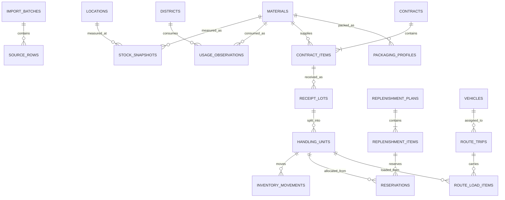

# MEA Synapse — Database Design v1

Status: **Design for review — Staging only**  
Scope: Khlong Toei warehouse (`Plant 2401`, `Storage Location 0001`) and 18 district Plants  
Cutover: Start operational movement history at Go-Live; preserve all imported source snapshots

## 1. Confirmed business rules

- Daily Stock import uses `Unrestricted / ไม่จำกัด` only. `Stock in Transfer / การส่ง/การโอน` is excluded.
- District stock is the sum of Unrestricted Stock across every Storage Location belonging to that district Plant. No Storage Location is excluded.
- A `-` in monthly usage means zero usage and is normalized to numeric `0`.
- CMP is refreshed monthly and rounded to an integer:
  `CMP = ROUND(AVERAGE(LY, 12M, 6M, 4M), 0)`.
- Weekly Replenishment Plan is the official plan. Daily calculation is Alert/Exception only and must not overwrite a locked weekly plan.
- Contracts are imported daily. Only rows containing both Material and Contract are eligible for preparation/allocation.
- `รายการที่` is a PO Item representing a delivery installment in the supplied source.
- FIFO uses `วันผ่านตรวจรับ` ascending, then PO, PO Item/installment, and source row as deterministic tie-breakers.
- Final approval is sequential: Planner, then Academic Officer.
- Delivery above 6 months is warned; above 9 months requires special approval.
- Go-Live starts Pallet/Remain/Movement history. Earlier movements are not fabricated.

## 2. Recommended platform and boundaries

Use **PostgreSQL/Supabase** as the system of record because the existing project documents already define Raw, Staging, Core, Analytics, Ops, and Audit boundaries. The Vercel application remains the UI/API client.

- The browser never receives database service keys.
- Every operational table uses Row Level Security.
- District users can only read/confirm their district.
- Real vendor names, when enabled later, are stored in a restricted table. UI uses a stable alias by default.
- Source files are immutable evidence. Core tables show the current approved interpretation.

## 3. Data layers

| Layer | Purpose | Update rule |
|---|---|---|
| `raw` | Exact imported file rows, checksum, filename and import batch | Append only; never overwrite |
| `staging` | Typed and validated rows; normalize `-` to `0` | Rebuilt per import batch |
| `core` | Current master and operational records | Upsert current state; preserve versions |
| `analytics` | Current stock, CMP, health, FIFO readiness, route readiness | Views/materialized views |
| `ops` | Import jobs, policies, plan runs, approvals and reconciliation | Append/status transitions |
| `audit` | Who changed what, when, reason, before/after | Append only |

## 4. Core entity model

## 5. Table catalog

### 5.1 Source lineage and daily imports

#### `raw.import_batches`

- `id` UUID PK
- `entity_type`: `STOCK`, `USAGE`, `CONTRACT`, `VENDOR`
- `source_file_name`, `source_sheet`, `file_checksum`
- `source_business_date`, `imported_at`, `imported_by`
- `row_count`, `accepted_count`, `rejected_count`, `status`
- Unique: `(entity_type, file_checksum)` prevents duplicate imports

#### `raw.source_rows`

- `id` UUID PK, `batch_id` FK, `source_row_number`
- `row_payload` JSONB, `row_checksum`
- Immutable; retains exactly what SAP export contained

#### `ops.import_issues`

- `batch_id`, `source_row_id`, `severity`, `field_name`, `issue_code`, `message`
- Examples: missing Material, missing Contract, invalid date, duplicate natural key

### 5.2 Masters

#### `core.materials`

- `id` UUID PK, `material_code` unique, description, base unit, active flag
- No CMP/MIN/MAX columns: those are calculated results, not material master facts

#### `core.locations`

- `id`, `plant_code`, `storage_location_code`, warehouse/district link, active flag
- Unique: `(plant_code, storage_location_code)`

#### `core.vendors_private`

- Restricted access only: real SAP vendor code/name when the organization allows it
- Never required for Staging UI

#### `core.vendor_aliases`

- `vendor_private_id` nullable, `alias_code` unique, e.g. `SUP-0001`
- Staging can use deterministic dummy names such as `Supplier A`, `Supplier B`
- Do not randomly change aliases on each daily import, otherwise history becomes unreadable

### 5.3 Stock and usage

#### `core.stock_snapshots`

- `material_id`, `location_id`, `snapshot_date`, `unrestricted_qty`, `batch_id`
- Unique: `(material_id, location_id, snapshot_date, batch_id)`
- Preserve every daily snapshot; `analytics.v_current_stock` selects the latest successful batch
- District total groups by Material + Plant and sums all Storage Locations

#### `core.usage_observations`

- `material_id`, `district_id`, `usage_month`, `usage_qty`, `batch_id`
- Source `-` is stored as `0`, with `source_was_dash = true` for traceability
- Unique: `(material_id, district_id, usage_month, batch_id)`

#### `ops.calculation_policies`

- Versioned values: trigger `3.5`, min target `4`, reference `3`, max target `6`, special approval `9`
- `effective_from`, `effective_to`, `approved_by`
- Each plan stores its policy version so later rule changes do not alter old plans

### 5.4 Daily contract synchronization without losing history

#### `core.contracts`

- One header per PO/contract combination
- `purchase_order_no`, `contract_no`, vendor alias, current status

#### `core.contract_items`

- `contract_id`, `material_id`, `po_item_no`, `installment_no`
- quantity, planned delivery date, accepted date (`วันผ่านตรวจรับ`)
- `fifo_date = accepted_date`
- `first_seen_at`, `last_seen_at`, `current_version_id`, `is_current`
- Eligibility: Material and Contract must both exist
- Recommended natural key: `(purchase_order_no, po_item_no, material_code)`

#### `core.contract_item_versions`

- Append a version only when a tracked value changes
- Stores quantity/dates/status/vendor alias plus `valid_from`, `valid_to`, `source_row_id`
- Daily process:
  1. Same key + same checksum: update `last_seen_at` only.
  2. Same key + changed checksum: close old version and append a new version.
  3. New key: insert item and version.
  4. Missing from today's file: do **not** delete; mark `not_seen_in_latest_batch` for review.

This permits the source file to update old rows and add new rows without destroying the previous state.

### 5.5 Receipt lots and physical handling units

#### `core.receipt_lots`

The traceable FIFO layer. A lot represents one Material + Contract/PO Item + delivery installment.

- `id`, `material_id`, `contract_item_id`, `warehouse_location_id`
- `receipt_reference`, `installment_no`, `fifo_date`
- `received_qty`, `opening_qty`, `status`
- `source_quality`: `VERIFIED`, `SOURCE_DERIVED`, `OPENING_UNKNOWN`

#### `core.handling_units`

Use the broader term Handling Unit because not every item is a pallet.

- `id` UUID and human code such as `KTL-26-000123`
- `receipt_lot_id`, `unit_type`
- `unit_type`: `FULL_PALLET`, `BOX`, `CRATE`, `BUNDLE`, `LOOSE`, `LONG_MATERIAL`
- `parent_unit_id` nullable, allowing boxes/crates to belong to a pallet
- `initial_qty`, `on_hand_qty`, `reserved_qty`
- `physical_location_code`, `opened_at`, `closed_at`, `status`
- `is_virtual`, `verified_at`, `verified_by`

#### `core.inventory_movements`

Append-only stock ledger:

- Types: `OPENING`, `RECEIPT`, `RESERVE`, `RELEASE`, `ISSUE`, `RETURN`, `TRANSFER`, `ADJUSTMENT`, `QUARANTINE`
- `handling_unit_id`, `material_id`, quantity delta, from/to location
- contract/lot, replenishment/ad-hoc/SAP document references
- actor, timestamp, reason, approval and source batch

Never edit an old movement. Corrections use a reversing movement and a new correct movement.

### 5.6 Packaging profiles

#### `core.packaging_profiles`

- Multiple profiles per Material are allowed
- `material_id`, `unit_type`, units per handling unit
- length, width, height, gross weight
- stackable, side-loadable, forklift-required, maximum stack layers
- `data_quality`: `DUMMY`, `ESTIMATED`, `VERIFIED`
- `effective_from`, `effective_to`, `source_note`

Dummy packaging may support Staging screens, but `DUMMY` records must not automatically approve a real vehicle load.

### 5.7 Replenishment, approvals and FIFO allocation

#### `core.replenishment_plans` / `core.replenishment_items`

- Weekly plan header is versioned and never overwritten after Lock
- Item stores source Stock snapshot, CMP inputs, CMP result, 3M/MIN/MAX, suggested quantity, district quantity, final quantity and post-delivery months
- Status: `DRAFT`, `DISTRICT_PENDING`, `DISTRICT_CONFIRMED`, `PLANNER_APPROVED`, `ACADEMIC_APPROVED`, `LOCKED`, `PICKING`, `DISPATCHED`, `CANCELLED`

#### `ops.approvals`

- Stores stage, decision, actor, timestamp, reason
- Database constraint/function enforces Planner approval before Academic approval
- More than 6 months creates Warning; more than 9 months requires explicit special approval

#### `core.reservations`

- One replenishment/ad-hoc item can reserve several Handling Units
- Allocation order:
  1. Oldest FIFO receipt lot.
  2. Oldest already-open Handling Unit with Remain.
  3. Unopened full unit from the same lot.
  4. Next FIFO lot only after the older lot is exhausted.
- Stores `reserved_qty`, `picked_qty`, `issued_qty` and released quantity

### 5.8 Ad-hoc issue and returns

#### `core.adhoc_issues` / `core.adhoc_issue_items`

- SAP document, district, urgency reason, requestor, material, quantity, pickup/delivery and issuer
- Status: `ISSUED_PENDING_SAP`, `RECONCILED`, `CANCELLED`
- Uses the same FIFO reservation/allocation tables as weekly plans

#### `core.returns`

- References original movement and original Handling Unit
- Return to the same unit where possible
- Damaged/test-failed returns move to `QUARANTINE`, not Available Stock

### 5.9 Vehicle and transport

#### `core.vehicles`

- For current planning: payload limit `6,000 kg`, usable deck `2.45 x 5.20 m`, side height `0.50 m`
- `allow_overhang = false`, `lifting_equipment = NONE`, `default_stack_layers = 1`
- Maintain individual records for พด.707 and พด.708; replace averages with verified vehicle-specific measurements later

#### `core.route_trips` / `core.route_load_items`

- Plan and Actual are separate fields/records
- Capacity check uses weight and floor footprint; volume alone is insufficient
- Long Material uses length, bundle count and tie-down/manual review rules
- A load containing unverified packaging requires Planner manual confirmation

## 6. Pallet ID without a printer

Accurate pallet-level tracking requires each physical unit to have a visible unique identifier. A database-only ID cannot distinguish two identical pallets in the warehouse.

Recommended low-cost Go-Live method:

1. System generates a short code, e.g. `KTL-26-000123`.
2. Staff writes the code with permanent marker on a waterproof hanging tag or pre-numbered cable-tie tag.
3. Record rack/bin/zone and optionally take one phone photo.
4. Later, the same ID can be converted to QR/barcode without changing database history.

If no physical tag of any kind is permitted, track at **Receipt Lot + Location** level only. The system must label it `Virtual Unit`; exact physical pallet traceback cannot be guaranteed.

For non-pallet items:

- Box: Box ID or parent Pallet ID
- Crate: Crate ID
- Bundle/Long Material: Bundle ID
- Loose: Lot + Bin/Zone; quantity verified at each issue

## 7. Go-Live cutover

1. Import the latest Material, Stock, Usage and Contract files as immutable baseline batches.
2. Create an `OPENING_UNKNOWN` lot for any quantity that cannot yet be tied to a contract/installment.
3. Start with all materials, but progressively verify them during physical count or first touch.
4. Where packaging/old documents identify a contract and installment, create a verified Receipt Lot and Handling Units.
5. Post an `OPENING` movement for every created unit/lot.
6. Reconcile summed system on-hand to SAP Unrestricted Stock by Material.
7. From Go-Live onward, every Reserve, Issue, Return and Adjustment must be an immutable movement.
8. Dashboard displays Traceability Coverage: verified quantity / SAP on-hand quantity.

The system must never invent a historical contract link. Unknown opening inventory stays explicitly unknown until staff verifies it.

## 8. Required operational views

- `analytics.v_current_stock`: latest daily SAP Stock by Material/Plant/Storage Location
- `analytics.v_district_stock`: Unrestricted total by District Plant + Material
- `analytics.v_stock_health`: Stock, CMP, remaining months and trigger band
- `analytics.v_fifo_queue`: available lots/units ordered by accepted date
- `analytics.v_handling_unit_balance`: initial/on-hand/reserved/available/Remain
- `analytics.v_sap_reconciliation`: SAP quantity versus ledger quantity and difference
- `analytics.v_traceability_coverage`: verified, source-derived and unknown quantities
- `analytics.v_plan_approval_status`: District, Planner and Academic stages
- `analytics.v_vehicle_readiness`: weight, floor footprint and manual-review warnings

## 9. Safety and implementation order

1. Freeze this design and field definitions.
2. Add additive Staging migrations only; do not modify deployed Production migrations.
3. Implement daily import lineage and snapshots first.
4. Implement contracts/versions and receipt lots.
5. Implement Handling Units, movements and FIFO reservation.
6. Implement weekly plan and sequential approvals.
7. Implement transport capacity and Actual cost tracking.
8. Rehearse Cutover with a copy of data, reconcile totals, then approve Go-Live.

## 10. Decisions still required before migration SQL

1. Contract rows missing from one daily file: mark for review immediately, or deactivate only after a defined number of consecutive missing days?
2. Can staff attach handwritten/pre-numbered waterproof tags, or must the first release stay at Lot + Location level?
3. Which physical location codes exist today: zone, rack, bay, floor area or none?
4. Does each PO Item always equal exactly one delivery installment, or can one PO Item be delivered in several separate receipts?
5. Is `6,000 kg` a planning safety limit for each vehicle or only an observed average?
