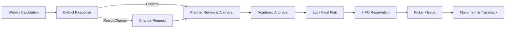
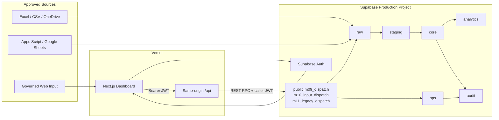
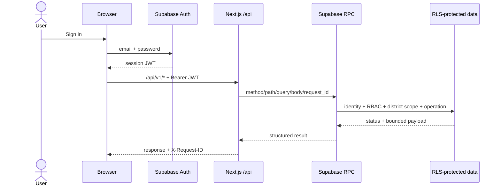
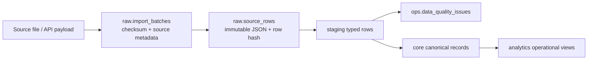
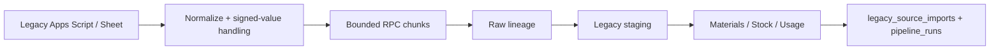

# MEA SYNAPSE — Current End-to-End Pipeline

สถานะเอกสาร: **Canonical human-readable pipeline**

อัปเดตล่าสุด: **26 กรกฎาคม 2026**

Deployed release: **Production Operations v1 / M24**

Workspace candidate: **M13e Smart Logistics (not deployed)**

Environment ที่ deploy อยู่: **Production operational เฉพาะ M24 baseline**

> เอกสารนี้เป็นจุดอ้างอิงหลักสำหรับ pipeline ปัจจุบันของ MEA SYNAPSE ตั้งแต่
> source data, ingestion, Supabase, business workflow, API, Dashboard, CI/CD,
> deployment, backup, rollback และ operational readiness
>
> Migration SQL และ executable source code ยังเป็น technical source of truth
> สูงสุด หาก implementation เปลี่ยน ต้องแก้เอกสารนี้ใน change เดียวกัน

> **ขอบเขตสถานะ:** ข้อความที่ระบุว่า “deploy แล้ว” หรือ
> “Production operational” หมายถึง verified M24 baseline เท่านั้น
> M13–M13e, Transport UI, road preview, worker และ production workflow
> ยังเป็น local working-tree candidate; ยังไม่มี live migration/deployment
> หรือ production CI/CD run จากงานนี้

---

## 1. Current release snapshot

| รายการ | สถานะปัจจุบัน |
|---|---|
| Canonical repository | `lanchakon-maikaeo/synapse-mea-pipeline` |
| Branch | `main` |
| Database release revision | `f238e9e` |
| Web application | <https://synapse-mea.vercel.app> |
| Vercel project | `spaiss-6/synapse-mea` |
| Vercel Root Directory | `dashboard` |
| Database/Auth | Supabase project `fvdfduuanfrncrwuareb` |
| Supabase project name | `synapse-01` |
| Supabase region | `ap-southeast-1` |
| Latest verified live migration | `202607240024` (M24) |
| Deployed API contract | SYNAPSE API `1.1.0`, 37 paths |
| Local candidate migration head | `202607250005` (M13e; not applied live) |
| Local candidate API contract | SYNAPSE API `1.3.0`, 48 paths; not deployed |
| Business rules | v1, frozen 22 กรกฎาคม 2026 |
| Active application roles | `admin`, `planner`, `academic`, `picker`, `district`, `viewer` |
| Deployed release scope | Stock, CMP, Weekly Replenishment, Approval, Handling Unit, FIFO, Issue, Return, Ad-hoc และ Traceability |
| Deployed exclusions | Forecasting, Routing/Transport optimization และ RAG/AI |
| Candidate scope | Governed transport reads/preflight, OSM-derived map, OSRM-compatible road preview, Valhalla truck + OR-Tools worker, immutable route evidence |

ชุดข้อมูลใน `data/MEA_Synapse_Supabase_Production_20260724` เป็น
`PRODUCTION_APPROVED` สำหรับ project `fvdfduuanfrncrwuareb` โดยเจ้าของยืนยัน
ว่า source ทั้งสี่ไฟล์ครบในขอบเขตที่ประกาศแล้ว คู่ active VMI × district หรือ
warehouse ที่ไม่ปรากฏใน exhaustive source จึงมีค่าเป็นศูนย์และต้องติด lineage
`owner_attested_zero` แยกจาก `source_observed`

ChatGPT Sites metadata เดิมไม่ active แล้ว; Vercel เป็น web release target
เพียงระบบเดียว

Repository เดิม `lanchakon-maikaeo/synapse-mea-dashboard` เป็น archived migration
record และไม่ได้เชื่อมกับ Vercel แล้ว

---

## 2. Active scope และ deferred scope

### 2.1 Active production-operations scope

- Daily immutable Stock และ Contract input
- Monthly immutable Usage/CMP input
- Source checksum, import batch และ source-row lineage
- Data validation และ quality issue tracking
- Material, District, Warehouse, Contract และ Vendor Alias masters
- Current warehouse stock และ district stock readiness
- Weekly rule-based replenishment
- District confirm/reject/change พร้อมเหตุผลและ requester
- Planner review และ approval
- Academic approval และ special note
- Lock, cancel และ version plan
- Reservation release เมื่อ cancel/version
- Receipt Lot, Packaging Profile และ Handling Unit
- Opening stock reconciliation ด้วย `OPENING_UNKNOWN`
- Deterministic FIFO allocation
- Issue, Return และ Quarantine movements
- Ad-hoc issue แยกจาก Weekly Plan
- Forward/reverse traceability
- Supabase Auth, RBAC, district scope และ RLS
- Vercel Next.js Dashboard และ same-origin API
- Audit, release evidence, backup evidence และ incident trace

### 2.2 Explicitly excluded from the deployed M24 release

- Demand forecasting
- Forecast workers และ forecast schedulers
- Route optimization
- Valhalla/OR-Tools runtime
- Vehicle/driver scheduling
- Wave 3 intelligence jobs
- RAG, MCP และ document indexing

Historical migration/source สำหรับ Forecast/Route อาจยังอยู่เพื่อรักษา migration
history แต่ active OpenAPI, Dashboard, CI schedule และ deployment profile จะไม่
เรียกใช้งาน namespace เหล่านี้ การเรียก legacy paths ต้องได้
`410 scope_excluded`

### 2.3 Local M13 smart-logistics candidate

ขอบเขตนี้มีใน working tree แต่ยังไม่ใช่ active Production:

- 18 พิกัดเขตและพิกัดฝ่ายจัดหาเมืองใหม่บางพลี จาก
  `data/MEA_Synapse_Supabase_Production_20260724/data/districts.csv`
  ด้วย SHA-256
  `fe97ecb44299dbd8b1fa8778b11483e343a31e8bd1d12ca7b11cba324e5fc62a`
- `WH-MMBP` มีพิกัด `13.55760333, 100.77072260` แต่ยังไม่มี
  owner-approved canonical warehouse/location mapping จึงยัง route-ineligible
- Dashboard ใช้ Leaflet และวาดเฉพาะ road GeoJSON จริง; ไม่มี demo
  fallback หรือเส้นตรงปลอมเป็นเส้นทาง
- Synchronous preview ใช้ controlled OSRM-compatible Table/Route และ
  nearest-neighbour + 2-opt เพื่อ interactive comparison เท่านั้น
- Operational worker ใช้ Valhalla `truck` matrix/route + OR-Tools และ
  เก็บ immutable per-vehicle road/fleet evidence ก่อน review
- Readiness ส่ง `optimization_eligible_plan_ids` แบบ plan-scoped
  เฉพาะ `admin`/`planner`; queue ตรวจ exact plan และ compatible
  Valhalla worker heartbeat ซ้ำบน server
- Transport UI ซ่อน mutation controls จาก role อื่น และ resume
  actor+plan request เดิมด้วย `X-Request-ID` ใน session โดยไม่เก็บ JWT
- Legacy radial matrix มี `route_eligible=false` เสมอ; Haversine ไม่ใช่
  Production fallback; legacy trips ทำได้เฉพาะ cancel
- `POST /v1/transport/trips` ยัง 410 เพราะยังไม่มี reviewed
  route-plan→trip activation contract

รายละเอียดและ activation blockers อยู่ที่
`docs/M13_TRANSPORT_PIPELINE.md` และ `docs/SMART_LOGISTICS_PRODUCTION.md`

---

## 3. Frozen Business Rules v1

### 3.1 Warehouse และ stock scope

- ปัจจุบันใช้เฉพาะคลังคลองเตย
- Warehouse key: Plant `2401`, Storage Location `0001`
- ใช้เฉพาะ Stock ประเภท Unrestricted
- ไม่รวม Stock in Transfer
- District stock รวม Unrestricted จากทุก Storage Location ภายใต้ Plant ของเขต
- หาก Material + Plant ไม่มีแถวใน exhaustive source ให้ใช้ `0` พร้อม
  `owner_attested_zero`
- ห้ามแสดง owner-attested zero ว่าเป็นแถว SAP ที่สังเกตโดยตรง

### 3.2 CMP และ quantity rules

```text
CMP = ROUND(AVERAGE(LY, 12M, 6M, 4M), 0)
3M Reference = CMP × 3
MIN Target = CMP × 4
MAX Target = CMP × 6
MIN Fill = MAX((CMP × 4) - District Stock, 0)
MAX Fill = MAX((CMP × 6) - District Stock, 0)
Months Remaining = District Stock ÷ CMP
```

- `-` ใน source usage แปลงเป็น `0`
- CMP เป็นค่าเฉลี่ยต่อเดือน ไม่ใช่เปอร์เซ็นต์
- CMP ปัดเป็นจำนวนเต็ม
- หาก CMP = 0 ไม่คำนวณ MIN/MAX หรือ Months Remaining
- Stock trigger คือไม่เกิน 3.5 เดือน
- 3 เดือนเป็น reference เท่านั้น
- มากกว่า 6 เดือนต้องแสดง warning
- มากกว่า 9 เดือนต้องมี Academic special approval note

### 3.3 Weekly plan workflow



- Weekly Plan เป็นแผนหลัก
- Daily calculation ใช้ Alert/Exception และห้ามทับ Locked Plan
- District response ต้องเก็บ decision, quantity, reason และ requester
- Planner on-behalf action ต้องคง District requester identity
- Locked Plan ห้ามแก้ inplace
- การเปลี่ยน Locked Plan ต้อง cancel หรือสร้าง version ใหม่
- Cancel/version ต้อง release reservation อย่างถูกต้อง
- Approval และ movement evidence ห้ามลบหรือแก้ย้อนหลัง

### 3.4 FIFO, Handling Unit และ Remain

FIFO ordering:

1. วันที่ผ่านตรวจรับจากเก่าไปใหม่
2. PO/รหัสจัดหา
3. PO Item/งวดรับ
4. Source row order

กติกาเพิ่มเติม:

- ใช้ Handling Unit ที่เปิดแล้วและมี Remain ก่อนเปิดหน่วยถัดไปใน FIFO lot เดียวกัน
- พยายามจ่าย Full Pallet ก่อนเมื่อ operationally possible
- Opening stock ที่พิสูจน์ lot เดิมไม่ได้ใช้ `OPENING_UNKNOWN`
- `OPENING_UNKNOWN` ห้ามนำไป allocate จนกว่าจะผ่าน physical reconciliation
- Return ต้องอ้างอิง issue เดิม
- ของเสีย/ไม่ผ่านการทดสอบเข้า Quarantine ไม่กลับ Available โดยอัตโนมัติ
- Receipt, Reserve, Release, Issue, Return และ Quarantine เป็น append-only movement

### 3.5 Ad-hoc issue

- เป็น workflow แยกจาก Weekly Plan
- ไม่ย้อนกลับไปแก้ Weekly Plan เดิม
- ต้องเก็บ District, Material, Quantity, Requester, Approver, Reason,
  Urgency, SAP reference และ delivery method
- เมื่อ approve ต้อง reserve ด้วย FIFO
- เมื่อ issue ต้องสร้าง immutable movement และ trace ถึง Contract/PO/Lot/HU

---

## 4. Runtime architecture (verified deployed M24 baseline)



### 4.1 Browser boundary

Browser ได้รับเฉพาะ:

- `NEXT_PUBLIC_SUPABASE_URL`
- Supabase publishable/anon key
- Same-origin API URL
- Supabase access token ของ session ปัจจุบัน

Browser ต้องไม่ได้รับ:

- `DATABASE_URL`
- Database password
- Supabase `service_role`
- JWT signing secret
- Operator access token
- Backup credential

### 4.2 Request flow



Vercel ไม่มี direct database credential ใน release profile นี้ ทุก business
request ใช้ caller JWT ผ่าน security-definer gateway ที่บังคับ role และ scope
ในฐานข้อมูล

---

## 5. Repository structure

| Path | หน้าที่ใน active pipeline |
|---|---|
| `dashboard/` | Next.js UI, Supabase Auth, role navigation, same-origin API |
| `dashboard/app/api/[...path]/route.ts` | HTTP gateway, headers, request ID, body limit |
| `dashboard/app/m09-openapi.ts` | Working-tree OpenAPI contract; compare release SHA before treating it as live |
| `dashboard/app/use-synapse-backend.ts` | Authenticated UI data/action orchestration |
| `pipeline/` | Source connectors, checksum, Raw ingestion, legacy actual importer |
| `supabase/migrations/` | Canonical managed-database migration chain |
| `supabase/tests/` | Database acceptance and workflow contract |
| `supabase/rollbacks/` | Reviewed/manual historical rollback helpers |
| `scripts/` | Secret scan, backup, restore drill, guarded migration deploy |
| `deploy/` | Optional self-host/container/monitoring artifacts |
| `api/` | Optional FastAPI compatibility adapter; not Vercel runtime |
| `intelligence/` | Local M13 candidate worker; tested separately, not deployed or scheduled live |
| `docs/incidents/` | Incident evidence and prevention records |
| `.github/workflows/` | Canonical monorepo CI |

`dashboard/db/migrations/0000–0002` เป็น Drizzle design contract ของ standalone
dashboard schema ห้าม apply ร่วมกับ managed migration family ใน
`supabase/migrations/` บนฐานข้อมูลเดียวกัน

---

## 6. Data platform และ lineage

### 6.1 Schema boundaries

| Schema | หน้าที่ | Browser direct access |
|---|---|---|
| `auth` | Users และ sessions | ผ่าน Supabase Auth |
| `public` | User profiles และ RPC gateway | เฉพาะ objects ที่ grant |
| `raw` | Immutable import batches/source rows | ไม่อนุญาต |
| `staging` | Typed rows และ validation | ไม่อนุญาต |
| `core` | Canonical business masters/transactions | ผ่าน API/RPC |
| `analytics` | Bounded operational views | ผ่าน API/RPC |
| `ops` | Runs, recommendations, approvals, alerts, evidence | ผ่าน API/RPC |
| `audit` | Append-only change evidence | ไม่อนุญาตโดยตรง |

### 6.2 Source-to-core lineage



Idempotency สำคัญ:

- Import batch: source checksum + sheet/source key
- Source row: batch + entity + source row number
- Contract item: source row lineage
- Stock snapshot: material + location + snapshot time
- Usage rate: material + district + effective date
- Web input: deterministic payload checksum/batch

ทุก import ต้องเก็บ:

- Source identity
- SHA-256/checksum
- Import timestamp
- Accepted/rejected counts
- Source row number
- Validation issue
- Publishing user/process
- Promotion status

### 6.3 Active operational objects

Core:

- `districts`
- `warehouses`
- `locations`
- `materials`
- `vendors`
- `vendor_aliases`
- `contracts`
- `contract_items`
- `stock_snapshots`
- `usage_rates`
- `replenishment_plans`
- `replenishment_items`
- `receipt_lots`
- `packaging_profiles`
- `handling_units`
- `inventory_movements`

Operations:

- `pipeline_runs`
- `data_quality_rules`
- `data_quality_issues`
- `calculation_policies`
- `replenishment_runs`
- `replenishment_adjustments`
- `quantity_recommendations`
- `district_change_requests`
- `plan_approvals`
- `fifo_allocations`
- `ad_hoc_issues`
- `system_alerts`
- `backup_runs`
- `release_versions`
- `api_rate_limit_windows`
- `web_input_submissions`
- `legacy_source_imports`

Active analytics:

- `v_contract_status`
- `v_current_stock`
- `v_stock_health`
- `v_replenishment_queue`
- `v_quantity_recommendations`
- `v_abnormal_request_queue`
- `v_fifo_queue`
- `v_issue_traceback`
- `v_data_quality_summary`
- `v_operations_health`

---

## 7. Application identity, RBAC และ district scope

`public.user_profiles.user_id` อ้างถึง `auth.users.id` และเป็น authorization
source ของ application role

| Role | Read | Governed actions |
|---|---|---|
| `admin` | ทุก operational scope | Import, supervise และทำ action ที่กำหนด |
| `planner` | Planning/warehouse operational scope | Create plan, review changes, Planner approve, cancel/version |
| `academic` | Approval/evidence scope | Academic approve และ special approval note |
| `picker` | Warehouse execution scope | Receipt, reconcile, issue, return/quarantine |
| `district` | เฉพาะ `district_id` ของตน | Confirm/reject/change และสร้าง ad-hoc request |
| `viewer` | Read-only operational evidence | ไม่มี write/approval |

กฎ:

- New Auth user ได้ `viewer` เป็นค่าเริ่มต้น
- Role ต้องถูก assign โดย authorized operator
- District user ต้องมี System District ID `5501–5518`
- District scope บังคับใน RPC/RLS ไม่ใช่เพียงซ่อนเมนู frontend
- Inactive profile ต้องถูกปฏิเสธ
- Frontend navigation เป็น UX convenience ไม่ใช่ security boundary
- API rate limit คือ 120 requests ต่อ user ต่อนาที

### 7.1 Production identity requirement

Owner กำหนด launch policy เป็น `single_admin`: Production ต้องมี approved,
active `admin` อย่างน้อยหนึ่งบัญชี ส่วน Planner, Academic, Picker และ District
identity `5501–5518` จะเพิ่มได้ภายหลังเมื่อมี owner-approved roster เท่านั้น
ห้ามสร้าง email, user หรือ role assignment สมมติขึ้นเพื่อให้ readiness ผ่าน

Launch acceptance ต้องครอบคลุม admin sign-in, authenticated navigation,
governed API boundary และ sign-out ส่วน role-specific navigation และ district
isolation ต้องทดสอบเพิ่มพร้อม roster ก่อนเปิดใช้ role นั้นจริง Password/Secret
ต้องไม่อยู่ใน repository หรือเอกสารนี้

---

## 8. End-to-end write pipelines

### 8.1 Standard source ingestion

1. Connector อ่าน local/HTTP/SFTP/S3-compatible source
2. คำนวณ SHA-256
3. สร้างหรือ reuse `raw.import_batches`
4. เขียน immutable `raw.source_rows`
5. Exact successful checksum ถูก skip
6. Refresh typed staging rows
7. สร้าง data-quality issues
8. Authorized promotion สร้าง/อัปเดต Core current state
9. เก็บ history/lineage เดิม
10. Dashboard อ่าน readiness และ current views ผ่าน API

CLI ingestion เขียน Raw ก่อน การ promote ไป Staging/Core เป็นขั้นตอนแยกเพื่อ
ป้องกันข้อมูลเสียเข้าระบบทันที

### 8.2 Existing actual-source import

Supported source keys:

- `materials`
- `warehouse_stock`
- `cmp_usage`

Flow:



- ต้องใช้ authenticated admin
- Signed SAP adjustments ถูกเก็บใน Raw และ quality lineage
- ค่าติดลบไม่ถูกนำไปสร้าง non-negative operational demand
- Dummy workbook ห้ามใช้เป็น actual readiness evidence
- District stock source ที่ไม่มีจริงต้องคงสถานะ missing

### 8.3 Governed TEST_FIXTURE import สำหรับ UAT

Workbook `MEA_VMI_Dummy_Klongtoey.xlsx` checksum
`c81b39b1aded306716da5808cff6c7fbeb479c46e06f4bba29f360be5cac6db9`
ถูกนำเข้า Test Supabase ผ่าน migration `202607240016` โดยแยก
`data_class = test_fixture` ออกจาก Actual ชัดเจน:

| Source | Raw/Promoted | จำนวน |
|---|---|---:|
| `DB_Material` | เติมเฉพาะช่องว่างใน Core พร้อม before-value audit | 225 |
| `DB_Contract_Static` | Packaging Profile สำหรับ UAT | 225 |
| `DB_Stock` เฉพาะ `DISTRICT` | District stock TEST_FIXTURE | 4,050 |
| `DB_SAP_Monthly` | CMP/usage TEST_FIXTURE + 12-month Raw lineage | 4,050 |

ข้อบังคับ:

- Import ใช้ได้เฉพาะ registered Test environment และ authenticated admin/service role
- ไม่เขียนทับ Actual row ที่มี key/date เดียวกัน
- Warehouse Dummy stock ไม่ถูก promote; Actual warehouse 462 rows คงเดิม
- Contract, vendor, plan, dispatch, trip, driver และ route Dummy ไม่ถูก promote
- Negative CMP/average 4 rows เก็บใน Raw เป็น `negative_adjustments` และ normalize
  Core เป็น 0
- TEST_FIXTURE ไม่ถูกส่งเข้า `demand_monthly_features`
- Stock-health, replenishment item และ quantity recommendation ต้องมี fixture label
- Rollback ใช้ `public.m16_rollback_test_fixture(<workbook_sha256>)`; หากมี
  replenishment item อ้างอิง fixture ระบบจะ block rollback เพื่อรักษา audit

ข้อมูลชุดนี้ทำให้ UAT workflow ทดสอบได้ แต่ **ไม่ปิด actual-readiness gate**
และห้ามใช้เป็นหลักฐาน MEA Production cutover

### 8.4 Governed Web VMI input

1. Admin/Planner เลือก Material และ District
2. UI โหลด existing stock/usage context
3. ผู้ใช้กรอก source note, stock และ demand history
4. API validate master, timestamps, ranges และ duplicate months
5. RPC เขียน Raw → Staging → Core/Ops ใน transaction เดียว
6. Payload ซ้ำคืนผลเดิมแบบ idempotent
7. Optional authorized action สร้าง replenishment run

Validation สำคัญ:

- Source note 3–500 ตัวอักษร
- Stock และ demand ห้ามติดลบ
- Timestamp ห้ามอยู่อนาคตเกิน tolerance
- History ต้องไม่ซ้ำเดือน
- Material และ District ต้อง active

### 8.5 Weekly replenishment

1. อ่าน latest District stock และ usage/CMP
2. ใช้ active calculation policy
3. สร้าง run, plan และ item candidates
4. บันทึก quantity recommendation พร้อม evidence
5. District confirm/reject/change
6. Planner review abnormal/change request
7. Planner approve
8. Academic approve; >9M ต้องมี note
9. Lock plan
10. Reserve FIFO
11. Picker issue
12. บันทึก movement และ traceback

### 8.6 Cancel และ version

- Cancel locked plan ต้อง release outstanding reservations
- ห้ามลบ approval/allocation/movement เดิม
- New version เชื่อมกับ prior plan/version
- New version ต้องผ่าน governed workflow ตาม policy
- Audit ต้องบอก actor, reason, source plan และ timestamp

### 8.7 Receipt และ opening stock

New receipt:

1. Picker เลือก eligible Contract Item
2. ระบุ receipt lot, accepted date, packaging และ quantity
3. สร้าง Handling Unit
4. สร้าง receipt movement
5. Unit เข้า FIFO queue ตาม deterministic ordering

Opening stock:

1. สร้าง unit เป็น `OPENING_UNKNOWN`
2. Mark blocked from allocation
3. Physical verification/reconciliation
4. ระบุ verified quantity/lot เมื่อพิสูจน์ได้
5. สร้าง reconciliation evidence
6. จึงเปิดให้ FIFO allocation

### 8.8 FIFO issue

1. Locked plan หรือ approved ad-hoc request ขอ reservation
2. เลือก already-opened Handling Unit ก่อน
3. เรียง accepted date, PO, item/installment, source order
4. สร้าง FIFO allocation
5. ลด available/increase reserved ผ่าน governed movement logic
6. Picker issue ตาม allocation
7. บันทึก before, issued และ remain quantity
8. Trace ถึง District, Plan/Ad-hoc, HU, Lot, Contract, PO และ Vendor Alias

### 8.9 Return และ quarantine

- Return ต้องอ้างอิง issue/movement เดิม
- Usable return กลับ Handling Unit ที่เหมาะสมตาม contract
- Damaged/test-failed return เข้า Quarantine
- ห้ามแก้ยอดย้อนหลังเพื่อ force balance

### 8.10 Ad-hoc issue

1. District/authorized user สร้าง request
2. บันทึก reason, requester, urgency และ SAP reference
3. Planner/Admin approve
4. ระบบ reserve FIFO
5. Picker issue
6. สร้าง movement/traceback
7. ไม่แก้ Weekly Plan

---

## 9. Read pipeline และ Dashboard resilience

Dashboard ใช้ same-origin `/api` และโหลด operational domains แบบแยกส่วน
Successful response ต้องแสดงได้แม้ endpoint อื่นล้มเหลว

Migration `202607230015` แก้ปัญหา stock-health analytical cube ขนาดใหญ่:

- Default `limit=250`
- Maximum `limit=500`
- รองรับ non-negative `offset`
- District scope ยังคง enforced
- Previous dispatcher ถูกซ่อนเป็น protected implementation
- Unrelated paths delegate ไป verified v14 dispatcher

หน้า OPERATIONS/WAREHOUSE ต้องแยกสถานะ:

- Real source-backed data available
- Source missing
- Readiness blocked
- Legitimate empty workflow
- API partial failure

ห้ามแสดง empty workflow เป็นข้อมูลจำลอง และห้ามทำให้ source missing ดูเหมือน
actual zero โดยไม่มี marker

---

## 10. API catalog: deployed baseline and local candidate

หัวข้อ 10.1–10.4 คือ verified deployed M24 contract. หัวข้อ 10.5 คือ
working-tree M13 candidate และยังไม่ควรใช้ทดสอบ live Production

### 10.1 Public/readiness

| Method | Path | หน้าที่ |
|---|---|---|
| GET | `/api/health` | Vercel process health |
| GET | `/api/health/ready` | Supabase RPC readiness |
| GET | `/api/openapi.json` | Published API contract |

### 10.2 Identity และ source data

| Method | Path | Scope |
|---|---|---|
| GET | `/api/v1/me` | Authenticated identity |
| GET | `/api/v1/contracts` | Authorized read |
| GET | `/api/v1/data-quality` | Authorized read |
| GET | `/api/v1/reference/materials` | Authenticated |
| GET | `/api/v1/reference/districts` | District-scoped |
| GET | `/api/v1/warehouse-stock` | Authenticated |
| GET | `/api/v1/data-sources/legacy/status` | Authenticated |
| POST | `/api/v1/admin/import/legacy` | Admin |
| GET/POST | `/api/v1/data-inputs/vmi` | Read / Admin-Planner publish |
| GET | `/api/v1/data-inputs/vmi/context` | District-scoped context |
| GET | `/api/v1/stock-health` | District-scoped, paginated |

### 10.3 Weekly replenishment

| Method | Path | Scope |
|---|---|---|
| GET | `/api/v1/replenishment/queue` | Role/district scoped |
| GET | `/api/v1/replenishment/recommendations` | Evidence |
| GET | `/api/v1/replenishment/change-requests` | Review queue |
| GET | `/api/v1/replenishment/approvals` | Immutable timeline |
| POST | `/api/v1/replenishment/runs` | Admin/Planner |
| POST | `/api/v1/replenishment/items/{item_id}/respond` | Matching District/authorized |
| POST | `/api/v1/replenishment/change-requests/{id}/review` | Planner/Admin |
| POST | `/api/v1/replenishment/plans/{id}/approve` | Planner/Academic stage |
| POST | `/api/v1/replenishment/plans/{id}/cancel` | Authorized |
| POST | `/api/v1/replenishment/plans/{id}/version` | Authorized |
| POST | `/api/v1/replenishment/plans/{id}/issue` | Picker/authorized |

### 10.4 Inventory, ad-hoc และ traceability

| Method | Path | Scope |
|---|---|---|
| GET | `/api/v1/inventory/fifo` | Role/district scoped |
| GET | `/api/v1/inventory/handling-units` | Authorized read |
| GET | `/api/v1/inventory/receipt-options` | Picker/warehouse context |
| POST | `/api/v1/inventory/receipts` | Picker/authorized |
| POST | `/api/v1/inventory/returns` | Picker/authorized |
| POST | `/api/v1/inventory/handling-units/{id}/reconcile` | Picker/authorized |
| GET/POST | `/api/v1/ad-hoc/issues` | Scoped queue/create |
| POST | `/api/v1/ad-hoc/issues/{id}/approve` | Planner/Admin |
| POST | `/api/v1/ad-hoc/issues/{id}/issue` | Picker/authorized |
| GET | `/api/v1/traceability` | Role/district scoped |
| GET | `/api/v1/operations/health` | Operational roles |
| GET | `/api/v1/operations/alerts` | Admin/Planner |

### 10.5 Governed transport (local M13 candidate only)

| Method | Path | Candidate behavior |
|---|---|---|
| GET | `/api/v1/transport/warehouses` | Active transport references and canonical mapping state |
| GET | `/api/v1/transport/readiness` | Geocode, exact origin, fleet, tariff, compatible-worker and activation gates; role-scoped eligible plan IDs |
| GET | `/api/v1/transport/geo` | Source-traced coordinates and candidate/verified/quarantined state |
| GET | `/api/v1/transport/vehicles` | Fleet references plus verification/availability state |
| GET | `/api/v1/transport/route-matrix` | Legacy radial references only; never road evidence |
| GET | `/api/v1/transport/dispatch-queue` | Positive locked demand grouped by exact plan/origin |
| GET | `/api/v1/transport/trips` | Historical trip evidence |
| POST | `/api/v1/transport/optimize` | Exact-plan preflight followed by controlled road preview |
| POST | `/api/v1/transport/optimization-jobs` | Valhalla-only exact locked-plan queue; admin/planner, request-ID idempotent |
| GET | `/api/v1/transport/optimization-jobs/{id}` | Own job for planner; any job for admin |
| POST | `/api/v1/transport/trips` | 410 until reviewed route-plan→trip activation exists |
| POST | `/api/v1/transport/trips/{id}/status` | Verified-trip transitions; legacy trip cancel only |

Legacy `/api/v1/routes*` และ `/api/v1/jobs*` ไม่ใช่ M13 transport API
และยังต้องได้ `410 scope_excluded`

UI เปิด planner/preview/queue/cancel เฉพาะ `admin`/`planner` และ
ให้ role อื่นเป็น read-only; database RBAC ยังเป็น security boundary
งาน queued/running จะ poll ต่อ และ request ที่ขาด POST response จะ resume
ด้วย actor+plan-scoped request ID เดิม; terminal failed/cancelled ต้องยืนยัน
และใช้ ID ใหม่ ส่วน succeeded เป็น immutable

HTTP boundary:

- Bearer Supabase JWT
- Request body limit 1 MiB
- Persistent rate limit
- `X-Request-ID`
- `Cache-Control: no-store`
- `X-Frame-Options: DENY`
- Structured 401/403/404/410/422/429 responses

---

## 11. Current deployed data and operational readiness

ตัวเลขต่อไปนี้เป็น verified evidence ณ 24 กรกฎาคม 2026 ไม่ใช่ live query ทุกครั้ง
ที่เปิดเอกสาร:

| Data/Object | Verified evidence |
|---|---:|
| Source material rows | 4,358 |
| VMI material scope | 223 |
| District master | 18 (`5501–5518`) |
| Stock source rows | 14,661; natural-key rows 14,641 |
| Usage/CMP actual rows | 5,926 |
| Normalized monthly observations | 71,112 |
| Contract source rows | 6,305; validated CSV rows 4,175 |
| Warehouse source rows | 222 |
| Production import package | `data/MEA_Synapse_Supabase_Production_20260724` |
| Production package state | Owner-approved; source checksums recorded |
| District stock omission policy | Owner-attested omission means zero; ไม่อ้างว่าเป็น source-observed zero |

ความหมาย:

- Import ต้องอ้าง source checksum, source row number และ batch lineage
- ค่า zero ที่เกิดจาก exhaustive source omission ต้องเก็บเป็น owner-attested evidence
  แยกจากค่าศูนย์ที่พบตรงใน source
- ห้ามสร้าง pallet, lot, identity หรือ movement history ย้อนหลังขึ้นเอง
- ก่อนเปิด operational writes ต้องนำเข้า package, ตรวจ identity ตาม active
  policy, ผ่าน restore drill และผ่าน Production readiness ทุก gate

### 11.1 Current readiness gates

| Gate | สถานะ |
|---|---|
| Production data package | ผ่าน owner approval และ checksum verification |
| M24 local acceptance evidence | ผ่าน 27 migrations, 69 schema checks, 20 workflow checks |
| Vercel Production | Deploy แล้วที่ `https://synapse-mea.vercel.app` |
| Supabase Production identity | Project `fvdfduuanfrncrwuareb`, environment `production` |
| Supabase migration | M00–M24 deploy และตรวจ contract แล้ว |
| Production data import | ผ่าน governed import + M22 completion attestation |
| Off-project backup | มี post-import logical backup พร้อม SHA-256 |
| Isolated restore drill | ผ่าน PostgreSQL 17; evidence บันทึกใน Production |
| Production identity | มีเฉพาะ `admin` หนึ่งบัญชีและทดสอบ password grant แล้ว; policy เป็น `single_admin` |
| Operational writes | เปิดผ่าน guarded cutover `SYNAPSE-PROD-20260724`; readiness เป็น `operational` |
| Live acceptance | readiness 200, authenticated admin 200, governed reads 200 และ mutation validation guard ผ่าน |

---

## 12. Managed database migration chain

Apply ตาม filename order เท่านั้น รายการ 1–27 คือ verified live
M24 baseline; รายการ 28–32 คือ local additive candidate ที่ยังไม่ได้
apply บน live Production:

1. `202607140000_m00_greenfield_bootstrap.sql`
2. `202607140001_m01_foundation.sql`
3. `202607140002_m01_environment_label.sql`
4. `202607150001_m03_raw_ingestion.sql`
5. `202607150002_m04_staging_quality.sql`
6. `202607150003_m05_core_model.sql`
7. `202607150004_m06_replenishment.sql`
8. `202607150005_m07_forecasting.sql` — historical/dormant
9. `202607150006_m08_routes.sql` — historical/dormant
10. `202607150007_wave3_readiness.sql` — historical/dormant
11. `202607150008_m12_operations.sql`
12. `202607150009_m09_serverless_api.sql`
13. `202607160010_m10_web_input_pipeline.sql`
14. `202607160011_legacy_actual_sources.sql`
15. `202607160012_legacy_usage_quality.sql`
16. `202607160013_m09_district_scope_status.sql`
17. `202607230014_production_operations_v1.sql`
18. `202607230015_dashboard_read_resilience.sql`
19. `202607240016_test_fixture_governance.sql`
20. `202607240017_production_rebuild_contract.sql`
21. `202607240018_relational_source_import.sql`
22. `202607240019_relation_coverage_fix.sql`
23. `202607240020_owner_attested_actual_promotion.sql`
24. `202607240021_actual_workbook_observation_lineage.sql`
25. `202607240022_production_completion_attestation.sql`
26. `202607240023_active_scope_readiness.sql`
27. `202607240024_single_admin_identity_policy.sql`
28. `202607250001_m13_transport_pipeline.sql` — local candidate, not deployed
29. `202607250002_m13b_transport_replenishment_link.sql` — local candidate, not deployed
30. `202607250003_m13_transport_hardening.sql` — local candidate, not deployed
31. `202607250004_m13d_operational_integrity.sql` — local candidate, not deployed
32. `202607250005_m13e_route_evidence.sql` — local candidate, not deployed

กฎ migration:

- ห้ามแก้ migration ที่ deploy แล้ว
- ทุก change ใช้ additive migration ใหม่
- Backup ก่อน apply
- Apply database ก่อน deploy web ที่เรียก contract ใหม่
- Compare `max(ops.schema_migrations.version)` กับ Git release
- Run authenticated contract checks หลัง migration
- ห้าม apply Drizzle migration family ร่วมกับ managed family
- การที่ migration อยู่ใน repository หรือผ่าน clean-local contract
  ไม่ใช่หลักฐานว่า apply บน Production แล้ว

---

## 13. CI/CD และ release pipeline

```mermaid
flowchart LR
  Commit["Commit to main"]
  Scan["Secret scan"]
  Test["Python + Dashboard tests"]
  Build["Next.js production build"]
  DB["Clean PostgreSQL 17 migrations"]
  Contract["Schema/RLS/workflow contract"]
  Backup["Pre-migration backup"]
  Migrate["Apply pending Supabase migrations"]
  DBVerify["Managed DB verification"]
  Deploy["Vercel deploy"]
  Smoke["Public + authenticated smoke"]
  Evidence["Release evidence"]

  Commit --> Scan --> Test --> Build --> DB --> Contract
  Contract --> Backup --> Migrate --> DBVerify --> Deploy --> Smoke --> Evidence
```



### 13.1 Local/CI release gates

```bash
make workspace-ci
bash scripts/scan_secrets.sh
```

Verified deployed M24 baseline evidence:

- Clean PostgreSQL applies 27 ordered migrations
- 69 schema/RLS/privilege checks
- 20 authenticated operational workflow checks
- M21 actual-source lineage checks 16 ข้อ
- M22 production completion checks 7 ข้อ
- M23 active-scope readiness checks 4 ข้อ
- M24 single-admin identity checks 4 ข้อ
- Dashboard lint, TypeScript, Next.js production build และ UI/API tests
- OpenAPI freshness check
- Secret scan

Forecast/Route/RAG ไม่ใช่ active acceptance paths ของ deployed M24 baseline

Local M13 candidate เพิ่ม release prerequisites ต่อไปนี้:

- Clean PostgreSQL 17 apply managed migration ครบ 32 ไฟล์ตามลำดับ
- M13–M13d contract และ M13e route-evidence contract ผ่าน
- Python API/pipeline/intelligence tests, Dashboard lint/test/build และ
  authenticated transport smoke ผ่านจาก release artifact เดียวกัน
- Worker image/lock/SBOM/vulnerability/secret checks ผ่าน
- `ROUTING_ENGINE_DATA_VERSION` และ `VALHALLA_TILESET_VERSION`
  ตรง `<lowercase-label>-sha256-<64 lowercase hex>` และผูกกับ
  exact reviewed graph/tileset artifact หรือ signed manifest
- Worker healthy heartbeat ยืนยัน controlled Valhalla URL, truck,
  exact tileset digest, numeric operator dataset ID, `/status` response hash
  และ validation time; queue ตรวจ heartbeat compatibility ซ้ำ
- Protected staging สร้าง locked-plan→Valhalla matrix→OR-Tools solve→
  road geometry→review evidence ได้จริง

รายการเหล่านี้เป็นเงื่อนไขก่อน release ไม่ใช่ข้อยืนยันว่า
M13 ถูก deploy หรือ activate แล้ว

### 13.2 Database deployment

คำสั่งนี้เป็น M24 baseline pattern และต้องรันจาก exact approved
release commit เท่านั้น ห้ามรัน guarded migration จาก working tree
ปัจจุบันกับ live Production เพราะจะรวม pending M13–M13e ด้วย
และงานนี้ไม่ได้รันคำสั่งนี้เพื่อ M13

```bash
export DATABASE_URL='postgresql://...'
export BACKUP_DIR='/approved/off-repository/location'
export RELEASE_VERSION='production-operations-v1'
export RELEASE_GIT_SHA='<40-character-commit>'
export DEPLOY_CONFIRM='APPLY_PENDING_MIGRATIONS'
bash scripts/deploy_database_migrations.sh
```

Guarded script ต้อง:

1. Validate explicit confirmation
2. Create logical backup
3. Create checksum
4. Apply only pending migrations
5. Stop on first SQL error
6. Run contract verification
7. Record backup/release evidence

### 13.3 Vercel deployment

สถานะด้านล่างคือ verified M24 deployment. M13 web/worker candidate
ยังไม่ได้ promote หรือ smoke บน live target

| Setting | Required value |
|---|---|
| Git Repository | `lanchakon-maikaeo/synapse-mea-pipeline` |
| Production Branch | `main` |
| Root Directory | `dashboard` |
| Framework | Next.js |
| Install | `npm ci` |
| Build | `npm run build` |
| Output | Next.js default `.next` |
| Node.js | 22.x, minimum 22.13 |

Release order:

1. Verify Git commit
2. Apply/verify database migration
3. Push approved `main`
4. Wait for Vercel `READY`
5. Test `/api/health`
6. Test `/api/health/ready`
7. Test `/api/openapi.json`
8. Test unauthenticated `/api/v1/me` returns 401
9. Test authenticated `/api/v1/me`
10. Test read-only role/district scope
11. Test one approved governed write scenario
12. Record deployed Git SHA and operator evidence
13. Revoke temporary token

### 13.4 M13 protected artifact promotion (local candidate)

`.github/workflows/production-release.yml` เป็น manual candidate workflow
และยังไม่เคยรันกับ live target ในงานนี้ สัญญาที่ต้องผ่านคือ:

1. `build-only` หรือ staging release สร้าง dashboard/worker bundle
   ครั้งเดียวจาก full Git SHA พร้อม manifest, checksums, SBOM และ
   worker scan/lock/image evidence
2. Protected staging environment รัน guarded database gate, deploy ผ่าน
   idempotent HTTPS orchestrator และรัน authenticated dashboard/worker smoke
3. Production promotion ต้องระบุ staging run ID, artifact name และ
   GitHub-recorded source digest; workflow ตรวจว่า staging smoke ผ่าน
   และ re-upload bundle เดิมโดยไม่ rebuild
4. Database ใช้ dedicated `self-hosted, linux, synapse-release` runner,
   backup นอก repository และ additive migration before cutover
5. Release orchestrator และ routing-smoke hook ตรวจ GitHub OIDC
   short-lived identity, repository/environment/commit/audience และ artifact digest;
   ไม่มี long-lived orchestrator token ใน workflow
6. Completion ต้องได้ component `ready`, authenticated inventory/transport
   canary และถ้า release worker ต้องได้ Valhalla/OR-Tools road-evidence
   smoke ด้วย

Workflow จะยัง inert จนกว่า protected environments/reviewers,
release runner, OIDC receivers, orchestrator, controlled routing services,
secrets/variables และ canary plan จะถูกตั้งค่านอก repository

---

## 14. Environment variables และ secrets

### 14.1 Vercel/public

```env
NEXT_PUBLIC_SUPABASE_URL=
NEXT_PUBLIC_SUPABASE_ANON_KEY=
NEXT_PUBLIC_API_BASE_URL=
NEXT_PUBLIC_SITE_URL=
```

เว้น `NEXT_PUBLIC_API_BASE_URL` ว่างหรือกำหนด `/api` สำหรับ same-origin runtime

M13 candidate ต้องมี Production map contract เพิ่มเติม:

```env
NEXT_PUBLIC_MAP_TILE_URL=https://approved-tiles.example/{z}/{x}/{y}.png
NEXT_PUBLIC_MAP_ATTRIBUTION=&copy; OpenStreetMap contributors
```

ห้ามใช้ `tile.openstreetmap.org` เป็น Production dependency และห้ามซ่อน
attribution

### 14.2 Operator/self-host only

```text
DATABASE_URL
SUPABASE_URL
SUPABASE_JWKS_URL
SUPABASE_JWT_SECRET
SUPABASE_ALLOWED_ORIGIN
API_CORS_ORIGINS
METRICS_TOKEN
SUPABASE_ACCESS_TOKEN
BACKUP_DIR
```

M13 candidate มี server/worker-only contract เพิ่มเติม:

```text
ROUTING_ENGINE_URL
ROUTING_ENGINE_PROFILE
ROUTING_ENGINE_DATA_VERSION
ROUTING_ENGINE_AUTH_TOKEN
VALHALLA_URL
VALHALLA_AUTH_TOKEN
VALHALLA_TILESET_VERSION
VALHALLA_OSM_CHANGESET
```

Production ต้องใช้ controlled HTTPS endpoints และ immutable graph/extract
version `ROUTING_ENGINE_DATA_VERSION` และ `VALHALLA_TILESET_VERSION`
ต้องตรง `<lowercase-label>-sha256-<64 lowercase hex>` โดย suffix
เป็น SHA-256 ของ exact artifact/immutable signed manifest ไม่ใช่วันที่
หรือ checksum ของ label

`VALHALLA_OSM_CHANGESET` เป็น nonnegative operator `dataset_id`
รอง ไม่ใช่ cryptographic proof; ต้องตรงกับค่า numeric ใน
validated Valhalla status/route ขณะที่ cryptographic binding มาจาก
tileset digest และ status/request/response hashes

`SUPABASE_ALLOWED_ORIGIN` เว้นว่างสำหรับ standard
`https://<20-character-ref>.supabase.co` และกำหนดเฉพาะเมื่อใช้
custom Supabase domain โดยต้องเป็น exact server-only HTTPS origin
ที่ไม่มี userinfo/path/query/fragment และไม่ใช่ loopback ห้ามใช้
`NEXT_PUBLIC_` prefix

ห้ามใช้ public community routing endpoints และ Haversine fallback

กฎ:

- ห้าม commit populated `.env`
- ห้ามวาง password/token ใน Markdown
- ห้ามใช้ service-role ใน browser
- ใช้ masked CI secret หรือ temporary operator session
- Revoke temporary token หลัง capture evidence
- Backup directory ต้องอยู่นอก repository

---

## 15. Observability และ incident handling

Routine checks:

1. `/api/health`
2. `/api/health/ready`
3. `analytics.v_operations_health`
4. Open `ops.system_alerts`
5. Latest source batch/checksum/accepted/rejected counts
6. Stock freshness ไม่เกิน agreed cadence
7. Pending District/Planner/Academic queue
8. `OPENING_UNKNOWN` blocked status
9. Latest successful `ops.backup_runs`
10. หลัง M13 release เท่านั้น: `optimization_worker_status`, role-scoped
    `optimization_eligible_plan_ids` และ recent compatible worker heartbeat

Repeated API error:

1. เก็บ request ID
2. Correlate Vercel/Supabase log
3. แยก 401/403/RLS จาก 404 contract mismatch
4. Compare latest managed migration กับ required Git migration
5. ห้าม retry approval/issue/return แบบ blind
6. ตรวจ immutable evidence ก่อนแก้
7. Record incident และ prevention

Known resolved incidents:

- Dashboard/Supabase contract mismatch ทำให้ `API path not found`
- Unbounded stock-health payload ทำให้ OPERATIONS/WAREHOUSE render ไม่สำเร็จ

Prevention ที่บังคับใช้แล้ว:

- Database-first contract deployment
- Authenticated smoke test
- Paginated stock-health
- Partial-load resilience
- Preserved request IDs

---

## 16. Backup, restore และ rollback

### 16.1 Current limitation

Supabase project ปัจจุบันอยู่บน Free plan และไม่มี scheduled managed backup
Same-database schema snapshot ช่วยลด migration risk แต่ไม่ป้องกัน project loss
และไม่ใช่ off-project backup

### 16.2 Logical backup

```bash
DATABASE_URL='...' \
BACKUP_DIR='/secure/off-repository/synapse' \
scripts/backup_database.sh
```

Required artifacts:

- Custom-format PostgreSQL dump
- SHA-256 sidecar
- Operator timestamp
- Release/backup evidence
- Encrypted storage
- Restricted access

### 16.3 Restore drill

```bash
SOURCE_DATABASE_URL='...' \
DRILL_DATABASE_URL='...' \
scripts/restore_drill.sh
```

- Target ต้องเป็น empty isolated project
- ห้ามใช้ Production เป็น drill target
- Verify checksum
- `pg_restore --exit-on-error`
- Run schema/RLS/workflow contract
- บันทึก drill result

### 16.4 Rollback

1. Restrict new writes
2. Preserve logs, approvals, movements และ audit
3. Redeploy previous verified Vercel version เมื่อเป็น application defect
4. Prefer reviewed forward-fix สำหรับ additive schema
5. หากต้อง restore ให้ restore ใน isolated project ก่อน
6. Validate แล้วจึง switch ด้วย change approval
7. Record failed/rolled-back release

ห้าม automated rollback ที่ drop operational tables หรือทำลาย immutable evidence

---

## 17. Go-live completion และ stabilization plan

### Production cutover evidence — เสร็จแล้ว

1. Governed Production import และ owner-attested coverage ผ่าน
2. Off-project logical backup และ isolated PostgreSQL 17 restore drill ผ่าน
3. Local workflow acceptance ผ่าน 20 scenarios
4. Owner กำหนด identity policy เป็น `single_admin`; มีผู้ใช้จริงเฉพาะ
   `admin` และไม่มี synthetic district users
5. M00–M24 และ 69 schema/RLS/privilege checks ผ่าน
6. Guarded cutover `SYNAPSE-PROD-20260724` เปิด operational writes แล้ว
7. Live readiness, password grant, authenticated identity, governed reads และ
   mutation validation boundary ผ่านบน Vercel Production
8. Release evidence `production-single-admin-m24` บันทึกใน Supabase แล้ว

### Priority 1 — Operational stabilization

1. เติม Material UOM/weight/packaging ที่จำเป็น
2. กำหนด source SLA และ notification channel
3. กำหนด backup retention
4. ทำ quarterly access review
5. ทำ quarterly restore drill
6. ออก Label/QR/Pallet Card procedure
7. กำหนด SAP post-back reconciliation

### Deferred

- Forecasting
- Routing/vehicle optimization
- Transport cost dashboard
- RAG/AI

รายการนี้ยัง deferred จาก deployed M24 baseline. Routing/vehicle
optimization มี local M13 candidate แล้ว แต่ยังไม่ผ่าน owner-data,
infrastructure, protected-release และ route-plan→trip activation gates
จึงยังไม่เปิดใช้ใน Production

Deferred scope ต้องเปิดด้วย requirement version และ release approval ใหม่

---

## 18. Change-control rules

- Business Rules v1 เปลี่ยนได้ด้วย version ใหม่เท่านั้น
- ห้ามคำนวณผลย้อนหลังใหม่โดยเงียบ ๆ
- Source row และ import history ต้องคงอยู่
- Approval, allocation และ movement ต้อง append-only
- Migration ที่ deploy แล้วห้าม rewrite
- Web/API change ที่ต้องใช้ schema ใหม่ต้อง deploy database ก่อน
- ทุก release ต้องอ้าง Git SHA, migration version, backup และ operator
- Environment Test ห้ามถูกเรียกเป็น MEA Production โดยไม่มี formal cutover
- Credentials และ user passwords ห้ามอยู่ใน repository/document

---

## 19. Source-of-truth order

เมื่อข้อมูลขัดกันให้ใช้ลำดับนี้:

1. `supabase/migrations/*.sql`
2. `supabase/tests/*.sql`
3. `dashboard/app/m09-openapi.ts`
4. `dashboard/app/api/[...path]/route.ts`
5. `dashboard/app/use-synapse-backend.ts`
6. `pipeline/src/synapse_pipeline/*`
7. `.github/workflows/*`
8. `scripts/*`
9. เอกสารนี้
10. Historical Wave/session documents

Local/Historical Forecast/Route source ไม่ขยาย active deployed release scope
โดยอัตโนมัติ

---

## 20. Definition of production-ready

ระบบถือว่า production-ready ได้เมื่อครบทุกข้อ:

- Source จริงและ master data ที่ active workflow ต้องใช้พร้อม
- District stock มี direct หรือ owner-attested evidence ครบ scope
- ไม่มีการสร้าง Opening Handling Unit, identity หรือ movement ย้อนหลังเทียม;
  Handling Unit ใหม่ต้องเข้าผ่าน governed receipt workflow
- Identity และ acceptance ตรงกับ owner-approved active policy
- Local workflow contract ครอบคลุม movement/traceback และ live API boundary ผ่าน
- Database/Web contract ตรงกัน
- CI และ acceptance ผ่านจาก release commit เดียวกัน
- Off-project backup และ restore drill ผ่าน
- Monitoring/incident ownership พร้อม
- Production environment แยกจาก Test
- Cutover, rollback และ security approval ได้รับอนุมัติ

สถานะปัจจุบันของ **deployed M24 baseline** คือ **Production operational**:
Vercel, Supabase Production,
governed data import, backup, isolated restore drill, M24 single-admin policy,
guarded cutover และ authenticated live acceptance ผ่านแล้ว ฐานข้อมูลรายงาน
`cutover_ready=true` และ `readiness_status=operational` โดยไม่สร้างผู้ใช้หรือ
ธุรกรรมธุรกิจสังเคราะห์เพิ่ม

**M13 smart-logistics candidate ยังไม่ production-ready และยังไม่ได้
deploy**: ยังขาด canonical depot/fleet/capacity/availability/packaging
evidence, controlled map/routing infrastructure ที่ผูก canonical digest IDs
และ compatible worker heartbeat, governed Thai toll tariff,
external protected-release configuration และ reviewed route-plan→trip activation
contract
