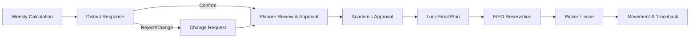
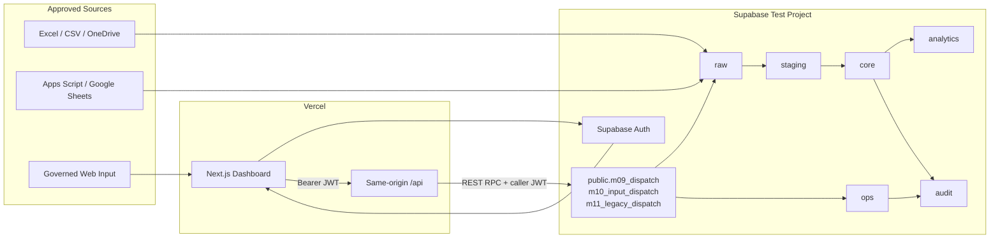
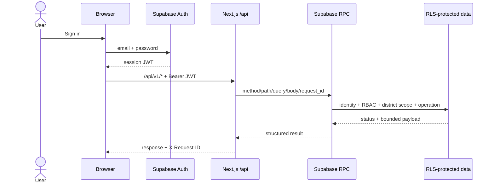
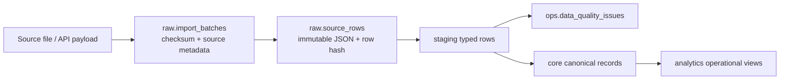
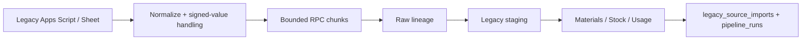

# MEA SYNAPSE — Current End-to-End Pipeline

สถานะเอกสาร: **Canonical human-readable pipeline**

อัปเดตล่าสุด: **24 กรกฎาคม 2026**

Release: **Production Operations v1**

Environment ที่ deploy อยู่: **Production (write-locked pending Auth and recovery gates)**

> เอกสารนี้เป็นจุดอ้างอิงหลักสำหรับ pipeline ปัจจุบันของ MEA SYNAPSE ตั้งแต่
> source data, ingestion, Supabase, business workflow, API, Dashboard, CI/CD,
> deployment, backup, rollback และ operational readiness
>
> Migration SQL และ executable source code ยังเป็น technical source of truth
> สูงสุด หาก implementation เปลี่ยน ต้องแก้เอกสารนี้ใน change เดียวกัน

---

## 1. Current release snapshot

| รายการ | สถานะปัจจุบัน |
|---|---|
| Canonical repository | `lanchakon-maikaeo/synapse-mea-pipeline` |
| Branch | `main` |
| Verified repository revision | `18e4b1f` |
| Web application | <https://synapse-mea.vercel.app> |
| Vercel project | `spaiss-6/synapse-mea` |
| Vercel Root Directory | `dashboard` |
| Database/Auth | Supabase project `fvdfduuanfrncrwuareb` |
| Supabase project name | `synapse-01` |
| Supabase region | `ap-southeast-1` |
| Latest release migration | `202607240022` |
| API contract | SYNAPSE API `1.1.0`, 37 paths |
| Business rules | v1, frozen 22 กรกฎาคม 2026 |
| Active application roles | `admin`, `planner`, `academic`, `picker`, `district`, `viewer` |
| Release scope | Stock, CMP, Weekly Replenishment, Approval, Handling Unit, FIFO, Issue, Return, Ad-hoc และ Traceability |
| Explicit exclusions | Forecasting, Routing/Transport optimization และ RAG/AI |

ชุดข้อมูลใน `data/MEA_Synapse_Supabase_Production_20260724` เป็น
`PRODUCTION_APPROVED` สำหรับ project `fvdfduuanfrncrwuareb` โดยเจ้าของยืนยัน
ว่า source ทั้งสี่ไฟล์ครบในขอบเขตที่ประกาศแล้ว คู่ active VMI × district หรือ
warehouse ที่ไม่ปรากฏใน exhaustive source จึงมีค่าเป็นศูนย์และต้องติด lineage
`owner_attested_zero` แยกจาก `source_observed`

ChatGPT Sites metadata เดิมไม่ active แล้ว; Vercel เป็น web release target
เพียงระบบเดียว

Repository เดิม `lanchakon-maikaeo/synapse-mea-dashboard` เป็น archived migration
record และไม่ได้เชื่อมกับ Vercel แล้ว

---

## 2. Active scope และ deferred scope

### 2.1 Active production-operations scope

- Daily immutable Stock และ Contract input
- Monthly immutable Usage/CMP input
- Source checksum, import batch และ source-row lineage
- Data validation และ quality issue tracking
- Material, District, Warehouse, Contract และ Vendor Alias masters
- Current warehouse stock และ district stock readiness
- Weekly rule-based replenishment
- District confirm/reject/change พร้อมเหตุผลและ requester
- Planner review และ approval
- Academic approval และ special note
- Lock, cancel และ version plan
- Reservation release เมื่อ cancel/version
- Receipt Lot, Packaging Profile และ Handling Unit
- Opening stock reconciliation ด้วย `OPENING_UNKNOWN`
- Deterministic FIFO allocation
- Issue, Return และ Quarantine movements
- Ad-hoc issue แยกจาก Weekly Plan
- Forward/reverse traceability
- Supabase Auth, RBAC, district scope และ RLS
- Vercel Next.js Dashboard และ same-origin API
- Audit, release evidence, backup evidence และ incident trace

### 2.2 Explicitly excluded from this release

- Demand forecasting
- Forecast workers และ forecast schedulers
- Route optimization
- Valhalla/OR-Tools runtime
- Vehicle/driver scheduling
- Wave 3 intelligence jobs
- RAG, MCP และ document indexing

Historical migration/source สำหรับ Forecast/Route อาจยังอยู่เพื่อรักษา migration
history แต่ active OpenAPI, Dashboard, CI schedule และ deployment profile จะไม่
เรียกใช้งาน namespace เหล่านี้ การเรียก legacy paths ต้องได้
`410 scope_excluded`

---

## 3. Frozen Business Rules v1

### 3.1 Warehouse และ stock scope

- ปัจจุบันใช้เฉพาะคลังคลองเตย
- Warehouse key: Plant `2401`, Storage Location `0001`
- ใช้เฉพาะ Stock ประเภท Unrestricted
- ไม่รวม Stock in Transfer
- District stock รวม Unrestricted จากทุก Storage Location ภายใต้ Plant ของเขต
- หาก Material + Plant ไม่มีแถวใน exhaustive source ให้ใช้ `0` พร้อม
  `owner_attested_zero`
- ห้ามแสดง owner-attested zero ว่าเป็นแถว SAP ที่สังเกตโดยตรง

### 3.2 CMP และ quantity rules

```text
CMP = ROUND(AVERAGE(LY, 12M, 6M, 4M), 0)
3M Reference = CMP × 3
MIN Target = CMP × 4
MAX Target = CMP × 6
MIN Fill = MAX((CMP × 4) - District Stock, 0)
MAX Fill = MAX((CMP × 6) - District Stock, 0)
Months Remaining = District Stock ÷ CMP
```

- `-` ใน source usage แปลงเป็น `0`
- CMP เป็นค่าเฉลี่ยต่อเดือน ไม่ใช่เปอร์เซ็นต์
- CMP ปัดเป็นจำนวนเต็ม
- หาก CMP = 0 ไม่คำนวณ MIN/MAX หรือ Months Remaining
- Stock trigger คือไม่เกิน 3.5 เดือน
- 3 เดือนเป็น reference เท่านั้น
- มากกว่า 6 เดือนต้องแสดง warning
- มากกว่า 9 เดือนต้องมี Academic special approval note

### 3.3 Weekly plan workflow



- Weekly Plan เป็นแผนหลัก
- Daily calculation ใช้ Alert/Exception และห้ามทับ Locked Plan
- District response ต้องเก็บ decision, quantity, reason และ requester
- Planner on-behalf action ต้องคง District requester identity
- Locked Plan ห้ามแก้ inplace
- การเปลี่ยน Locked Plan ต้อง cancel หรือสร้าง version ใหม่
- Cancel/version ต้อง release reservation อย่างถูกต้อง
- Approval และ movement evidence ห้ามลบหรือแก้ย้อนหลัง

### 3.4 FIFO, Handling Unit และ Remain

FIFO ordering:

1. วันที่ผ่านตรวจรับจากเก่าไปใหม่
2. PO/รหัสจัดหา
3. PO Item/งวดรับ
4. Source row order

กติกาเพิ่มเติม:

- ใช้ Handling Unit ที่เปิดแล้วและมี Remain ก่อนเปิดหน่วยถัดไปใน FIFO lot เดียวกัน
- พยายามจ่าย Full Pallet ก่อนเมื่อ operationally possible
- Opening stock ที่พิสูจน์ lot เดิมไม่ได้ใช้ `OPENING_UNKNOWN`
- `OPENING_UNKNOWN` ห้ามนำไป allocate จนกว่าจะผ่าน physical reconciliation
- Return ต้องอ้างอิง issue เดิม
- ของเสีย/ไม่ผ่านการทดสอบเข้า Quarantine ไม่กลับ Available โดยอัตโนมัติ
- Receipt, Reserve, Release, Issue, Return และ Quarantine เป็น append-only movement

### 3.5 Ad-hoc issue

- เป็น workflow แยกจาก Weekly Plan
- ไม่ย้อนกลับไปแก้ Weekly Plan เดิม
- ต้องเก็บ District, Material, Quantity, Requester, Approver, Reason,
  Urgency, SAP reference และ delivery method
- เมื่อ approve ต้อง reserve ด้วย FIFO
- เมื่อ issue ต้องสร้าง immutable movement และ trace ถึง Contract/PO/Lot/HU

---

## 4. Runtime architecture



### 4.1 Browser boundary

Browser ได้รับเฉพาะ:

- `NEXT_PUBLIC_SUPABASE_URL`
- Supabase publishable/anon key
- Same-origin API URL
- Supabase access token ของ session ปัจจุบัน

Browser ต้องไม่ได้รับ:

- `DATABASE_URL`
- Database password
- Supabase `service_role`
- JWT signing secret
- Operator access token
- Backup credential

### 4.2 Request flow



Vercel ไม่มี direct database credential ใน release profile นี้ ทุก business
request ใช้ caller JWT ผ่าน security-definer gateway ที่บังคับ role และ scope
ในฐานข้อมูล

---

## 5. Repository structure

| Path | หน้าที่ใน active pipeline |
|---|---|
| `dashboard/` | Next.js UI, Supabase Auth, role navigation, same-origin API |
| `dashboard/app/api/[...path]/route.ts` | HTTP gateway, headers, request ID, body limit |
| `dashboard/app/m09-openapi.ts` | Published active OpenAPI contract |
| `dashboard/app/use-synapse-backend.ts` | Authenticated UI data/action orchestration |
| `pipeline/` | Source connectors, checksum, Raw ingestion, legacy actual importer |
| `supabase/migrations/` | Canonical managed-database migration chain |
| `supabase/tests/` | Database acceptance and workflow contract |
| `supabase/rollbacks/` | Reviewed/manual historical rollback helpers |
| `scripts/` | Secret scan, backup, restore drill, guarded migration deploy |
| `deploy/` | Optional self-host/container/monitoring artifacts |
| `api/` | Optional FastAPI compatibility adapter; not Vercel runtime |
| `intelligence/` | Historical excluded source; not deployed or scheduled |
| `docs/incidents/` | Incident evidence and prevention records |
| `.github/workflows/` | Canonical monorepo CI |

`dashboard/db/migrations/0000–0002` เป็น Drizzle design contract ของ standalone
dashboard schema ห้าม apply ร่วมกับ managed migration family ใน
`supabase/migrations/` บนฐานข้อมูลเดียวกัน

---

## 6. Data platform และ lineage

### 6.1 Schema boundaries

| Schema | หน้าที่ | Browser direct access |
|---|---|---|
| `auth` | Users และ sessions | ผ่าน Supabase Auth |
| `public` | User profiles และ RPC gateway | เฉพาะ objects ที่ grant |
| `raw` | Immutable import batches/source rows | ไม่อนุญาต |
| `staging` | Typed rows และ validation | ไม่อนุญาต |
| `core` | Canonical business masters/transactions | ผ่าน API/RPC |
| `analytics` | Bounded operational views | ผ่าน API/RPC |
| `ops` | Runs, recommendations, approvals, alerts, evidence | ผ่าน API/RPC |
| `audit` | Append-only change evidence | ไม่อนุญาตโดยตรง |

### 6.2 Source-to-core lineage



Idempotency สำคัญ:

- Import batch: source checksum + sheet/source key
- Source row: batch + entity + source row number
- Contract item: source row lineage
- Stock snapshot: material + location + snapshot time
- Usage rate: material + district + effective date
- Web input: deterministic payload checksum/batch

ทุก import ต้องเก็บ:

- Source identity
- SHA-256/checksum
- Import timestamp
- Accepted/rejected counts
- Source row number
- Validation issue
- Publishing user/process
- Promotion status

### 6.3 Active operational objects

Core:

- `districts`
- `warehouses`
- `locations`
- `materials`
- `vendors`
- `vendor_aliases`
- `contracts`
- `contract_items`
- `stock_snapshots`
- `usage_rates`
- `replenishment_plans`
- `replenishment_items`
- `receipt_lots`
- `packaging_profiles`
- `handling_units`
- `inventory_movements`

Operations:

- `pipeline_runs`
- `data_quality_rules`
- `data_quality_issues`
- `calculation_policies`
- `replenishment_runs`
- `replenishment_adjustments`
- `quantity_recommendations`
- `district_change_requests`
- `plan_approvals`
- `fifo_allocations`
- `ad_hoc_issues`
- `system_alerts`
- `backup_runs`
- `release_versions`
- `api_rate_limit_windows`
- `web_input_submissions`
- `legacy_source_imports`

Active analytics:

- `v_contract_status`
- `v_current_stock`
- `v_stock_health`
- `v_replenishment_queue`
- `v_quantity_recommendations`
- `v_abnormal_request_queue`
- `v_fifo_queue`
- `v_issue_traceback`
- `v_data_quality_summary`
- `v_operations_health`

---

## 7. Application identity, RBAC และ district scope

`public.user_profiles.user_id` อ้างถึง `auth.users.id` และเป็น authorization
source ของ application role

| Role | Read | Governed actions |
|---|---|---|
| `admin` | ทุก operational scope | Import, supervise และทำ action ที่กำหนด |
| `planner` | Planning/warehouse operational scope | Create plan, review changes, Planner approve, cancel/version |
| `academic` | Approval/evidence scope | Academic approve และ special approval note |
| `picker` | Warehouse execution scope | Receipt, reconcile, issue, return/quarantine |
| `district` | เฉพาะ `district_id` ของตน | Confirm/reject/change และสร้าง ad-hoc request |
| `viewer` | Read-only operational evidence | ไม่มี write/approval |

กฎ:

- New Auth user ได้ `viewer` เป็นค่าเริ่มต้น
- Role ต้องถูก assign โดย authorized operator
- District user ต้องมี System District ID `5501–5518`
- District scope บังคับใน RPC/RLS ไม่ใช่เพียงซ่อนเมนู frontend
- Inactive profile ต้องถูกปฏิเสธ
- Frontend navigation เป็น UX convenience ไม่ใช่ security boundary
- API rate limit คือ 120 requests ต่อ user ต่อนาที

### 7.1 Production identity requirement

Production ต้องมี approved active identity สำหรับ central workflow อย่างน้อย:

- Admin
- Planner
- Academic
- Picker

และ District identity ที่ผูก System District ID `5501–5518` ครบทั้ง 18 เขต
ก่อนเปิด operational writes โดยต้องมาจาก owner-approved roster เท่านั้น
ห้ามสร้าง email, user หรือ role assignment สมมติขึ้นเพื่อให้ readiness ผ่าน

การทดสอบต้องครอบคลุม sign-in, role-specific navigation, district isolation,
governed write และ sign-out โดย Password/Secret ต้องไม่อยู่ใน repository
หรือเอกสารนี้

---

## 8. End-to-end write pipelines

### 8.1 Standard source ingestion

1. Connector อ่าน local/HTTP/SFTP/S3-compatible source
2. คำนวณ SHA-256
3. สร้างหรือ reuse `raw.import_batches`
4. เขียน immutable `raw.source_rows`
5. Exact successful checksum ถูก skip
6. Refresh typed staging rows
7. สร้าง data-quality issues
8. Authorized promotion สร้าง/อัปเดต Core current state
9. เก็บ history/lineage เดิม
10. Dashboard อ่าน readiness และ current views ผ่าน API

CLI ingestion เขียน Raw ก่อน การ promote ไป Staging/Core เป็นขั้นตอนแยกเพื่อ
ป้องกันข้อมูลเสียเข้าระบบทันที

### 8.2 Existing actual-source import

Supported source keys:

- `materials`
- `warehouse_stock`
- `cmp_usage`

Flow:



- ต้องใช้ authenticated admin
- Signed SAP adjustments ถูกเก็บใน Raw และ quality lineage
- ค่าติดลบไม่ถูกนำไปสร้าง non-negative operational demand
- Dummy workbook ห้ามใช้เป็น actual readiness evidence
- District stock source ที่ไม่มีจริงต้องคงสถานะ missing

### 8.3 Governed TEST_FIXTURE import สำหรับ UAT

Workbook `MEA_VMI_Dummy_Klongtoey.xlsx` checksum
`c81b39b1aded306716da5808cff6c7fbeb479c46e06f4bba29f360be5cac6db9`
ถูกนำเข้า Test Supabase ผ่าน migration `202607240016` โดยแยก
`data_class = test_fixture` ออกจาก Actual ชัดเจน:

| Source | Raw/Promoted | จำนวน |
|---|---|---:|
| `DB_Material` | เติมเฉพาะช่องว่างใน Core พร้อม before-value audit | 225 |
| `DB_Contract_Static` | Packaging Profile สำหรับ UAT | 225 |
| `DB_Stock` เฉพาะ `DISTRICT` | District stock TEST_FIXTURE | 4,050 |
| `DB_SAP_Monthly` | CMP/usage TEST_FIXTURE + 12-month Raw lineage | 4,050 |

ข้อบังคับ:

- Import ใช้ได้เฉพาะ registered Test environment และ authenticated admin/service role
- ไม่เขียนทับ Actual row ที่มี key/date เดียวกัน
- Warehouse Dummy stock ไม่ถูก promote; Actual warehouse 462 rows คงเดิม
- Contract, vendor, plan, dispatch, trip, driver และ route Dummy ไม่ถูก promote
- Negative CMP/average 4 rows เก็บใน Raw เป็น `negative_adjustments` และ normalize
  Core เป็น 0
- TEST_FIXTURE ไม่ถูกส่งเข้า `demand_monthly_features`
- Stock-health, replenishment item และ quantity recommendation ต้องมี fixture label
- Rollback ใช้ `public.m16_rollback_test_fixture(<workbook_sha256>)`; หากมี
  replenishment item อ้างอิง fixture ระบบจะ block rollback เพื่อรักษา audit

ข้อมูลชุดนี้ทำให้ UAT workflow ทดสอบได้ แต่ **ไม่ปิด actual-readiness gate**
และห้ามใช้เป็นหลักฐาน MEA Production cutover

### 8.4 Governed Web VMI input

1. Admin/Planner เลือก Material และ District
2. UI โหลด existing stock/usage context
3. ผู้ใช้กรอก source note, stock และ demand history
4. API validate master, timestamps, ranges และ duplicate months
5. RPC เขียน Raw → Staging → Core/Ops ใน transaction เดียว
6. Payload ซ้ำคืนผลเดิมแบบ idempotent
7. Optional authorized action สร้าง replenishment run

Validation สำคัญ:

- Source note 3–500 ตัวอักษร
- Stock และ demand ห้ามติดลบ
- Timestamp ห้ามอยู่อนาคตเกิน tolerance
- History ต้องไม่ซ้ำเดือน
- Material และ District ต้อง active

### 8.5 Weekly replenishment

1. อ่าน latest District stock และ usage/CMP
2. ใช้ active calculation policy
3. สร้าง run, plan และ item candidates
4. บันทึก quantity recommendation พร้อม evidence
5. District confirm/reject/change
6. Planner review abnormal/change request
7. Planner approve
8. Academic approve; >9M ต้องมี note
9. Lock plan
10. Reserve FIFO
11. Picker issue
12. บันทึก movement และ traceback

### 8.6 Cancel และ version

- Cancel locked plan ต้อง release outstanding reservations
- ห้ามลบ approval/allocation/movement เดิม
- New version เชื่อมกับ prior plan/version
- New version ต้องผ่าน governed workflow ตาม policy
- Audit ต้องบอก actor, reason, source plan และ timestamp

### 8.7 Receipt และ opening stock

New receipt:

1. Picker เลือก eligible Contract Item
2. ระบุ receipt lot, accepted date, packaging และ quantity
3. สร้าง Handling Unit
4. สร้าง receipt movement
5. Unit เข้า FIFO queue ตาม deterministic ordering

Opening stock:

1. สร้าง unit เป็น `OPENING_UNKNOWN`
2. Mark blocked from allocation
3. Physical verification/reconciliation
4. ระบุ verified quantity/lot เมื่อพิสูจน์ได้
5. สร้าง reconciliation evidence
6. จึงเปิดให้ FIFO allocation

### 8.8 FIFO issue

1. Locked plan หรือ approved ad-hoc request ขอ reservation
2. เลือก already-opened Handling Unit ก่อน
3. เรียง accepted date, PO, item/installment, source order
4. สร้าง FIFO allocation
5. ลด available/increase reserved ผ่าน governed movement logic
6. Picker issue ตาม allocation
7. บันทึก before, issued และ remain quantity
8. Trace ถึง District, Plan/Ad-hoc, HU, Lot, Contract, PO และ Vendor Alias

### 8.9 Return และ quarantine

- Return ต้องอ้างอิง issue/movement เดิม
- Usable return กลับ Handling Unit ที่เหมาะสมตาม contract
- Damaged/test-failed return เข้า Quarantine
- ห้ามแก้ยอดย้อนหลังเพื่อ force balance

### 8.10 Ad-hoc issue

1. District/authorized user สร้าง request
2. บันทึก reason, requester, urgency และ SAP reference
3. Planner/Admin approve
4. ระบบ reserve FIFO
5. Picker issue
6. สร้าง movement/traceback
7. ไม่แก้ Weekly Plan

---

## 9. Read pipeline และ Dashboard resilience

Dashboard ใช้ same-origin `/api` และโหลด operational domains แบบแยกส่วน
Successful response ต้องแสดงได้แม้ endpoint อื่นล้มเหลว

Migration `202607230015` แก้ปัญหา stock-health analytical cube ขนาดใหญ่:

- Default `limit=250`
- Maximum `limit=500`
- รองรับ non-negative `offset`
- District scope ยังคง enforced
- Previous dispatcher ถูกซ่อนเป็น protected implementation
- Unrelated paths delegate ไป verified v14 dispatcher

หน้า OPERATIONS/WAREHOUSE ต้องแยกสถานะ:

- Real source-backed data available
- Source missing
- Readiness blocked
- Legitimate empty workflow
- API partial failure

ห้ามแสดง empty workflow เป็นข้อมูลจำลอง และห้ามทำให้ source missing ดูเหมือน
actual zero โดยไม่มี marker

---

## 10. Active API catalog

### 10.1 Public/readiness

| Method | Path | หน้าที่ |
|---|---|---|
| GET | `/api/health` | Vercel process health |
| GET | `/api/health/ready` | Supabase RPC readiness |
| GET | `/api/openapi.json` | Published API contract |

### 10.2 Identity และ source data

| Method | Path | Scope |
|---|---|---|
| GET | `/api/v1/me` | Authenticated identity |
| GET | `/api/v1/contracts` | Authorized read |
| GET | `/api/v1/data-quality` | Authorized read |
| GET | `/api/v1/reference/materials` | Authenticated |
| GET | `/api/v1/reference/districts` | District-scoped |
| GET | `/api/v1/warehouse-stock` | Authenticated |
| GET | `/api/v1/data-sources/legacy/status` | Authenticated |
| POST | `/api/v1/admin/import/legacy` | Admin |
| GET/POST | `/api/v1/data-inputs/vmi` | Read / Admin-Planner publish |
| GET | `/api/v1/data-inputs/vmi/context` | District-scoped context |
| GET | `/api/v1/stock-health` | District-scoped, paginated |

### 10.3 Weekly replenishment

| Method | Path | Scope |
|---|---|---|
| GET | `/api/v1/replenishment/queue` | Role/district scoped |
| GET | `/api/v1/replenishment/recommendations` | Evidence |
| GET | `/api/v1/replenishment/change-requests` | Review queue |
| GET | `/api/v1/replenishment/approvals` | Immutable timeline |
| POST | `/api/v1/replenishment/runs` | Admin/Planner |
| POST | `/api/v1/replenishment/items/{item_id}/respond` | Matching District/authorized |
| POST | `/api/v1/replenishment/change-requests/{id}/review` | Planner/Admin |
| POST | `/api/v1/replenishment/plans/{id}/approve` | Planner/Academic stage |
| POST | `/api/v1/replenishment/plans/{id}/cancel` | Authorized |
| POST | `/api/v1/replenishment/plans/{id}/version` | Authorized |
| POST | `/api/v1/replenishment/plans/{id}/issue` | Picker/authorized |

### 10.4 Inventory, ad-hoc และ traceability

| Method | Path | Scope |
|---|---|---|
| GET | `/api/v1/inventory/fifo` | Role/district scoped |
| GET | `/api/v1/inventory/handling-units` | Authorized read |
| GET | `/api/v1/inventory/receipt-options` | Picker/warehouse context |
| POST | `/api/v1/inventory/receipts` | Picker/authorized |
| POST | `/api/v1/inventory/returns` | Picker/authorized |
| POST | `/api/v1/inventory/handling-units/{id}/reconcile` | Picker/authorized |
| GET/POST | `/api/v1/ad-hoc/issues` | Scoped queue/create |
| POST | `/api/v1/ad-hoc/issues/{id}/approve` | Planner/Admin |
| POST | `/api/v1/ad-hoc/issues/{id}/issue` | Picker/authorized |
| GET | `/api/v1/traceability` | Role/district scoped |
| GET | `/api/v1/operations/health` | Operational roles |
| GET | `/api/v1/operations/alerts` | Admin/Planner |

HTTP boundary:

- Bearer Supabase JWT
- Request body limit 1 MiB
- Persistent rate limit
- `X-Request-ID`
- `Cache-Control: no-store`
- `X-Frame-Options: DENY`
- Structured 401/403/404/410/422/429 responses

---

## 11. Current data and operational readiness

ตัวเลขต่อไปนี้เป็น verified evidence ณ 24 กรกฎาคม 2026 ไม่ใช่ live query ทุกครั้ง
ที่เปิดเอกสาร:

| Data/Object | Verified evidence |
|---|---:|
| Source material rows | 4,358 |
| VMI material scope | 223 |
| District master | 18 (`5501–5518`) |
| Stock source rows | 14,661; natural-key rows 14,641 |
| Usage/CMP actual rows | 5,926 |
| Normalized monthly observations | 71,112 |
| Contract source rows | 6,305; validated CSV rows 4,175 |
| Warehouse source rows | 222 |
| Production import package | `data/MEA_Synapse_Supabase_Production_20260724` |
| Production package state | Owner-approved; source checksums recorded |
| District stock omission policy | Owner-attested omission means zero; ไม่อ้างว่าเป็น source-observed zero |

ความหมาย:

- Import ต้องอ้าง source checksum, source row number และ batch lineage
- ค่า zero ที่เกิดจาก exhaustive source omission ต้องเก็บเป็น owner-attested evidence
  แยกจากค่าศูนย์ที่พบตรงใน source
- ห้ามสร้าง pallet, lot, identity หรือ movement history ย้อนหลังขึ้นเอง
- ก่อนเปิด operational writes ต้องนำเข้า package, ตรวจ identity roster,
  ผ่าน restore drill และผ่าน Production readiness ทุก gate

### 11.1 Current readiness gates

| Gate | สถานะ |
|---|---|
| Production data package | ผ่าน owner approval และ checksum verification |
| Local database contract | ผ่าน 26 migrations, 67 schema checks, 20 workflow checks |
| Vercel Production | Deploy แล้วที่ `https://synapse-mea.vercel.app` |
| Supabase Production identity | Project `fvdfduuanfrncrwuareb`, environment `production` |
| Supabase migration | M00–M23 deploy แล้ว; release evidence ผูก Git SHA `606f40b` |
| Production data import | ผ่าน governed import + M22 completion attestation |
| Off-project backup | มี post-import logical backup พร้อม SHA-256 |
| Isolated restore drill | ผ่าน PostgreSQL 17; evidence บันทึกใน Production |
| Central + 18-district identity roster | ต้องตรวจจาก owner-approved roster |
| Operational writes | Locked จนกว่า readiness ทุก gate ผ่าน |

---

## 12. Managed database migration chain

Apply ตาม filename order เท่านั้น:

1. `202607140000_m00_greenfield_bootstrap.sql`
2. `202607140001_m01_foundation.sql`
3. `202607140002_m01_environment_label.sql`
4. `202607150001_m03_raw_ingestion.sql`
5. `202607150002_m04_staging_quality.sql`
6. `202607150003_m05_core_model.sql`
7. `202607150004_m06_replenishment.sql`
8. `202607150005_m07_forecasting.sql` — historical/dormant
9. `202607150006_m08_routes.sql` — historical/dormant
10. `202607150007_wave3_readiness.sql` — historical/dormant
11. `202607150008_m12_operations.sql`
12. `202607150009_m09_serverless_api.sql`
13. `202607160010_m10_web_input_pipeline.sql`
14. `202607160011_legacy_actual_sources.sql`
15. `202607160012_legacy_usage_quality.sql`
16. `202607160013_m09_district_scope_status.sql`
17. `202607230014_production_operations_v1.sql`
18. `202607230015_dashboard_read_resilience.sql`
19. `202607240016_test_fixture_governance.sql`
20. `202607240017_production_rebuild_contract.sql`
21. `202607240018_relational_source_import.sql`
22. `202607240019_relation_coverage_fix.sql`
23. `202607240020_owner_attested_actual_promotion.sql`
24. `202607240021_actual_workbook_observation_lineage.sql`
25. `202607240022_production_completion_attestation.sql`
26. `202607240023_active_scope_readiness.sql`

กฎ migration:

- ห้ามแก้ migration ที่ deploy แล้ว
- ทุก change ใช้ additive migration ใหม่
- Backup ก่อน apply
- Apply database ก่อน deploy web ที่เรียก contract ใหม่
- Compare `max(ops.schema_migrations.version)` กับ Git release
- Run authenticated contract checks หลัง migration
- ห้าม apply Drizzle migration family ร่วมกับ managed family

---

## 13. CI/CD และ release pipeline

```mermaid
flowchart LR
  Commit["Commit to main"]
  Scan["Secret scan"]
  Test["Python + Dashboard tests"]
  Build["Next.js production build"]
  DB["Clean PostgreSQL 17 migrations"]
  Contract["Schema/RLS/workflow contract"]
  Backup["Pre-migration backup"]
  Migrate["Apply pending Supabase migrations"]
  DBVerify["Managed DB verification"]
  Deploy["Vercel deploy"]
  Smoke["Public + authenticated smoke"]
  Evidence["Release evidence"]

  Commit --> Scan --> Test --> Build --> DB --> Contract
  Contract --> Backup --> Migrate --> DBVerify --> Deploy --> Smoke --> Evidence
```



### 13.1 Local/CI release gates

```bash
make workspace-ci
bash scripts/scan_secrets.sh
```

Current production contract:

- Clean PostgreSQL applies 26 ordered migrations
- 67 schema/RLS/privilege checks
- 20 authenticated operational workflow checks
- M21 actual-source lineage checks 16 ข้อ
- M22 production completion checks 7 ข้อ
- M23 active-scope readiness checks 4 ข้อ
- Dashboard lint, TypeScript, Next.js production build และ UI/API tests
- OpenAPI freshness check
- Secret scan

Forecast/Route/RAG are not active acceptance paths

### 13.2 Database deployment

```bash
export DATABASE_URL='postgresql://...'
export BACKUP_DIR='/approved/off-repository/location'
export RELEASE_VERSION='production-operations-v1'
export RELEASE_GIT_SHA='<40-character-commit>'
export DEPLOY_CONFIRM='APPLY_PENDING_MIGRATIONS'
bash scripts/deploy_database_migrations.sh
```

Guarded script ต้อง:

1. Validate explicit confirmation
2. Create logical backup
3. Create checksum
4. Apply only pending migrations
5. Stop on first SQL error
6. Run contract verification
7. Record backup/release evidence

### 13.3 Vercel deployment

| Setting | Required value |
|---|---|
| Git Repository | `lanchakon-maikaeo/synapse-mea-pipeline` |
| Production Branch | `main` |
| Root Directory | `dashboard` |
| Framework | Next.js |
| Install | `npm ci` |
| Build | `npm run build` |
| Output | Next.js default `.next` |
| Node.js | 22.x, minimum 22.13 |

Release order:

1. Verify Git commit
2. Apply/verify database migration
3. Push approved `main`
4. Wait for Vercel `READY`
5. Test `/api/health`
6. Test `/api/health/ready`
7. Test `/api/openapi.json`
8. Test unauthenticated `/api/v1/me` returns 401
9. Test authenticated `/api/v1/me`
10. Test read-only role/district scope
11. Test one approved governed write scenario
12. Record deployed Git SHA and operator evidence
13. Revoke temporary token

---

## 14. Environment variables และ secrets

### 14.1 Vercel/public

```env
NEXT_PUBLIC_SUPABASE_URL=
NEXT_PUBLIC_SUPABASE_ANON_KEY=
NEXT_PUBLIC_API_BASE_URL=
NEXT_PUBLIC_SITE_URL=
```

เว้น `NEXT_PUBLIC_API_BASE_URL` ว่างหรือกำหนด `/api` สำหรับ same-origin runtime

### 14.2 Operator/self-host only

```text
DATABASE_URL
SUPABASE_URL
SUPABASE_JWKS_URL
SUPABASE_JWT_SECRET
API_CORS_ORIGINS
METRICS_TOKEN
SUPABASE_ACCESS_TOKEN
BACKUP_DIR
```

กฎ:

- ห้าม commit populated `.env`
- ห้ามวาง password/token ใน Markdown
- ห้ามใช้ service-role ใน browser
- ใช้ masked CI secret หรือ temporary operator session
- Revoke temporary token หลัง capture evidence
- Backup directory ต้องอยู่นอก repository

---

## 15. Observability และ incident handling

Routine checks:

1. `/api/health`
2. `/api/health/ready`
3. `analytics.v_operations_health`
4. Open `ops.system_alerts`
5. Latest source batch/checksum/accepted/rejected counts
6. Stock freshness ไม่เกิน agreed cadence
7. Pending District/Planner/Academic queue
8. `OPENING_UNKNOWN` blocked status
9. Latest successful `ops.backup_runs`

Repeated API error:

1. เก็บ request ID
2. Correlate Vercel/Supabase log
3. แยก 401/403/RLS จาก 404 contract mismatch
4. Compare latest managed migration กับ required Git migration
5. ห้าม retry approval/issue/return แบบ blind
6. ตรวจ immutable evidence ก่อนแก้
7. Record incident และ prevention

Known resolved incidents:

- Dashboard/Supabase contract mismatch ทำให้ `API path not found`
- Unbounded stock-health payload ทำให้ OPERATIONS/WAREHOUSE render ไม่สำเร็จ

Prevention ที่บังคับใช้แล้ว:

- Database-first contract deployment
- Authenticated smoke test
- Paginated stock-health
- Partial-load resilience
- Preserved request IDs

---

## 16. Backup, restore และ rollback

### 16.1 Current limitation

Supabase project ปัจจุบันอยู่บน Free plan และไม่มี scheduled managed backup
Same-database schema snapshot ช่วยลด migration risk แต่ไม่ป้องกัน project loss
และไม่ใช่ off-project backup

### 16.2 Logical backup

```bash
DATABASE_URL='...' \
BACKUP_DIR='/secure/off-repository/synapse' \
scripts/backup_database.sh
```

Required artifacts:

- Custom-format PostgreSQL dump
- SHA-256 sidecar
- Operator timestamp
- Release/backup evidence
- Encrypted storage
- Restricted access

### 16.3 Restore drill

```bash
SOURCE_DATABASE_URL='...' \
DRILL_DATABASE_URL='...' \
scripts/restore_drill.sh
```

- Target ต้องเป็น empty isolated project
- ห้ามใช้ Production เป็น drill target
- Verify checksum
- `pg_restore --exit-on-error`
- Run schema/RLS/workflow contract
- บันทึก drill result

### 16.4 Rollback

1. Restrict new writes
2. Preserve logs, approvals, movements และ audit
3. Redeploy previous verified Vercel version เมื่อเป็น application defect
4. Prefer reviewed forward-fix สำหรับ additive schema
5. หากต้อง restore ให้ restore ใน isolated project ก่อน
6. Validate แล้วจึง switch ด้วย change approval
7. Record failed/rolled-back release

ห้าม automated rollback ที่ drop operational tables หรือทำลาย immutable evidence

---

## 17. Go-live blockers และ completion plan

### Priority 0 — ต้องเสร็จก่อน Production cutover

1. ได้รับและ validate District stock actual source ทั้ง 18 เขต
2. ทำ encrypted off-project backup
3. ผ่าน restore drill บน isolated target
4. Register/reconcile Opening Handling Units
5. ทำ Weekly Plan UAT ที่มี actual item อย่างน้อยหนึ่งรอบครบ workflow
6. ทดสอบ Receipt → FIFO Reserve → Issue → Return/Quarantine
7. ทดสอบ Ad-hoc request → approve → issue → traceback
8. สร้าง approved user roster และ District users ครบ scope
9. กำหนด Production Supabase project/plan, owner และ credential custody
10. อนุมัติ Cutover, rollback authority และ support window

### Priority 1 — Operational stabilization

1. เติม Material UOM/weight/packaging ที่จำเป็น
2. กำหนด source SLA และ notification channel
3. กำหนด backup retention
4. ทำ quarterly access review
5. ทำ quarterly restore drill
6. ออก Label/QR/Pallet Card procedure
7. กำหนด SAP post-back reconciliation

### Deferred

- Forecasting
- Routing/vehicle optimization
- Transport cost dashboard
- RAG/AI

Deferred scope ต้องเปิดด้วย requirement version และ release approval ใหม่

---

## 18. Change-control rules

- Business Rules v1 เปลี่ยนได้ด้วย version ใหม่เท่านั้น
- ห้ามคำนวณผลย้อนหลังใหม่โดยเงียบ ๆ
- Source row และ import history ต้องคงอยู่
- Approval, allocation และ movement ต้อง append-only
- Migration ที่ deploy แล้วห้าม rewrite
- Web/API change ที่ต้องใช้ schema ใหม่ต้อง deploy database ก่อน
- ทุก release ต้องอ้าง Git SHA, migration version, backup และ operator
- Environment Test ห้ามถูกเรียกเป็น MEA Production โดยไม่มี formal cutover
- Credentials และ user passwords ห้ามอยู่ใน repository/document

---

## 19. Source-of-truth order

เมื่อข้อมูลขัดกันให้ใช้ลำดับนี้:

1. `supabase/migrations/*.sql`
2. `supabase/tests/*.sql`
3. `dashboard/app/m09-openapi.ts`
4. `dashboard/app/api/[...path]/route.ts`
5. `dashboard/app/use-synapse-backend.ts`
6. `pipeline/src/synapse_pipeline/*`
7. `.github/workflows/*`
8. `scripts/*`
9. เอกสารนี้
10. Historical Wave/session documents

Historical Forecast/Route source ไม่ขยาย active release scope

---

## 20. Definition of production-ready

ระบบถือว่า production-ready ได้เมื่อครบทุกข้อ:

- Source จริงและ master data ที่ workflow ต้องใช้พร้อม
- District stock ไม่ใช่ assumed-zero ทั้งระบบ
- Opening stock ถูก reconcile เป็น Handling Units
- UAT ครบทั้งหก roles และ district isolation
- Immutable movement/traceback ผ่าน scenario จริง
- Database/Web contract ตรงกัน
- CI และ acceptance ผ่านจาก release commit เดียวกัน
- Off-project backup และ restore drill ผ่าน
- Monitoring/incident ownership พร้อม
- Production environment แยกจาก Test
- Cutover, rollback และ security approval ได้รับอนุมัติ

สถานะปัจจุบันคือ **Production code/web/data/recovery deployed และ database
write-locked**: Vercel, Supabase Production, governed data import, backup และ
isolated restore drill ผ่านแล้ว แต่ยังไม่ประกาศ MEA Production Go-Live จนกว่า
approved central + 18-district identity roster, authenticated acceptance และ
formal cutover จะผ่านจาก release evidence ชุดเดียวกัน
