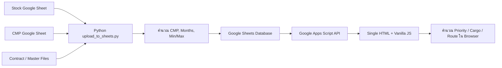
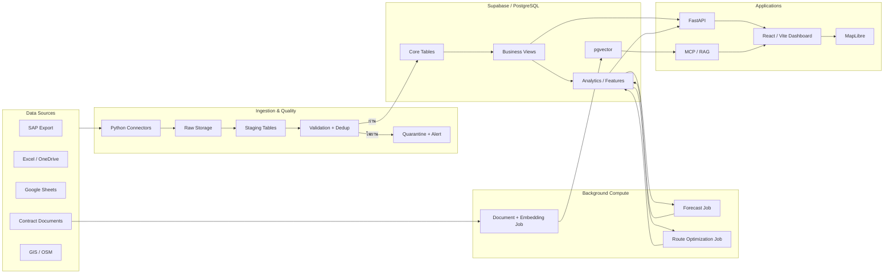
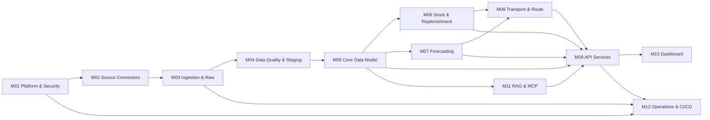

# SYNAPSE Open-Source & Free Pipeline Improvement Plan

> วันที่จัดทำ: 2026-07-14  
> เป้าหมาย: ปรับปรุง SYNAPSE จาก Google Sheets/Apps Script และงาน Manual ให้เป็น Data Pipeline ที่ตรวจสอบได้ ทำซ้ำได้ ปลอดภัย และไม่เสียค่าไลเซนส์ซอฟต์แวร์

> **Production relation update 2026-07-24:** ตรวจไฟล์ใน `data/` ใหม่แล้ว
> ได้ VMI scope 223 วัสดุ × 18 เขต, เพิ่ม row-level Stock/Usage lineage,
> normalized monthly observations และ owner-attested zero evidence ที่แยกจาก
> source-observed zero อย่างชัดเจน ดู
> [`docs/ACTUAL_DATA_RELATION_AND_SUPABASE_PRODUCTION_2026-07-24.md`](docs/ACTUAL_DATA_RELATION_AND_SUPABASE_PRODUCTION_2026-07-24.md)

## 1. ข้อเสนอหลัก

ให้ใช้ **Supabase/PostgreSQL เป็นศูนย์กลางข้อมูลต่อไป** แต่เพิ่มโครงสร้าง `raw -> staging -> core -> analytics` และย้ายงาน Forecasting, Route Optimization, Document Processing และ Embeddings ออกจาก HTTP request ปกติไปเป็นงานเบื้องหลังแบบ scheduled job

หลักการสำคัญ:

1. ใช้ซอฟต์แวร์ Open Source และรูปแบบข้อมูลมาตรฐานเพื่อลด Vendor Lock-in
2. เริ่ม PoC ด้วยบริการ Free Tier ที่มีอยู่ แล้วรองรับการย้ายไป Self-host ด้วย Docker Compose
3. ทุกการนำเข้าต้องมี `batch_id`, checksum, validation, audit log และสามารถรันซ้ำได้โดยไม่สร้างข้อมูลซ้ำ
4. แยกข้อมูลดิบ ข้อมูลที่ผ่านการตรวจสอบ ข้อมูลธุรกิจ และผลวิเคราะห์ออกจากกัน
5. ไม่ฝึกโมเดลหรือคำนวณเส้นทางหนักภายใน request ของ Dashboard
6. ใช้ Row Level Security (RLS) และเก็บ Service Key ไว้เฉพาะ Backend/Worker

> **คำว่า Free ในเอกสารนี้หมายถึงไม่มีค่าไลเซนส์ซอฟต์แวร์** ค่าเครื่อง Server, Storage, Backup, Network และเวลาของผู้ดูแลระบบยังคงมีอยู่ แม้จะเลือก Self-host ก็ตาม

## 2. Pipeline ปัจจุบัน

อ้างอิงจาก `synapse/SYSTEM_MANUAL.md`, `synapse/DATABASE.md` และ `synapse/ALGORITHM.md` ระบบเดิมทำงานดังนี้:



### จุดแข็ง

- ใช้เครื่องมือที่ทีมคุ้นเคยและเริ่มต้นได้เร็ว
- มีสูตรธุรกิจ CMP, Min/Max, Priority และ Cargo Check ชัดเจน
- Python สามารถดาวน์โหลด CSV และอัปโหลดข้อมูลเป็นชุดได้
- ค่าใช้จ่ายโครงสร้างพื้นฐานต่ำ

### ข้อจำกัด

- Daily workflow ยังต้องสั่งรันไฟล์ `.bat` และกดอัปเดตข้อมูล
- Google Sheets ทำหน้าที่เป็นทั้ง Database, Queue และ Audit Log ซึ่งควบคุม transaction และความสัมพันธ์ของข้อมูลได้จำกัด
- มีการ `clearSheet + batchAppend` ทำให้เสี่ยงต่อช่วงเวลาที่ข้อมูลว่างหรืออัปโหลดไม่ครบ
- สูตรสำคัญกระจายอยู่ใน Python และ JavaScript ทำให้ผลคำนวณต่างเวอร์ชันได้
- Frontend เป็นไฟล์เดียวและคำนวณ Route/Priority ใน Browser
- ไม่มี Data Lineage, Schema Migration, Retry, Quarantine และ Import History ที่เป็นระบบ
- การควบคุมสิทธิ์และการตรวจสอบย้อนหลังยังไม่เหมาะกับข้อมูลระดับองค์กร

## 3. Target Pipeline ที่แนะนำ



## 4. การแบ่งงานเป็น Module ย่อย

งานถูกแบ่งเป็น 12 โมดูลที่สามารถพัฒนาและทดสอบแยกกันได้ โดยใช้ Database Contracts, API Contracts และ Event/Job Status เป็นขอบเขตเชื่อมต่อระหว่างโมดูล

### ภาพรวม Dependency



### M01 — Platform, Database และ Security Foundation

**เป้าหมาย:** สร้างโครงสร้างพื้นฐานกลางที่ทุกโมดูลใช้งานร่วมกัน

**สถานะ 2026-07-14:** ดำเนินการบน Supabase project `test-synapse-mea` (`mklnbumfwojxhqscthjd`) แล้ว โดยสร้าง 7 schemas, Application Roles, RLS, Audit Trail และเชื่อม `public.contracts` เดิม 6,305 แถวกับ Source Batch โดยไม่ลบหรือเขียนทับข้อมูลธุรกิจเดิม ดูรายละเอียดที่ [`docs/M01_IMPLEMENTATION.md`](docs/M01_IMPLEMENTATION.md)

**ขอบเขตงาน:**

- สร้าง Supabase/PostgreSQL environments: Development, Test และ Production
- สร้าง schemas: `raw`, `staging`, `core`, `analytics`, `rag`, `ops`, `audit`
- จัดทำ SQL migrations และ seed data
- ตั้งค่า Supabase Auth, roles และ RLS policies
- กำหนด Secret/Environment Variable management
- สร้างมาตรฐาน `created_at`, `updated_at`, `source_batch_id` และ audit fields

**Input:** Data Dictionary, รายชื่อผู้ใช้/บทบาท, Security policy  
**Output:** Database foundation, roles, migrations และ connection contracts  
**Dependency:** ไม่มี  
**Deliverables:** Migration scripts, RLS tests, environment template, backup policy  
**เกณฑ์รับงาน:** ทุก role อ่าน/เขียนได้เฉพาะข้อมูลตามสิทธิ์ และไม่มี secret ใน Repository

### M02 — Source Connectors

**เป้าหมาย:** เชื่อมต่อแหล่งข้อมูลโดยไม่ผูก logic ธุรกิจกับวิธีดาวน์โหลดไฟล์

**สถานะ 2026-07-15:** ดำเนินการแล้ว มี connector กลางสำหรับ Excel/OneDrive-synced file, CSV, public Google Sheets และ document discovery พร้อม checksum/idempotency และ automated tests ผ่าน 4/4 ดู `pipeline/README.md` และ `docs/WAVE1_DATA_FOUNDATION.md`

**ขอบเขตงาน:**

- Connector สำหรับ Excel/OneDrive
- Connector สำหรับ Google Sheets CSV export
- Connector สำหรับ SAP export files
- Connector สำหรับเอกสารสัญญา PDF/DOCX
- ตรวจไฟล์ใหม่ด้วย filename, modified time และ checksum
- กำหนด interface กลาง `discover()`, `download()` และ `get_metadata()`

**Input:** Source URL/path และ credential ที่จำเป็น  
**Output:** ไฟล์ต้นฉบับพร้อม source metadata  
**Dependency:** M01  
**Deliverables:** Connector package, configuration schema, connector tests  
**เกณฑ์รับงาน:** ดาวน์โหลดไฟล์เดียวกันซ้ำแล้วตรวจพบว่าไม่มีการเปลี่ยนแปลง

### M03 — Ingestion, Raw Storage และ Batch Control

**เป้าหมาย:** นำข้อมูลเข้าอย่างตรวจสอบย้อนหลังและรันซ้ำได้

**สถานะ 2026-07-15:** Deploy แล้วบน Test project โดย reconcile สัญญา 6,305 แถวและ material master 203 แถวเข้า Raw พร้อม batch, checksum, row hash, source row และ unique idempotency key

**ขอบเขตงาน:**

- สร้าง `raw.import_batches` และ Raw tables
- เก็บไฟล์ต้นฉบับใน Storage
- สร้าง `batch_id`, `row_hash`, source metadata และสถานะงาน
- Load แบบ transaction และ idempotent
- รองรับ retry โดยไม่สร้างข้อมูลซ้ำ
- สถานะมาตรฐาน `queued`, `running`, `succeeded`, `failed`, `quarantined`

**Input:** ไฟล์และ metadata จาก M02  
**Output:** Immutable raw rows และ import batch record  
**Dependency:** M01, M02  
**Deliverables:** Ingestion runner, batch tables, retry command, unit/integration tests  
**เกณฑ์รับงาน:** รันไฟล์เดิมซ้ำแล้วจำนวน Raw/Core ไม่เพิ่มโดยไม่ตั้งใจ

### M04 — Data Quality, Staging และ Master Mapping

**เป้าหมาย:** ตรวจสอบและแปลงข้อมูลก่อนเผยแพร่ไปยัง Core

**สถานะ 2026-07-15:** Deploy แล้ว มี typed staging, 16 validation rules, row-level issue lineage, DQ summary และ SAP Plant-to-District mapping ครบ 18 เขต; baseline ไม่มี rejected row

**ขอบเขตงาน:**

- ตรวจ headers, required fields, types, duplicate และ date ranges
- แปลงวันที่ พ.ศ. เป็น ค.ศ.
- Normalize material, unit, district, plant และ contract identifiers
- สร้าง `ops.data_quality_issues` และ quarantine workflow
- Mapping SAP Plant ไป System District ID
- สร้าง Data Quality summary ต่อ batch

**Input:** Raw rows จาก M03  
**Output:** Valid staging rows, rejected rows และ quality report  
**Dependency:** M03  
**Deliverables:** Validation rules, mapping tables, DQ report/API  
**เกณฑ์รับงาน:** ทุก rejected row มี rule, field, reason และ source row ย้อนกลับได้

### M05 — Core Data Model และ Business Views

**เป้าหมาย:** สร้าง Single Source of Truth สำหรับข้อมูลสัญญา วัสดุ สต็อก และธุรกรรม

**สถานะ 2026-07-15:** Deploy แล้ว โดยใช้ purchase order เป็น contract grain ได้ 2,857 headers, 6,305 items, material union 776 รายการ, 19 locations และ business/reconciliation views; Wave 1 acceptance ผ่าน 21/21 checks

**ขอบเขตงาน:**

- Core tables สำหรับ materials, vendors, districts และ locations
- แยก contract header และ contract items
- สร้าง inventory transactions และ stock snapshots
- สร้าง delivery/inspection events
- Upsert จาก Staging แบบ transaction
- สร้าง views สำหรับ contract status และ current stock
- Migration ข้อมูล `public.contracts` 6,305 รายการโดยไม่ลบต้นฉบับ

**Input:** Valid staging rows และ master mappings  
**Output:** Normalized Core tables และ business views  
**Dependency:** M04  
**Deliverables:** ERD, migrations, upsert procedures, reconciliation report  
**เกณฑ์รับงาน:** จำนวนและยอดรวมสำคัญตรงกับต้นทาง และทุก Core row ย้อนกลับถึง batch ได้

### M06 — Stock Health, Replenishment และ Approval Workflow

**เป้าหมาย:** ย้ายสูตร CMP, Months Available, Min/Max และ Priority ให้เป็น logic ที่มี version และทดสอบได้

**สถานะ 2026-07-15:** ส่วน Database deploy และ acceptance ผ่านแล้ว: policy `v1.0.0`, stock-health view, calculation/rounding, replenishment workflow, anti-hoarding และ adjustment audit. รอสิทธิ์อ่าน Stock source เพื่อ load snapshot จริงและสร้าง candidate แผนแรก ดู `docs/WAVE2_REPLENISHMENT_API.md`

**อัปเดต 2026-07-27 (candidate):** เพิ่มทางเลือก **safety stock เชิงสถิติ** แทน
buffer จำนวนเดือนคงที่ (`MIN=CMP×4`, `MAX=CMP×6`) — `intelligence/.../replenishment.py`
มี `safety_stock = z(service level)×σ√protection`, `(R,s,S)` order-up-to policy และ
inventory-aware simulation (fill rate/service level/on-hand) พร้อม unit tests
เสนอใช้เป็น **advisory column คู่ขนาน** ให้ planner เทียบก่อน ไม่ override frozen rule
ดู `docs/RESEARCH_DRIVEN_IMPROVEMENTS.md`

**ขอบเขตงาน:**

- คำนวณ CMP และ rolling usage
- คำนวณ Months Available
- คำนวณ Min/Max Fill และ rounding tiers
- คำนวณ Priority Score
- สร้าง replenishment draft, district confirmation และ planner approval
- บันทึก adjustment reason และค่าก่อน/หลัง
- เปรียบเทียบผลกับ `synapse/ALGORITHM.md`

**Input:** Core stock, usage, material และ contract data  
**Output:** Replenishment candidates/plans และ approval history  
**Dependency:** M05  
**Deliverables:** Versioned calculation package, SQL views, approval tables, regression tests  
**เกณฑ์รับงาน:** Test cases ให้ผลตรงกับสูตรเดิม และทุก manual adjustment มี audit trail

### M07 — Demand Forecasting

**เป้าหมาย:** สร้าง Forecast ที่วัดความแม่นยำและทำซ้ำได้

**สถานะ 2026-07-15:** พัฒนาและ deploy แล้วทั้ง monthly feature contract, Seasonal Naive, Moving Average, StatsForecast AutoETS, rolling backtest/model selection, WAPE/MAE/Bias/80% interval, background worker, model registry, drift monitoring และ persisted Dashboard views; การรันข้อมูลจริงรอ usage history อย่างน้อย 14 เดือนต่อ material/เขต

**อัปเดต 2026-07-27 (candidate):** เพิ่ม intermittent-demand family (ADI×CV²
classification, Croston/SBA/TSB/ADIDA, MASE) ใน intelligence layer พร้อม unit
tests — activation-gated ด้วย env `SYNAPSE_INTERMITTENT_FORECAST=1` และ prepared
migration `supabase/candidate/202607270001_m07b_intermittent_forecasting.sql`
ดู `docs/RESEARCH_DRIVEN_IMPROVEMENTS.md`

**ขอบเขตงาน:**

- สร้าง material-demand features รายเดือนต่อเขต
- สร้าง Seasonal Naive/Moving Average baseline
- ทดลอง StatsForecast หรือ Prophet ตามความเหมาะสม
- Rolling backtest และ model selection
- บันทึก WAPE, MAE, Bias และ prediction interval
- Schedule training/inference และ model versioning
- Monitoring data drift และ forecast accuracy

**Input:** Usage transactions, stock-out flags, calendar และ lead time  
**Output:** `forecast_runs`, `forecast_results`, `forecast_metrics`  
**Dependency:** M05  
**Deliverables:** Feature builder, training job, inference job, evaluation report  
**เกณฑ์รับงาน:** มี baseline comparison และ Dashboard อ่านผลที่บันทึกไว้โดยไม่ train ใหม่

### M08 — Transport, Cargo และ Route Optimization

**เป้าหมาย:** สร้างแผนจัดรถและเส้นทางที่ใช้ constraints จริง

**สถานะ 2026-07-15:** พัฒนาและ deploy แล้วทั้ง cargo/vehicle/location contracts, Valhalla matrix adapter, OR-Tools capacity/time-window/service/priority solver, timeout/retry, GeoJSON, utilization/unserved results และ approve/reject workflow; การรันจริงรอ geocode, packaging, pallet capacity, driver และ approved replenishment plan ที่ผ่านการยืนยัน

**ขอบเขตงาน:**

- Master vehicles, capacities, drivers, depots และ district coordinates
- Cargo calculation: weight, volume, boxes และ pallets
- Valhalla time-distance matrix
- OR-Tools VRP พร้อม capacity, time windows, service time และ priority penalties
- Background route job พร้อม timeout/retry
- บันทึก stop sequence, ETA, utilization และ unserved stops
- สร้าง GeoJSON สำหรับ MapLibre
- Planner approve/reject route plan

**Input:** Confirmed replenishment plans, forecast, vehicle/location master  
**Output:** Versioned route plan, stops, GeoJSON และ route metrics  
**Dependency:** M06; ใช้ผล M07 เมื่อพร้อม  
**Deliverables:** Matrix adapter, optimizer, route tables, benchmark report  
**เกณฑ์รับงาน:** ทุก route ผ่าน capacity/time-window constraints และมี comparison กับแผนเดิม

### M09 — API และ Integration Services

**เป้าหมาย:** ให้ Frontend และระบบภายนอกเข้าถึงข้อมูลผ่าน contract ที่ปลอดภัย

**สถานะ 2026-07-15:** พัฒนาเสร็จแล้ว 22 OpenAPI paths ครอบคลุม contract, data quality, stock, replenishment, forecast, route, jobs และ operations พร้อม HS256/JWKS JWT verification, role/district scope, structured errors/logs, request ID, CORS, rate/body limits, Prometheus metrics และ fail-closed HTTP 409; contract/security tests ผ่าน 7/7 และมี Docker runtime แบบ non-root

**ขอบเขตงาน:**

- FastAPI + Pydantic request/response models
- API สำหรับ contracts, stock health, replenishment, forecast และ routes
- Authentication/JWT และ role authorization
- CORS allowlist, request limits และ structured errors
- Job submission/status endpoints
- OpenAPI documentation และ API versioning
- Integration tests กับ RLS

**Input:** Core/Analytics data และ services จาก M05–M08  
**Output:** Versioned REST API และ OpenAPI specification  
**Dependency:** M01, M05; เชื่อม M06–M08 แบบเพิ่มทีละส่วน  
**Deliverables:** API service, OpenAPI spec, test collection, error catalog  
**เกณฑ์รับงาน:** Unauthorized requests ถูกปฏิเสธ และ response schema ผ่าน contract tests

### M10 — Dashboard และ Map UI

**เป้าหมาย:** แยก Single HTML เดิมเป็นหน้าจอที่ดูแลและทดสอบได้

**สถานะ 2026-07-15:** พัฒนาเสร็จแล้วเป็น React/vinext dashboard ภาษาไทย มี Supabase login, role navigation, contract/DQ/stock/replenishment/forecast/route/jobs/operations surfaces, MapLibre, uncertainty chart, responsive/accessibility baseline และ no-fake-data empty states; lint/build/rendered tests ผ่าน และจัดส่งเป็น private Sites release

**ขอบเขตงาน:**

- React + Vite application structure
- Login และ role-based navigation
- Contract monitoring และ data quality status
- Stock health และ replenishment workflow
- Forecast chart พร้อม uncertainty
- Route map ด้วย MapLibre และ GeoJSON
- Job progress/error states
- Responsive และ accessibility baseline

**Input:** APIs จาก M09  
**Output:** Static Web Application  
**Dependency:** M09  
**Deliverables:** Frontend source, component tests, user acceptance scenarios  
**เกณฑ์รับงาน:** แต่ละ role เห็นเฉพาะเมนู/ข้อมูลตามสิทธิ์ และไม่มี business secret ใน Browser

### M11 — Document Intelligence, RAG และ MCP

**เป้าหมาย:** ค้นและตอบคำถามจากเอกสารโดยมี citation และควบคุมสิทธิ์

**สถานะ:** ไม่ดำเนินการตามขอบเขตที่ผู้ใช้กำหนดให้ยกเว้น Wave 4 AI

**ขอบเขตงาน:**

- Apache Tika/Tesseract extraction
- Normalize, chunk, hash และ document versioning
- sentence-transformers embeddings และ pgvector index
- Metadata/access-scope filtering
- Hybrid search และ citation ถึงไฟล์/หน้า
- Read-only MCP tools
- Retrieval evaluation และ no-answer behavior
- MCP audit log

**Input:** Contract documents และ Core contract metadata  
**Output:** Search index, RAG API, MCP tools และ citations  
**Dependency:** M01, M05; เปิดผ่าน M09  
**Deliverables:** Document worker, search function, MCP server, evaluation set  
**เกณฑ์รับงาน:** คำตอบอ้างอิงเอกสาร/หน้าได้ และผู้ใช้ค้นไม่พบเอกสารนอกสิทธิ์

### M12 — Operations, Observability, Testing และ CI/CD

**เป้าหมาย:** ทำให้ระบบ deploy, monitor, backup และกู้คืนได้อย่างสม่ำเสมอ

**สถานะ 2026-07-15:** พัฒนาและ deploy database operations แล้ว มี alert/heartbeat/backup/release contracts, JSON logs, metrics, Prometheus rules, Docker Compose, GitHub Actions, logical backup/checksum, isolated restore drill, rollback procedure, runbook และ ownership matrix; aggregate database acceptance ผ่าน 15/15

**ขอบเขตงาน:**

- Docker Compose profiles สำหรับ Development/Production
- Automated unit, integration, migration, RLS และ data-quality tests
- Pipeline/API/job metrics และ structured logs
- Alert เมื่อ import/job ล้มเหลวหรือข้อมูลล่าช้า
- Database/Storage backup และ restore drill
- Release/version policy และ rollback procedure
- Runbook และ ownership matrix

**Input:** Services และ jobs จากทุกโมดูล  
**Output:** CI/CD, monitoring, backup และ operational runbook  
**Dependency:** เริ่มพร้อม M01 และเพิ่ม coverage ตามแต่ละโมดูล  
**Deliverables:** Pipelines, dashboards, alerts, backup scripts, runbook  
**เกณฑ์รับงาน:** Deploy/rollback และ restore ผ่านการทดสอบใน Test environment

### Module Contract มาตรฐาน

ทุกโมดูลต้องส่งมอบอย่างน้อย:

1. Source code และ configuration template
2. Database/API/Event contract ที่ใช้เชื่อมโมดูลอื่น
3. Unit tests และ integration tests ตามความเสี่ยง
4. Migration/rollback instructions
5. Structured logs และ health/status signal
6. README วิธีรัน พัฒนา ทดสอบ และแก้ปัญหา
7. Owner และผู้รับผิดชอบเมื่อ Production มีปัญหา

### แผนดำเนินงานเป็น Wave

| Wave | Modules | ผลลัพธ์ที่ต้องได้ |
|---|---|---|
| 0 — Foundation | M01, เริ่ม M12 | Environment, schemas, migrations, Auth/RLS และ CI พื้นฐาน |
| 1 — Data Foundation (เสร็จ 2026-07-15) | M02, M03, M04, M05 | Automated ingestion, validation และ Core Database; acceptance ผ่าน 21/21 |
| 2 — Business Operations (เสร็จด้านระบบ 2026-07-15) | M06, M09, M10 | Stock/Replenishment workflow ผ่าน API และ Dashboard; activation รอ Stock source และ public API runtime |
| 3 — Intelligence (เสร็จด้านระบบ 2026-07-15) | M07, M08 | Forecast และ Route Optimization แบบ background jobs; activation รอ operational masters/history |
| 4 — AI | M11 | RAG/MCP แบบ Read-only พร้อม citation |
| ต่อเนื่อง (เสร็จสำหรับ release 1.0.0-non-ai) | M12 | Monitoring, backup/restore drill, security tests, CI และ runbook ครบทุกโมดูลที่อยู่ในขอบเขต |

### งานที่ทำขนานกันได้

- M02 Connector แต่ละแหล่งข้อมูลพัฒนาแยกกันได้หลังมี interface กลาง
- M06 และ M07 ทำขนานกันได้หลัง M05 stable
- M10 เริ่มสร้าง UI ด้วย mock API ได้ระหว่าง M09
- M11 document extraction เริ่มได้หลัง M01 แต่เชื่อมสิทธิ์จริงเมื่อ M05/M09 พร้อม
- M12 ทำงานต่อเนื่องคู่กับทุก Wave

## 5. Open-Source Technology Stack

| Layer | ตัวเลือกหลัก | หน้าที่ | แนวทาง Free |
|---|---|---|---|
| Database | PostgreSQL + PostGIS | Relational และ Geospatial Database | Supabase Free สำหรับ PoC หรือ Self-host |
| Backend Platform | Supabase | Auth, REST API, Storage, Realtime, RLS | Managed Free ก่อน แล้วจึง Self-host หากจำเป็น |
| Vector Search | pgvector | Embedding และ Similarity Search | ทำงานใน PostgreSQL |
| Ingestion | Python + Polars/Pandas + openpyxl | อ่าน CSV/XLSX และแปลงข้อมูล | รันด้วย cron หรือ Worker ภายในองค์กร |
| Validation | Pandera หรือ Great Expectations | Schema และ Data Quality Tests | รันใน ingestion job |
| Transformation | SQL Migration + PostgreSQL Views | Business rules และ data marts | เริ่มด้วย SQL; ใช้ dbt Core เมื่อมีหลาย model |
| Orchestration | cron + Python | Pipeline ขนาดเล็ก | แนะนำสำหรับ PoC เพราะใช้ทรัพยากรต่ำ |
| Orchestration เมื่อขยาย | Apache Airflow | Schedule, retry, backfill, logs, DAG | Self-host เมื่อมีหลาย pipeline และ dependency |
| API | FastAPI + Pydantic | API validation และ business service | Docker บนเครื่อง/VM ที่มีอยู่ |
| Frontend | React + vinext | Dashboard | Sites private deployment หรือ Web Server ภายใน |
| Map UI | MapLibre GL JS หรือ Leaflet | แสดงแผนที่และเส้นทาง | ไม่มีค่าไลเซนส์ซอฟต์แวร์ |
| Road Routing | Valhalla + OpenStreetMap | Route, Matrix และ Isochrone | Self-host เฉพาะพื้นที่กรุงเทพฯ/ปริมณฑล |
| Optimization | Google OR-Tools | Vehicle Routing และ Capacity/Time Window | รันใน Background Worker |
| Forecasting | StatsForecast / Prophet | Forecast รายวัสดุและเขต | ฝึกตาม Schedule ไม่ฝึกทุก API request |
| Document Extraction | Apache Tika + Tesseract OCR | อ่าน PDF/DOCX และเอกสาร Scan | ทำงานใน Worker |
| Embeddings | sentence-transformers | Multilingual Embeddings | รัน Local CPU ได้สำหรับ PoC |
| Local LLM (Optional) | Ollama + โมเดลที่มี license เหมาะสม | RAG/Chat แบบไม่ส่งข้อมูลออกภายนอก | ต้องมี RAM/VRAM ตามขนาดโมเดล |
| Packaging | Docker Compose | ย้ายระบบระหว่างเครื่องได้ | ใช้ Community/Open Source Engine ใน Production ตามนโยบายองค์กร |

### สิ่งที่ไม่แนะนำเป็นแกนหลัก

- ไม่ควรใช้ Vercel Serverless สำหรับ `Prophet`, `OR-Tools`, OCR หรือ Embeddings เพราะ package ใหญ่, cold start สูง และมีโอกาส timeout
- ไม่ควรใช้ public routing demo server ใน Production; ควร self-host Valhalla หรือกำหนด quota/usage policy ชัดเจน
- ไม่ควรให้ Browser เรียก Service Role Key หรือ LLM API Key โดยตรง
- ไม่ควรใช้ Google Sheets เป็นฐานข้อมูลหลักหลังเริ่ม Production
- ไม่ควรเพิ่ม Kafka, Kubernetes หรือ Airflow ตั้งแต่วันแรก หาก cron + Python ยังรองรับงานได้

## 6. Data Architecture

### 6.1 Raw Layer

เก็บข้อมูลตามที่ได้รับโดยไม่แก้ไข เพื่อให้ตรวจสอบย้อนหลังได้:

- `raw.import_batches`
- `raw.contract_rows`
- `raw.stock_rows`
- `raw.usage_rows`
- `raw.route_rows`
- ไฟล์ต้นฉบับใน Supabase Storage หรือ Object Storage

ฟิลด์มาตรฐานทุก Raw Table:

```text
batch_id
source_system
source_filename
source_sheet
source_row_number
source_updated_at
ingested_at
row_hash
raw_payload JSONB
```

### 6.2 Staging Layer

ใช้แปลงชนิดข้อมูลและตรวจสอบคุณภาพ:

- `staging.contracts`
- `staging.stock`
- `staging.monthly_usage`
- `staging.materials`
- `staging.districts`

กฎสำหรับไฟล์ `รวมสัญญา.xlsx`:

1. ตรวจสอบ 16 source columns ก่อนนำเข้า
2. แปลงวันที่ พ.ศ. ที่มากกว่า 2400 เป็น ค.ศ. โดยลบ 543
3. เก็บ `material_code` เป็นข้อความเพื่อรักษาเลขศูนย์นำหน้า
4. อนุญาตให้ `contract_number` และ `material_code` ว่างได้ แต่ต้องสร้าง Data Quality Issue
5. ไม่ใช้ `contract_number` เป็น Primary Key เพราะหนึ่งสัญญามีหลาย line items
6. ตรวจแถวซ้ำด้วย `row_hash`
7. เก็บข้อมูลที่ไม่ผ่านไว้ใน `ops.data_quality_issues` โดยไม่ทิ้งข้อมูลต้นฉบับ

### 6.3 Core Layer

โครงสร้างที่แนะนำ:

```text
core.materials
core.vendors
core.districts
core.locations
core.contracts
core.contract_items
core.purchase_orders
core.delivery_events
core.inventory_transactions
core.stock_snapshots
core.monthly_usage
core.vehicles
core.vehicle_capacities
core.replenishment_plans
core.transport_jobs
core.transport_stops
```

หลักการสำคัญ:

- `contracts` เก็บข้อมูลระดับหัวสัญญา
- `contract_items` เก็บรายการวัสดุและจำนวนในแต่ละสัญญา
- `stock_snapshots` เก็บยอด ณ เวลาใดเวลาหนึ่ง
- `inventory_transactions` เก็บการรับเข้า เบิกจ่าย โอน และปรับยอด
- สถานะสัญญาและยอดคงเหลือควรคำนวณจาก Events/Transactions หรือ View
- ทุก Core Table มี `created_at`, `updated_at` และ `source_batch_id`

### 6.4 Analytics Layer

```text
analytics.material_demand_daily
analytics.material_demand_monthly
analytics.stock_health
analytics.replenishment_candidates
analytics.forecast_runs
analytics.forecast_results
analytics.forecast_metrics
analytics.route_runs
analytics.route_stops
analytics.route_metrics
```

## 7. Pipeline Execution Flow

```text
1. DISCOVER
   ตรวจสอบไฟล์ใหม่/ไฟล์ที่แก้ไขจาก Source

2. EXTRACT
   ดาวน์โหลดไฟล์และสร้าง import batch

3. LOAD RAW
   เก็บไฟล์ต้นฉบับและ raw_payload

4. VALIDATE
   ตรวจ header, type, required fields, duplicate และ date range

5. NORMALIZE
   แปลงวันที่ รหัสเขต รหัสวัสดุ หน่วย และ business keys

6. UPSERT CORE
   ใช้ transaction และ idempotency key

7. BUILD ANALYTICS
   Refresh views/features สำหรับ Dashboard และ Models

8. RUN JOBS
   Forecast, Replenishment และ Route Optimization

9. PUBLISH
   บันทึกผลลัพธ์ที่มี version แล้วให้ API อ่าน

10. OBSERVE
    บันทึก metrics, logs, data quality และส่ง alert เมื่อผิดพลาด
```

เงื่อนไขสำคัญ:

- Pipeline เดียวกันต้องรันซ้ำด้วยไฟล์เดิมแล้วไม่สร้างข้อมูลเพิ่ม
- หาก Core update ล้มเหลว ต้อง rollback ทั้ง transaction
- Batch ที่ไม่ผ่าน validation ห้ามเผยแพร่ไปยัง Dashboard
- การแก้ไขข้อมูลย้อนหลังต้องมี user, timestamp, reason และค่าก่อน/หลัง

## 8. Forecasting Pipeline

### Input

- Material ID
- District ID
- Period
- Quantity used/dispatched
- Stock-out flag
- Calendar และวันหยุด
- Lead time และข้อมูลสัญญาที่กำลังส่งมอบ

### Process

1. สร้างข้อมูลรายเดือนต่อ `material_id x district_id`
2. ตรวจ missing periods, outliers และ stock-out censoring
3. **จำแนก series ด้วย ADI × CV²** (smooth/erratic/intermittent/lumpy) เพื่อ route
   ไปหาโมเดลที่เหมาะ — ดู `docs/RESEARCH_DRIVEN_IMPROVEMENTS.md`
4. สร้าง baseline ด้วย Moving Average/Seasonal Naive
5. สำหรับ series ต่อเนื่อง ทดลอง StatsForecast (AutoETS) หรือ Prophet
6. **สำหรับ series แบบ intermittent/lumpy ใช้ Croston/SBA/TSB/ADIDA** (candidate,
   activation-gated) — TSB จับ obsolescence ได้ตรงกับ rule ">9 เดือน"
7. ทำ rolling backtest
8. เลือกโมเดลจาก WAPE/MAE/bias สำหรับ series ต่อเนื่อง และ **MASE** สำหรับ
   intermittent (WAPE ถูกครอบงำด้วยเดือนศูนย์)
9. บันทึก model version, training window, metrics และ generated_at

### Output

```text
material_id
district_id
forecast_period
yhat
yhat_lower
yhat_upper
model_name
model_version
run_id
generated_at
```

Dashboard ต้องอ่านผล Forecast ที่คำนวณไว้แล้ว ไม่ฝึกโมเดลใหม่ทุกครั้งที่เปิดหน้า

## 9. Route Optimization Pipeline

### Input ที่จำเป็น

- Depot และ District coordinates
- Demand ของแต่ละ stop
- น้ำหนัก/ปริมาตร/จำนวนพาเลท
- Vehicle capacity
- Driver/vehicle availability
- Time window และ service time
- Priority score

### Process

1. ขอ time-distance matrix จาก Valhalla
2. สร้าง Vehicle Routing Problem ใน OR-Tools
3. กำหนด capacity, time windows, depot และ priority penalties
4. Solve ใน Background Worker พร้อม timeout
5. บันทึก route, stop sequence, ETA, distance และ utilization
6. สร้าง GeoJSON ให้ MapLibre แสดงผล

ผลที่ต้องวัด:

- ระยะทางรวม
- เวลาเดินทางรวม
- จำนวนรถ
- Vehicle utilization
- จำนวนจุดที่ส่งได้/ส่งไม่ได้
- เทียบผลกับแผนเดิมก่อนใช้งานจริง

## 10. RAG และ MCP Pipeline


ทุก chunk ต้องมี:

```text
document_id
contract_id
source_filename
page_number
chunk_index
content
content_hash
embedding_model
embedding_version
access_scope
```

MCP Tools ระยะแรกควรเป็น Read-only:

- `search_contract_knowledge(query, filters)`
- `get_contract_status(contract_id)`
- `get_stock_health(material_id, district_id)`
- `get_forecast(material_id, district_id)`
- `get_route_plan(route_run_id)`

คำตอบจาก RAG ต้องมี citation ไปยังไฟล์ หน้า และสัญญาต้นฉบับ และต้องกรอง `access_scope` ก่อนค้นหา

## 11. Security Baseline

1. เปิด RLS ทุกตารางที่ Frontend เข้าถึง
2. ใช้ Supabase Auth และกำหนด role อย่างน้อย `admin`, `planner`, `district`, `viewer`
3. `anon/publishable key` ใช้กับ Frontend ได้เฉพาะเมื่อมี RLS ที่ทดสอบแล้ว
4. Service Role Key, ORS/Valhalla admin key และ LLM key อยู่ใน Environment/Secret Store เท่านั้น
5. CORS ใช้ allowlist ของ Dashboard domain ห้ามใช้ `*` ใน Production
6. API ใช้ Pydantic validation, request size limit และ rate limit
7. บันทึก `audit.events` สำหรับ import, approve, adjust, route publish และ document access
8. สำรอง PostgreSQL และ Storage พร้อมทดสอบ Restore
9. แยก Development, Test และ Production

## 12. Deployment Profiles

### Profile A — Free PoC

- Managed Supabase Free: Database, Auth, Storage, pgvector
- Python cron บนเครื่องทีมงาน: Ingestion, Forecast และ Route jobs
- React/Vite static site: GitHub Pages หรือ Web Server ภายใน
- Valhalla: Local Docker เฉพาะเวลาทดสอบ หรือ routing provider ที่มี Free quota
- GitHub: Source control และ CI ตามโควตาที่มี

ข้อดี: เริ่มเร็วและไม่มีค่าไลเซนส์  
ข้อจำกัด: งานจะไม่รันเมื่อเครื่อง Worker ปิด และ Free Tier มี quota

### Profile B — Open-Source Self-host

- Linux Server/VM ภายในองค์กร
- Supabase Docker Compose หรือ PostgreSQL + PostgREST + Auth components ที่จำเป็น
- FastAPI, Worker, Airflow/cron, Valhalla และ Frontend ใน Docker Compose
- Reverse Proxy + TLS
- Automated backup ไปยังเครื่องหรือ Storage คนละชุด

ข้อดี: ควบคุมข้อมูลและไม่มีค่าบริการราย API  
ข้อจำกัด: องค์กรต้องรับผิดชอบ patching, security, monitoring, backup และ uptime เอง

## 13. Migration Plan จากระบบปัจจุบัน

### Phase 0 — Freeze Contract และ KPI

- ยืนยัน Data Dictionary และสูตรใน `synapse/DATABASE.md` และ `synapse/ALGORITHM.md`
- กำหนด KPI ปัจจุบันเป็น baseline
- ห้ามเปลี่ยนสูตร CMP/Min/Max ระหว่าง migration โดยไม่มี version

### Phase 1 — Data Foundation

**สถานะ:** เสร็จและ deploy บน Test project เมื่อ 2026-07-15; reconciliation ไม่พบ row delta และไม่มี hard rejection

- เก็บ `public.contracts` จำนวน 6,305 รายการที่นำเข้าแล้วไว้เป็น source baseline
- สร้าง schemas: `raw`, `staging`, `core`, `analytics`, `rag`, `ops`, `audit`
- สร้าง import batch และ data quality tables
- แยก contract header และ contract items
- เปิด RLS และสร้าง roles

### Phase 2 — Automated Ingestion

- ย้าย logic จาก `upload_to_sheets.py` เป็น reusable pipeline tasks
- ดาวน์โหลด Stock/CMP/Contract แบบ scheduled
- เพิ่ม checksum, validation, upsert, retry และ alert
- เปรียบเทียบผล PostgreSQL กับ Google Sheets อย่างน้อย 2 รอบข้อมูล

**สถานะ:** โครง M06/M09 พร้อมแล้ว แต่ยังต้องเปิด read-only Stock export หรือส่ง SAP stock batch เนื่องจาก URL ปัจจุบันตอบ 401; ระบบจะไม่สร้างข้อมูล stock จำลองแทนข้อมูลจริง

### Phase 3 — Application Migration

- สร้าง FastAPI สำหรับ business operations ที่ต้องควบคุมสิทธิ์
- เปลี่ยน Frontend ให้อ่าน Supabase Views/API
- ย้าย Priority/Cargo calculations ออกจาก Browser หรือสร้าง versioned database functions
- ใช้ Google Sheets เป็น read-only fallback ระหว่างช่วงเปลี่ยนผ่าน

### Phase 4 — Forecast และ Route

- สร้าง feature tables และ baseline forecast
- ทำ backtest ก่อนเปิดใช้คำแนะนำสั่งเติม
- ใช้ Valhalla matrix + OR-Tools ใน Background Worker
- ใช้ Planner approval ก่อน publish แผนขนส่ง

### Phase 5 — RAG และ MCP

- เริ่มจากเอกสารสัญญา Read-only
- เพิ่ม OCR, chunking, embeddings, metadata filters และ citations
- ทำ MCP audit log และจำกัด tool permissions

## 14. Acceptance Criteria

### Data

- ไฟล์เดิมรันซ้ำแล้วจำนวนข้อมูลไม่เพิ่ม
- ไม่มี duplicate business key ใน Core
- ทุกแถวระบุ source batch ย้อนกลับได้
- แถวผิดถูก quarantine และแสดงสาเหตุ
- วันที่ พ.ศ./ค.ศ. ผ่าน validation
- Dashboard ไม่เห็นข้อมูลจาก batch ที่ยังไม่ผ่าน

### Reliability

- Pipeline retry ได้และไม่สร้างข้อมูลซ้ำ
- มีสถานะ `queued/running/succeeded/failed`
- มี log และระยะเวลาของแต่ละ task
- Backup restore ผ่านการทดสอบ

### Forecast

- มี baseline model และ rolling backtest
- บันทึก WAPE/MAE/Bias ต่อ material group
- แสดง prediction interval และ model version

### Route

- Capacity และ time-window constraints ผ่านทุก route
- มี distance/time comparison กับแผนเดิม
- Planner สามารถ approve/reject พร้อมเหตุผล

### Security

- RLS tests ผ่านสำหรับทุก role
- ไม่มี Service Key อยู่ใน Frontend หรือ Repository
- ทุกการแก้ plan และ publish route มี audit event

## 15. ตัวชี้วัดที่ควรติดตาม

| กลุ่ม | KPI |
|---|---|
| Pipeline | Success rate, duration, data freshness, failed rows |
| Data Quality | Duplicate rate, missing material/vendor, invalid dates |
| Stock | Stock-out rate, months available, fill quantity |
| Forecast | WAPE, MAE, Bias, coverage ของ prediction interval |
| Transport | Total distance, total time, vehicle utilization, unserved stops |
| API | Error rate, p95 latency, requests per role |
| RAG | Citation coverage, no-answer rate, retrieval precision sample |
| Cost | Database size, storage growth, compute hours, routing tile size |

## 16. Official References

- [Supabase Self-Hosting](https://supabase.com/docs/guides/self-hosting)
- [Supabase Self-Hosting with Docker](https://supabase.com/docs/guides/self-hosting/docker)
- [Apache Airflow Documentation](https://airflow.apache.org/docs/apache-airflow/stable/)
- [Google OR-Tools](https://developers.google.com/optimization)
- [Valhalla Open-Source Routing Engine](https://valhalla.github.io/valhalla/)
- [MapLibre](https://maplibre.org/)
- [PostgreSQL](https://www.postgresql.org/)
- [PostGIS](https://postgis.net/)
- [pgvector](https://github.com/pgvector/pgvector)
- [FastAPI](https://fastapi.tiangolo.com/)
- [OpenStreetMap Copyright and License](https://www.openstreetmap.org/copyright)

### Research-driven improvements (2026-07-27)

ดูรายละเอียดและ mapping ต่อโมดูลใน `docs/RESEARCH_DRIVEN_IMPROVEMENTS.md`

- [A Review of Croston's method for intermittent demand forecasting](https://www.researchgate.net/publication/254044245_A_Review_of_Croston's_method_for_intermittent_demand_forecasting)
- [Intermittent demand, obsolescence and temporal aggregation forecasts (TSB, ADIDA)](https://www.tandfonline.com/doi/full/10.1080/00207543.2023.2199435)
- [Nixtla HierarchicalForecast](https://github.com/Nixtla/hierarchicalforecast)
- [Optimal operational service levels in VMI contracts](https://www.sciencedirect.com/science/article/abs/pii/S0167637722001043)
- [Multi-echelon inventory optimization (guaranteed-service extensions)](https://www.sciencedirect.com/science/article/abs/pii/S0377221723006173)
- [PyVRP: a high-performance VRP solver](https://arxiv.org/pdf/2403.13795)
- [Open-source data quality tools 2026](https://atlan.com/open-source-data-quality-tools/)
