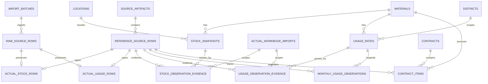

# SYNAPSE Actual Data Relation และ Supabase Staging

> ตรวจใหม่จากไฟล์บนดิสก์: 2026-07-24
> ขอบเขต: `data/`, `SYNAPSE_Open_Source_Pipeline_Improvement.md` และ canonical migration chain ใน `supabase/migrations/`

## 1. ข้อสรุปการเลือกแหล่งข้อมูล

ใช้ไฟล์ใน
`data/MEA_Synapse_Supabase_Complete_Staging_20260724/source_files/`
เป็น source-of-truth ล่าสุด เพราะผ่าน checksum ตาม `PACKAGE_MANIFEST.json`
และไฟล์ `คลังคลองเตย (1).xlsx` ใหม่กว่า loose file
`data/คลังคลองเตย.xlsx`

แพ็กเกจนี้ระบุ `STAGING_ONLY` และ
`production_use_prohibited=true` จึงมีข้อกำหนดดังนี้:

1. ใช้ source workbooks และ manifest เป็นหลักฐานนำเข้า
2. ไม่รัน migration/seed 9 ไฟล์ภายในแพ็กเกจร่วมกับ canonical migration
   chain เพราะเป็น alternate schema และ usage seed ไม่ผ่าน constraint
   เมื่อทดสอบบน PostgreSQL 17
3. ห้าม import หรือ promote แพ็กเกจนี้ลง Production
4. ต้องให้ CLI และ Database ตรวจ environment ก่อนเขียนข้อมูล

## 2. Source inventory ที่ตรวจยืนยัน

| Logical source | SHA-256 | Raw scope ที่รักษาไว้ | Business date |
|---|---|---:|---|
| `Stock.xlsx!update-stock` | `3475f8b31f71e79932b9dc1f13e3ebdf68bed28abae3245e0eca93420cfda38c` | 14,661 rows; 14,641 distinct natural keys | 2026-07-21 |
| `อัตราการใช้งาน.xlsx!Check CMP` | `7c81fcfd2b17ebb113c9e96d793e00636bedbdf701309bdacfad28c8c88a3ba0` | 6,164 rows; 5,926 mapped rows; 71,112 mapped monthly observations | 2026-04-30 |
| `คลังคลองเตย.xlsx` (physical file มี `(1)`) | `d6e2bb1d9fcd659a45a80a334102fcb4fe9920e1a16c97ea96b442e9c792084a` | MASTER 2,049; Districts 18; VMI 223; History 1,116; Routes 10 | 2026-07-20 |
| `รวมสัญญา.xlsx!รวมสัญญา` | `8ea7b0e712726e6cc1990f33b0031be231a91cc01fb4f8d96e6146d83e3cf9dd` | 6,305 source rows | ตามวันที่รายแถว |

Importer ใช้ logical name `คลังคลองเตย.xlsx` เพื่อรักษา database contract
แต่เก็บ physical path, package name และ manifest checksum ใน metadata
ทุกครั้ง

## 3. Relation contract

### Grain และ key ที่ต้องไม่เปลี่ยน

| Relation | Grain / business key |
|---|---|
| `reference_data.source_artifacts` | `(source_path, source_sheet, checksum)` |
| `reference_data.source_rows` | `(artifact_id, row_number)` |
| `raw.import_batches` | `(checksum, source_sheet)` |
| `raw.source_rows` | `(batch_id, source_entity, source_row_number)` |
| `staging.actual_stock_rows` | 1 typed row ต่อ 1 Raw Stock row |
| `staging.actual_usage_rows` | 1 typed row ต่อ material × SAP Plant ใน source |
| `core.stock_snapshots` | material × location × snapshot time |
| `core.usage_rates` | material × district × as-of date |
| `core.monthly_usage_observations` | import × source row × month |
| Stock/Usage evidence | Core row × original source row × Actual import |
| Contract item | purchase order/contract × line item × material พร้อม source row |

## 4. Source-to-table mapping

| Source sheet | Raw/Staging | Core/Relation | Promotion policy |
|---|---|---|---|
| Stock `update-stock` | `raw.source_rows` → `staging.actual_stock_rows` | `core.stock_snapshots` + `stock_observation_evidence` | ใช้ Unrestricted; Transfer เก็บเป็น evidence แต่ไม่รวมยอด |
| Usage `Check CMP` | `raw.source_rows` → `staging.actual_usage_rows` | `core.usage_rates`, `core.monthly_usage_observations` + evidence | dash → 0 พร้อม flag; signed value เก็บ Raw; Core ไม่ติดลบ |
| Warehouse `MASTER` | Reference/Raw rows | `core.materials` | canonical material ID 12 หลัก |
| Warehouse `M_Districts` | Reference/validation | `core.districts` | ต้องมี 18 SAP Plant ที่ไม่ซ้ำและ map ได้ |
| Warehouse `VMI คลองเตย` | `staging.actual_vmi_district_values` | VMI scope และ derived grid | derived values ไม่ใช่ source observation |
| Warehouse History/Route | Reference rows/edges | ไม่มี operational promotion | reference-only จนกว่าจะอนุมัติ contract |
| Contract `รวมสัญญา` | Raw/reference + contract staging | Contract headers/items/versions | เก็บ 6,305 source rows; material ID 11 หลัก pad เป็น 12 และเก็บค่าเดิม |

## 5. Coverage และ readiness จากไฟล์ล่าสุด

VMI scope ปัจจุบันคือ 223 วัสดุ × 18 เขต = 4,014 คู่

| Evidence | Observed | Missing | Coverage |
|---|---:|---:|---:|
| District Stock | 1,379 | 2,635 | 34.35% |
| District Usage/CMP | 1,202 | 2,812 | 29.95% |
| Warehouse Stock | 222 | 1 | 99.55% |

ผลคือ `actual_data_ready=false` จนกว่าจะมี source observation ครบตาม
policy ที่อนุมัติ แถวที่ระบบสร้างเป็น `source_missing_assumed_zero` หรือ
ค่าจาก VMI derived matrix ห้ามนับเป็นหลักฐานที่ทำให้ readiness ผ่าน

Coverage view ต้องนับเฉพาะ evidence ของ `latest successful Actual import`
เพื่อป้องกันการรวมข้อมูลหลาย batch แล้วเกิด false pass

## 6. Data Quality decisions

- Stock มี duplicate natural keys 20 แถว; Raw ต้องเก็บทุกแถว และการรวมยอด
  ต้องระบุ aggregation rule ใน evidence
- Usage มี 238 แถวที่ SAP Plant ไม่อยู่ใน 18-district mapping; เก็บ Raw
  และสร้าง DQ issue แต่ไม่ promote เป็น district usage
- Usage mapped 71,112 monthly observations มี dash 22,597 ค่า และ signed
  negative adjustment 256 ค่า
- Summary ที่ติดลบใน mapped rows: LY 19, 12M 22, 6M 14, 4M 44
- สูตร CMP ใช้ Excel-compatible
  `ROUND(AVERAGE(LY,12M,6M,4M),0)`; signed source values เก็บใน Raw
  และ normalize component เป็นค่าที่ไม่ติดลบก่อนใช้ใน Core
- Contract มีรหัสวัสดุ 11 หลัก 38 แถว/32 รหัส; pad เป็น 12 หลักเพื่อ
  เชื่อม `core.materials` โดยเก็บ `source_material_code` เดิมไว้

## 7. Supabase Staging deployment gate

ก่อนเชื่อม managed Supabase ต้องครบทุกข้อ:

1. มี Staging/Test project ที่ไม่ใช่ Production และระบุ project ref ชัดเจน
2. ตั้ง `DATABASE_URL`, `SUPABASE_URL` และ
   `SUPABASE_SERVICE_ROLE_KEY` นอก repository
3. รัน clean PostgreSQL migration/schema contract ผ่าน
4. deploy canonical migrations ถึง M21 พร้อมตรวจ registered project ref
5. import ด้วย `--confirm-actual-data --confirm-staging-package`
6. ตรวจ import journal, checksum, row counts, DQ issues, evidence coverage
   และยืนยันว่า `actual_data_ready=false` ตามข้อมูลจริง

คำสั่ง import อยู่ใน `pipeline/README.md` การนำเข้าจริงยังไม่ควรเริ่มจนกว่า
ผู้ดูแลจะให้ Staging project ref/credentials และ change ticket ที่อนุมัติ

## 8. Verification status

- Python parser/importer tests: 25/25 ผ่าน
- Canonical migrations: 24/24 apply ผ่านบน PostgreSQL 17
- Main workflow contract: 20/20 ผ่าน
- M21 lineage/readiness/environment/CMP contract: 16/16 ผ่าน
- RLS/schema/deployment/project-ref guard: ผ่าน
- Managed Supabase import: ยังไม่ทำ เพราะเครื่องไม่มี Staging
  `DATABASE_URL`, Service Role key หรือ linked project
