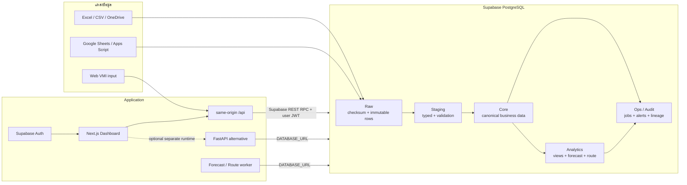
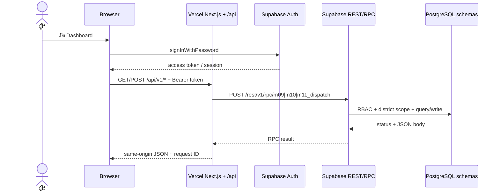
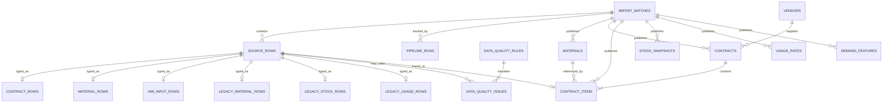
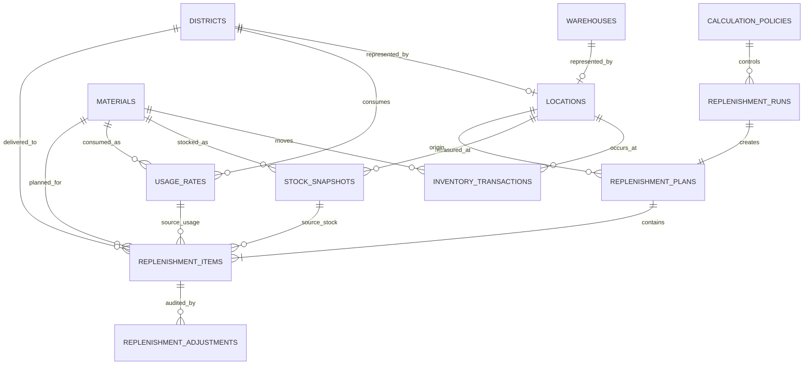
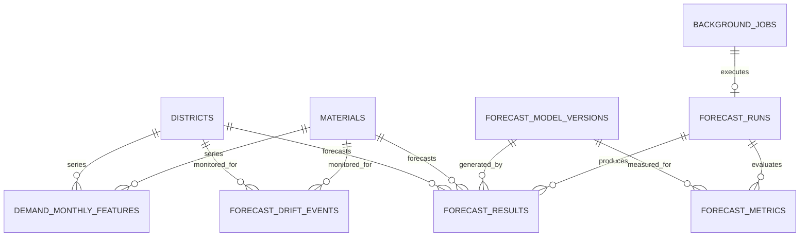
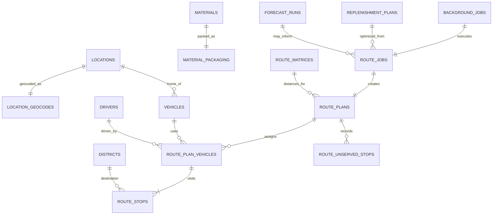
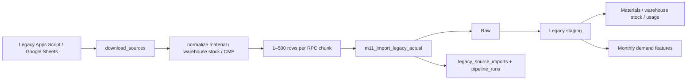
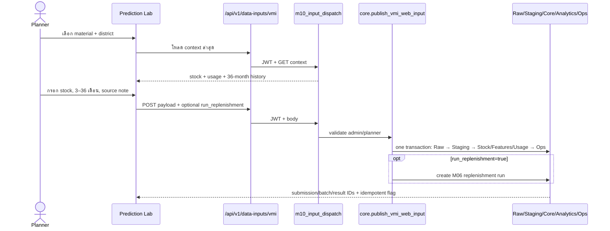

# SYNAPSE — End-to-End Project Pipeline

เอกสารนี้อธิบาย pipeline ของโปรเจกต์ `Project-Synapse` ตั้งแต่แหล่งข้อมูล, Supabase, ความสัมพันธ์ของข้อมูล, API, background worker, Dashboard, การรันในเครื่อง, การ deploy บน Vercel และงานปฏิบัติการระบบ

> สถานะเอกสาร: 2026-07-23  
> Release ที่อ้างอิง: `1.0.0-non-ai`  
> Supabase environment ที่มีอยู่ใน repository: **Test** (`test-synapse-mea`, project ref `mklnbumfwojxhqscthjd`, region `ap-northeast-1`)  
> ขอบเขต: M01–M10 และ M12; M11 RAG/MCP/AI ถูกตัดออกจาก release นี้โดยตั้งใจ แม้จะมี schema `rag` สำรองไว้

> หมายเหตุเรื่องชื่อ: function `m11_legacy_dispatch` และ `m11_import_legacy_actual` เป็น code identifier ของ migration ลำดับ `011` สำหรับ legacy actual sources ไม่ใช่โมดูล M11 RAG/MCP/AI ที่ถูกตัดออกจาก scope

## 1. ภาพรวมระบบ

SYNAPSE เป็นระบบ VMI/Supply Chain ที่เก็บ lineage ของข้อมูลตั้งแต่ต้นทาง และไม่สร้างข้อมูลปฏิบัติการจำลองเมื่อ source หรือ master data ยังไม่พร้อม



หลักสำคัญของ architecture:

- Browser ใช้เฉพาะ Supabase URL และ publishable/anon key ซึ่งเป็น public client configuration
- Password อยู่ใน Supabase Auth และไม่มี `service_role` หรือ database credential ใน browser
- Dashboard ส่ง access token ของผู้ใช้ไปยัง `/api`
- Production-style same-origin API ส่งต่อ JWT ไปยัง PostgreSQL RPC (`m09_dispatch`, `m10_input_dispatch`, `m11_legacy_dispatch`)
- RPC ตรวจ application role, district scope และ rate limit ภายในฐานข้อมูล
- FastAPI ใช้เป็น self-hosted/local alternative และเป็น canonical Python contract reference
- Pipeline และ worker ที่เชื่อมฐานข้อมูลโดยตรงต้องใช้ `DATABASE_URL` จาก secret manager หรือ ignored `.env`

## 2. ส่วนประกอบใน repository

| Path | หน้าที่ | Runtime หลัก |
|---|---|---|
| External repository `lanchakon-maikaeo/synapse-mea-dashboard` | Thai role-aware UI, Supabase Auth, same-origin API route | Node.js `>=22.13`, React 19, Next.js 16 |
| `api/` | API contract ทางเลือกสำหรับ local/self-host | Python `>=3.11`, FastAPI, psycopg |
| `pipeline/` | Source connectors, checksum, Raw ingestion, legacy actual importer | Python `>=3.11` |
| `intelligence/` | Forecasting, drift, Valhalla matrix และ OR-Tools routing worker | Python `>=3.11` |
| `supabase/migrations/` | Versioned database schema/functions/RLS | Supabase PostgreSQL |
| `supabase/tests/` | Read-only acceptance SQL | Supabase PostgreSQL |
| `supabase/rollbacks/` | Manual rollback scripts | Supabase PostgreSQL |
| `deploy/docker/` | API, worker และ pipeline images แบบ non-root | Docker |
| `deploy/monitoring/` | Prometheus config และ alert rules | Docker/Prometheus |
| `deploy/cron/` | ตัวอย่าง schedule ของ intelligence worker | Unix cron |
| `scripts/` | Backup, restore drill และ secret scan | Shell + PostgreSQL tools |
| `docs/` | Implementation/status/runbook | Markdown |

## 3. Hosting topology

### 3.1 สถานะ deployment ปัจจุบัน

Dashboard ถูก deploy แบบ native Next.js ที่ `https://mea-synapse-staging.vercel.app` จาก GitHub repository `lanchakon-maikaeo/synapse-mea-dashboard` ไปยัง Vercel project `synapse-mea/mea-synapse-staging`

Source ถูกแบ่งเป็น 2 private repositories ตาม release boundary:

- `lanchakon-maikaeo/synapse-mea-pipeline` เก็บ `api/`, `pipeline/`,
  `intelligence/`, `supabase/`, `deploy/` และ operations workflow
- `lanchakon-maikaeo/synapse-mea-dashboard` เก็บ Next.js dashboard และเป็น
  repository ที่ Vercel เชื่อมโดยตรง

ใน local workspace อาจมี `dashboard/` เป็น nested checkout เพื่อรัน
`make workspace-ci` แต่ path นี้ถูก ignore จาก pipeline repository เพื่อไม่ให้
เกิด source ซ้ำสองชุดหรือ nested Git history ที่ไม่ชัดเจน

`https://synapse-mea-dashboard.lanchakon0.chatgpt.site` เป็น ChatGPT
Sites-hosted snapshot แยกต่างหากและ response ถูก serve ผ่าน Cloudflare ไม่ได้
deploy จาก Vercel project ข้างต้น ปัจจุบัน API/OpenAPI ของสอง URL ตรงกัน แต่ UI
bundle บน Sites เก่ากว่า revision `804c6f0` และยังไม่มี orchestration ครบสำหรับ
สร้าง/อนุมัติ replenishment และ queue route job จึงให้ Vercel URL เป็น release
target และ deployment evidence ของ Git pipeline นี้

### 3.2 Topology สำหรับ Vercel



Vercel ทำหน้าที่เฉพาะ Web App และ same-origin API proxy/RPC gateway ส่วนฐานข้อมูล, Auth, RLS และ business functions อยู่ใน Supabase

### 3.3 Self-host topology

- Dashboard รันแยกจาก FastAPI
- Dashboard ตั้ง `NEXT_PUBLIC_API_BASE_URL=http://localhost:8000` หรือ URL ของ API host
- FastAPI ตรวจ Supabase JWT ผ่าน JWKS/issuer แล้วอ่าน/เขียน PostgreSQL ผ่าน `DATABASE_URL`
- Worker และ Valhalla อยู่ใน backend network
- Prometheus อ่าน `/metrics` โดยใช้ `METRICS_TOKEN`

## 4. Supabase schemas และ security boundary

| Schema | หน้าที่ | Browser เข้าถึงโดยตรงหรือไม่ |
|---|---|---|
| `auth` | Supabase users/session | ผ่าน Supabase Auth client |
| `public` | `user_profiles`, legacy `contracts`, public RPC gateway | เฉพาะ object/function ที่ grant ไว้ |
| `raw` | Import batch และ immutable source payload | ไม่; service role/security-definer เท่านั้น |
| `staging` | Typed/validated source rows | ไม่ |
| `core` | Canonical masters และ transactions | ไม่; อ่าน/เขียนผ่าน RPC/API |
| `analytics` | Derived views, features, forecasts, route results | ไม่; อ่านผ่าน RPC/API |
| `ops` | Pipeline runs, jobs, policies, alerts, release/backup evidence | ไม่ |
| `audit` | Append-only change log/helpers | ไม่ |
| `rag` | Reserved for excluded AI/document scope | ยังไม่มี production object ใน release นี้ |

ทุก business table เปิด RLS และ migration จะ revoke schema/table access จาก `public`, `anon` และ `authenticated` โดย default จากนั้นอนุญาตเฉพาะ function หรือ public table operation ที่กำหนดไว้

### 4.1 Identity และ application roles

```mermaid
erDiagram
  AUTH_USERS ||--|| USER_PROFILES : "user_id"
  DISTRICTS ||--o{ USER_PROFILES : "district_id when role=district"

  AUTH_USERS {
    uuid id PK
  }
  USER_PROFILES {
    uuid user_id PK_FK
    app_role role
    text district_id
    boolean is_active
  }
  DISTRICTS {
    text district_id PK
    text sap_plant_code UK
  }
```

| Role | ขอบเขตหลัก |
|---|---|
| `admin` | อ่านทั้งหมด, import legacy actual, publish VMI, run/approve/review และดู alerts |
| `planner` | อ่าน planning data, publish VMI, run replenishment/forecast/route และ approve/review |
| `viewer` | อ่านข้อมูลภาพรวม/monitoring แต่ไม่มีสิทธิ์ publish หรืออนุมัติ |
| `district` | อ่าน stock/replenishment/forecast และ context เฉพาะ `district_id` ของตน; confirm item ของเขตได้ |

ผู้ใช้ Auth ใหม่จะได้ role `viewer` อัตโนมัติจาก trigger `public.handle_new_auth_user()` การตั้ง admin คนแรกต้องทำโดยผู้ดูแลผ่าน SQL Editor หลังผู้ใช้นั้น sign in แล้ว

## 5. Data relations

### 5.1 Raw → Staging → Core lineage



Idempotency keys ที่สำคัญ:

- Batch: `(source_checksum, source_sheet)`
- Raw row: `(batch_id, source_entity, source_row_number)`
- Contract item lineage: `source_row_id` unique
- Stock snapshot: `(material_id, location_id, snapshot_at)`
- Usage rate: `(material_id, district_id, as_of_date)`
- Monthly feature: `(material_id, district_id, period_start, feature_version)`
- Web submission: `batch_id` unique โดย checksum รวม payload ที่ไม่รวม `run_replenishment` และ user ID

### 5.2 Location, stock และ replenishment



`core.locations` บังคับให้แต่ละ row เป็น `WAREHOUSE` หรือ `DISTRICT` อย่างใดอย่างหนึ่งเท่านั้น ปัจจุบัน repository บันทึก 18 เขต, 1 VMI warehouse และ 19 locations

### 5.3 Forecasting และ background jobs



ข้อกำหนด readiness:

- Baseline worker ประมวลผล series ที่มีอย่างน้อย 7 เดือน
- Readiness/AutoETS comparison ต้องมีอย่างน้อย 14 monthly observations ต่อ material/district
- เลือกโมเดลด้วย WAPE ก่อน แล้วใช้ MAE/Bias เป็นลำดับรอง
- เก็บ prediction interval 80%

### 5.4 Routing



หมายเหตุ: `route_stops.replenishment_item_ids` และ `route_unserved_stops.replenishment_item_ids` เป็น UUID array สำหรับ trace รายการ ไม่ใช่ foreign key constraint ราย row

## 6. Table catalog

ตารางด้านล่างเป็น catalog ระดับ purpose/relationship ส่วน column และ constraint ฉบับเต็มให้ถือ migration SQL เป็น source of truth

### 6.1 Public, Raw, Staging และ Audit

| Table | Key/Relation หลัก | หน้าที่ |
|---|---|---|
| `public.user_profiles` | PK/FK `user_id → auth.users.id` | Application role และ district scope |
| `public.contracts` | FK `source_batch_id → raw.import_batches` | Legacy 6,305-row baseline ที่ต้องเก็บไว้ |
| `raw.import_batches` | PK `batch_id`; unique checksum/sheet | Source metadata, status และ batch lineage |
| `raw.source_rows` | FK `batch_id`; unique batch/entity/row | Immutable JSONB source payload |
| `staging.sap_plant_district_map` | PK plant; unique district | Mapping SAP plant ↔ 18 districts |
| `staging.contract_rows` | PK/FK `source_row_id` | Typed contract rows |
| `staging.material_rows` | PK/FK `source_row_id` | Typed material rows |
| `staging.vmi_input_rows` | FK batch/source/material/district/user | Typed Web stock/demand observations |
| `staging.legacy_material_rows` | FK batch/source | Typed legacy material source |
| `staging.legacy_stock_rows` | FK batch/source | Typed warehouse stock source |
| `staging.legacy_usage_rows` | FK batch/source | Typed CMP/history source |
| `audit.change_log` | identity PK | INSERT/UPDATE/DELETE audit history |

### 6.2 Core

| Table | Key/Relation หลัก | หน้าที่ |
|---|---|---|
| `core.districts` | PK district; unique SAP plant | District master |
| `core.warehouses` | PK warehouse; unique plant/storage | Warehouse master |
| `core.locations` | FK warehouse หรือ district | Unified stock/routing locations |
| `core.vendors` | unique normalized name | Vendor master |
| `core.materials` | FK source batch | Material master จาก master/contracts |
| `core.contracts` | FK vendor/source batch | Contract header grain = purchase order |
| `core.contract_items` | FK contract/material/source row/batch | Contract lines พร้อม lineage |
| `core.inventory_transactions` | FK material/location/batch | Inventory movement foundation |
| `core.stock_snapshots` | FK material/location/batch | Point-in-time quantity |
| `core.delivery_events` | FK contract item/batch | Delivery lifecycle events |
| `core.usage_rates` | FK material/district/batch | CMP และ rolling usage values |
| `core.replenishment_plans` | FK run/origin/users | Versioned replenishment plan |
| `core.replenishment_items` | FK plan/material/district/stock/usage | Suggested/confirmed quantity และ priority |
| `core.location_geocodes` | PK/FK location | Coordinates, time windows, verification |
| `core.material_packaging` | PK/FK material | Box/pallet volume/weight master |
| `core.vehicles` | FK home location | Capacity master |
| `core.drivers` | unique employee reference | Driver master |
| `core.route_plans` | FK route job/matrix/user | Route solution และ review status |
| `core.route_plan_vehicles` | FK plan/vehicle/driver | Vehicle assignment/utilization |
| `core.route_stops` | FK plan vehicle/district | Ordered served stops |
| `core.route_unserved_stops` | FK plan/district | Explicit unserved reason |

### 6.3 Analytics

| Table/View | Relation/Source | หน้าที่ |
|---|---|---|
| `analytics.demand_monthly_features` | material + district + source batch | Forecast feature series |
| `analytics.forecast_model_versions` | model registry | Versioned model definitions |
| `analytics.forecast_runs` | optional background job | Training window/horizon/run status |
| `analytics.forecast_results` | run + material + district + model | Predictions และ 80% interval |
| `analytics.forecast_metrics` | run + series + model | WAPE, MAE, Bias และ selected flag |
| `analytics.forecast_drift_events` | material + district | Drift/freshness events |
| `analytics.route_matrices` | request hash | Valhalla/test distance-duration matrix |
| `analytics.v_contract_status` | Core contracts/items/vendors | Contract dashboard |
| `analytics.v_current_stock` | latest stock snapshots | Current stock |
| `analytics.v_contract_reconciliation` | source vs core | Reconciliation |
| `analytics.v_material_master_coverage` | contracts/materials | Master coverage |
| `analytics.v_data_quality_summary` | DQ issues | Batch/entity quality summary |
| `analytics.v_stock_health` | stock + usage | Months available/health band |
| `analytics.v_replenishment_queue` | plans/items | Confirmation queue |
| `analytics.v_latest_forecasts` | forecast results | Latest forecast per series |
| `analytics.v_forecast_monitoring` | metrics/drift | Forecast monitoring |
| `analytics.v_route_plan_geojson` | route plans/stops | MapLibre-ready GeoJSON |
| `analytics.v_route_plan_summary` | route solution | Planner summary |
| `analytics.v_wave3_readiness` | features/masters/plans | Forecast/routing readiness gate |
| `analytics.v_operations_health` | ops objects | Operational health snapshot |

### 6.4 Operations

| Table | Relation หลัก | หน้าที่ |
|---|---|---|
| `ops.schema_migrations` | version PK | Applied migration register |
| `ops.environment_registry` | environment PK | Environment/project label |
| `ops.pipeline_runs` | optional batch FK | Ingestion execution metrics/error |
| `ops.data_quality_rules` | rule code PK | Versioned DQ rules |
| `ops.data_quality_issues` | batch/source row/rule FKs | Row-level issues |
| `ops.calculation_policies` | policy version PK | Replenishment parameters |
| `ops.replenishment_runs` | policy/user FKs | Calculation execution |
| `ops.replenishment_adjustments` | replenishment item/user FKs | Override audit |
| `ops.background_jobs` | user FK | Retryable forecast/route queue |
| `ops.route_jobs` | background job/plan/forecast FKs | Route job request |
| `ops.system_alerts` | user acknowledgment FK | Import/job/staleness/security alerts |
| `ops.service_heartbeats` | service name PK | Worker/service liveness |
| `ops.backup_runs` | UUID PK | Backup/restore evidence |
| `ops.release_versions` | optional self-FK rollback_of | Deployment/rollback evidence |
| `ops.api_rate_limit_windows` | user + minute PK | Persistent 120 requests/minute limit |
| `ops.web_input_submissions` | batch/material/district/result/user FKs | Published VMI request lineage |
| `ops.legacy_source_imports` | source key + batch FK | Actual-source import status |

## 7. Write pipelines

### 7.1 Standard file ingestion: Excel/CSV/Google Sheets

1. Connector discovers/downloads source
2. SHA-256 identifies source version
3. `IngestionRunner` creates/reuses `raw.import_batches`
4. Rows are inserted into `raw.source_rows` with deterministic row hash
5. Exact succeeded checksum/sheet is skipped
6. Contract/material sources are typed by `staging.refresh_contracts(batch_id)` และ `staging.refresh_materials(batch_id)`
7. `core.refresh_contract_foundation(contract_batch_id, material_batch_id)` publishes vendors/materials/contracts/items
8. Review `analytics.v_data_quality_summary` and reconciliation views before downstream use

ข้อควรระวัง: CLI `synapse-pipeline ingest` เขียนถึง Raw เท่านั้น การ refresh Staging/Core เป็น database promotion step แยกต่างหาก

### 7.2 Legacy actual source import



- ต้องใช้ authenticated admin access token
- Source keys: `materials`, `warehouse_stock`, `cmp_usage`
- Dummy workbook ไม่ถูก import
- Signed SAP adjustment ถูกเก็บใน Raw แต่ค่าติดลบไม่ถูกใช้สร้าง non-negative forecast features
- District stock source เดิมยังไม่พร้อม ระบบจึงไม่สร้างค่าทดแทน

### 7.3 Governed Web VMI input



Validation หลัก:

- Material และ active district ต้องมีใน Supabase master
- `source_note` 3–500 ตัวอักษร
- Stock ต้องไม่ติดลบและ timestamp ห้ามอยู่อนาคตเกิน 5 นาที
- History ต้องมี 3–36 เดือน, เดือนไม่ซ้ำ, demand ไม่ติดลบ และห้ามเป็นเดือนอนาคต
- การส่ง payload เดิมซ้ำจะคืนผลเดิมแบบ idempotent

### 7.4 Replenishment

1. `analytics.v_stock_health` จับคู่ latest district stock กับ usage rate
2. `core.create_replenishment_run()` ใช้ active `ops.calculation_policies`
3. สร้าง `core.replenishment_plans` และ `core.replenishment_items`
4. District/planner/admin confirm item พร้อมเหตุผล
5. ทุก override เก็บใน `ops.replenishment_adjustments`
6. Admin/planner approve plan ก่อนใช้สร้าง route job

### 7.5 Forecast worker

1. API หรือ monthly scheduler สร้าง `analytics.forecast_runs` + `ops.background_jobs`
2. Worker claim job ด้วย `FOR UPDATE SKIP LOCKED`
3. โหลด `monthly-demand-v1` ตาม training window
4. เปรียบเทียบ Seasonal Naive, Moving Average และ AutoETS เมื่อ history พร้อม
5. บันทึก metrics, selected model, forecasts และ 80% interval
6. Mark job/run succeeded หรือ bounded retry สูงสุดตาม `max_attempts`
7. Refresh drift และ operational alerts ตาม schedule

### 7.6 Route worker

1. Approved replenishment plan สร้าง `ops.route_jobs` + background job
2. Worker ตรวจ geocode, packaging, vehicle capacity และ confirmed/approved items
3. Production ใช้ Valhalla `sources_to_targets`; Haversine ใช้ได้เฉพาะ explicit test mode
4. OR-Tools แก้ VRP ภายใต้ weight/volume/pallet/time-window constraints
5. บันทึก matrix, plan, vehicle assignment, served/unserved stops และ GeoJSON
6. Planner/admin review แล้ว approve หรือ reject พร้อมเหตุผล

## 8. Read/API pipeline

### 8.1 Same-origin route dispatch

`dashboard/app/api/[...path]/route.ts` ทำหน้าที่ดังนี้:

- `/api/health` ตอบ process health โดยไม่เรียกฐานข้อมูล
- `/api/openapi.json` ตอบ committed serverless contract
- `/api/health/ready` เรียก anonymous `m09_health()`
- `/api/v1/*` ต้องมี `Authorization: Bearer <Supabase JWT>`
- จำกัด request body 1 MiB
- สร้าง/ส่งต่อ `X-Request-ID`
- ตอบ `Cache-Control: no-store`, `X-Frame-Options: DENY` และ security headers อื่น

Dispatcher mapping:

| Path group | Supabase RPC |
|---|---|
| Materials, warehouse stock, legacy status/import | `public.m11_legacy_dispatch` |
| Districts, VMI submissions/context/publish | `public.m10_input_dispatch` |
| Contract, quality, stock health, replenishment, forecast, route, jobs, operations | `public.m09_dispatch` |

### 8.2 FastAPI alternative

FastAPI ตรวจ token ได้สองแบบ:

- แนะนำ: ES256/RS256 ผ่าน Supabase JWKS พร้อม issuer check
- Legacy migration support: HS256 ผ่าน `SUPABASE_JWT_SECRET`

จากนั้น FastAPI อ่าน role จาก `public.user_profiles`, enforce district scope และเชื่อม PostgreSQL ผ่าน `DATABASE_URL`

### 8.3 API endpoint catalog

| Method | Endpoint | Access/scope |
|---|---|---|
| `GET` | `/health` | Public process health |
| `GET` | `/health/ready` | Public database readiness |
| `GET` | `/v1/me` | Authenticated identity/scope |
| `GET` | `/v1/contracts` | Admin, planner, viewer |
| `GET` | `/v1/data-quality` | Admin, planner, viewer |
| `GET` | `/v1/reference/materials` | Authenticated |
| `GET` | `/v1/warehouse-stock` | Authenticated |
| `GET` | `/v1/data-sources/legacy/status` | Authenticated |
| `POST` | `/v1/admin/import/legacy` | Admin |
| `GET` | `/v1/reference/districts` | Authenticated; district scoped |
| `GET` | `/v1/data-inputs/vmi` | Authenticated; district scoped |
| `GET` | `/v1/data-inputs/vmi/context` | Authenticated; district scoped |
| `POST` | `/v1/data-inputs/vmi` | Admin, planner |
| `GET` | `/v1/stock-health` | Authenticated; district scoped |
| `GET` | `/v1/replenishment/queue` | Authenticated; district scoped |
| `POST` | `/v1/replenishment/runs` | Admin, planner |
| `POST` | `/v1/replenishment/items/{item_id}/confirm` | Matching district, planner, admin |
| `POST` | `/v1/replenishment/plans/{plan_id}/approve` | Admin, planner |
| `GET` | `/v1/forecasts/latest` | Authenticated; district scoped |
| `GET` | `/v1/forecasts/monitoring` | Admin, planner, viewer |
| `POST` | `/v1/forecasts/runs` | Admin, planner |
| `GET` | `/v1/jobs/{job_id}` | Admin, planner, viewer |
| `GET` | `/v1/jobs` | Admin, planner, viewer |
| `POST` | `/v1/routes/jobs` | Admin, planner |
| `GET` | `/v1/routes/plans` | Admin, planner, viewer |
| `GET` | `/v1/routes/plans/{route_plan_id}` | Admin, planner, viewer |
| `POST` | `/v1/routes/plans/{route_plan_id}/review` | Admin, planner |
| `GET` | `/v1/wave3/readiness` | Admin, planner, viewer |
| `GET` | `/v1/operations/health` | Admin, planner, viewer |
| `GET` | `/v1/operations/alerts` | Admin, planner |

## 9. Environment variables

### 9.1 Dashboard/Vercel — public configuration เท่านั้น

| Variable | Required | ตัวอย่าง/ความหมาย |
|---|---:|---|
| `NEXT_PUBLIC_SUPABASE_URL` | แนะนำ | `https://<project-ref>.supabase.co` |
| `NEXT_PUBLIC_SUPABASE_ANON_KEY` | แนะนำ | Supabase publishable/anon key; ห้ามใช้ service role |
| `NEXT_PUBLIC_API_BASE_URL` | ไม่จำเป็นสำหรับ same-origin | เว้นว่าง/ไม่ตั้งเพื่อใช้ `/api`; หรือ URL ของ FastAPI |
| `NEXT_PUBLIC_SITE_URL` | ใช่สำหรับ production metadata | `https://<vercel-domain>` |

แม้ code มี project-specific public fallback อยู่ ควรกำหนดตัวแปรในแต่ละ Vercel environment เพื่อให้ Preview/Production ไม่ผูกกับค่าที่ hardcode

### 9.2 FastAPI/self-host secrets

| Variable | หน้าที่ |
|---|---|
| `DATABASE_URL` | PostgreSQL direct/session-pooler URL พร้อม TLS |
| `SUPABASE_URL` | Auth issuer และ default JWKS URL |
| `SUPABASE_JWKS_URL` | Override JWKS endpoint |
| `SUPABASE_JWT_SECRET` | ใช้เฉพาะ legacy HS256 transition |
| `API_CORS_ORIGINS` | Comma-separated explicit dashboard origins |
| `SYNAPSE_ENVIRONMENT` | `development`, `test` หรือ `production` |
| `API_RATE_LIMIT_PER_MINUTE` | FastAPI limit; default 120 |
| `API_MAX_REQUEST_BODY_BYTES` | default 1,048,576 |
| `METRICS_TOKEN` | ป้องกัน `/metrics` |

### 9.3 Worker/pipeline

| Variable | หน้าที่ |
|---|---|
| `DATABASE_URL` | Pipeline/worker database connection |
| `WORKER_ID` | Worker instance identity |
| `WORKER_POLL_SECONDS` | Poll interval ใน container |
| `VALHALLA_URL` | Production route matrix service |
| `ALLOW_HAVERSINE_FALLBACK` | ต้องเป็น `true` เฉพาะ test/dev |
| `SUPABASE_ANON_KEY` | Legacy importer public API key |
| `SUPABASE_ACCESS_TOKEN` | Legacy importer authenticated admin token |
| `IMPORT_DIRECTORY` | Read-only source mount ของ pipeline container |

กฎ: ห้าม commit populated `.env`, database password, access token, JWT secret หรือ service-role key

## 10. รันในเครื่อง

### 10.1 Dashboard แบบ same-origin Supabase RPC

```bash
cd dashboard
cp .env.example .env.local
npm ci
npm run dev
```

แก้ `.env.local` ให้ใช้ค่าจริงและตั้ง `NEXT_PUBLIC_API_BASE_URL=/api` หรือเอาตัวแปรนี้ออก เพราะค่าใน `.env.example` ปัจจุบันชี้ไป FastAPI ที่ `http://localhost:8000`

`npm run dev` ใช้ native Next.js เหมือน Vercel runtime

### 10.2 Dashboard + FastAPI

Terminal 1:

```bash
python3 -m venv .venv
.venv/bin/python -m pip install -e api
DATABASE_URL='...' \
SUPABASE_URL='https://<project-ref>.supabase.co' \
API_CORS_ORIGINS='http://localhost:3000' \
.venv/bin/uvicorn synapse_api.main:app --reload
```

Terminal 2:

```bash
cd dashboard
cp .env.example .env.local
npm ci
npm run dev
```

กำหนด `NEXT_PUBLIC_API_BASE_URL=http://localhost:8000` ใน `dashboard/.env.local`

### 10.3 Docker API + worker

```bash
cp .env.example .env
chmod 600 .env
docker compose --profile development up --build api worker
```

API bind ที่ `127.0.0.1:8000` โดย default ส่วน Dashboard ยังรันแยกจาก `dashboard/`

### 10.4 One-shot file ingestion

```bash
python -m pip install -e pipeline
DATABASE_URL='...' synapse-pipeline ingest \
  --source 'รวมสัญญา.xlsx' \
  --sheet 'รวมสัญญา' \
  --entity contracts
```

หรือใช้ container:

```bash
docker compose --profile tools run --rm pipeline \
  ingest --source /imports/source.xlsx --sheet Sheet1 --entity contracts
```

### 10.5 Tests

```bash
make test
.venv/bin/python api/scripts/export_openapi.py --check
```

Dashboard เฉพาะส่วน:

```bash
cd dashboard
npm run verify
npm audit --omit=dev
```

`npm run verify` ครอบคลุม ESLint, native Next build, rendered HTML, pipeline orchestration, TypeScript/database tooling และ database contract static tests

## 11. Supabase provisioning และ migrations

ใช้ Supabase project แยกสำหรับ development, test และ production ห้าม reuse project Test ปัจจุบันเป็น Production โดยไม่ผ่าน change approval และ backup

Apply migration ตามลำดับ filename เท่านั้น:

1. `202607140001_m01_foundation.sql` — schemas, roles, RLS, audit และ contract baseline reconciliation
2. `202607140002_m01_environment_label.sql` — register managed project เป็น Test
3. `202607150001_m03_raw_ingestion.sql` — immutable source rows และ pipeline control
4. `202607150002_m04_staging_quality.sql` — typed staging, DQ rules/issues และ district mapping
5. `202607150003_m05_core_model.sql` — normalized Core model และ foundational views
6. `202607150004_m06_replenishment.sql` — stock health, replenishment, confirmation/approval
7. `202607150005_m07_forecasting.sql` — demand features, forecasts, metrics และ job queue
8. `202607150006_m08_routes.sql` — routing masters/jobs/results/GeoJSON
9. `202607150007_wave3_readiness.sql` — model/drift/readiness signal
10. `202607150008_m12_operations.sql` — alerts, heartbeat, backup/release evidence
11. `202607150009_m09_serverless_api.sql` — RPC API gateway, RBAC และ rate limiting
12. `202607160010_m10_web_input_pipeline.sql` — governed Web input end-to-end
13. `202607160011_legacy_actual_sources.sql` — legacy actual source import/status API
14. `202607160012_legacy_usage_quality.sql` — signed-adjustment quality treatment
15. `202607160013_m09_district_scope_status.sql` — explicit cross-district 403 response และ protected M09 implementation

ใช้ Supabase SQL Editor หรือ `psql` ผ่าน protected `DATABASE_URL` และหยุดทันทีเมื่อ migration ใดล้มเหลว ห้ามแก้ migration ที่ deploy แล้ว ให้สร้าง migration ใหม่

หลังแต่ละ wave ให้รัน verification ที่ตรงกัน โดย final release ใช้:

```bash
psql "$DATABASE_URL" -v ON_ERROR_STOP=1 \
  -f supabase/tests/non_ai_completion_verify.sql
```

Expected: ทุก row มี `passed = true`

Bootstrap administrator หลัง user sign in:

```sql
update public.user_profiles
set role = 'admin', district_id = null
where user_id = '<auth-user-uuid>';
```

District user ต้องใช้ `district_id` ตั้งแต่ `5501` ถึง `5518`

## 12. Deploy Dashboard บน Vercel

### 12.1 Current Vercel project

GitHub repository ที่ Vercel เชื่อมอยู่มี Dashboard เป็น repository root และ `package.json` ใช้ native Next.js โดยตรง

ค่าปัจจุบัน/ที่แนะนำใน Vercel Project:

| Setting | Value |
|---|---|
| Root Directory | repository root (`.`) |
| Framework Preset | Next.js |
| Install Command | `npm ci` |
| Build Command | `npm run build` (`next build --webpack`) |
| Output Directory | ใช้ Next.js default (`.next`) |
| Node.js | 22.x และต้องไม่ต่ำกว่า `22.13.0` |

ห้ามตั้ง Output Directory เป็น `dist`; artifact ที่ deploy ต้องมาจาก native Next build ใน `.next`

### 12.2 Environment setup

กำหนดอย่างน้อยใน Production และ Preview:

```text
NEXT_PUBLIC_SUPABASE_URL=https://<project-ref>.supabase.co
NEXT_PUBLIC_SUPABASE_ANON_KEY=<publishable-key>
NEXT_PUBLIC_SITE_URL=https://<production-domain>
```

ไม่ต้องตั้ง `NEXT_PUBLIC_API_BASE_URL` สำหรับ same-origin `/api` หรือกำหนดเป็น `/api`

อย่าเพิ่ม `DATABASE_URL`, `SUPABASE_SERVICE_ROLE_KEY` หรือ `SUPABASE_JWT_SECRET` ใน Vercel Dashboard project นี้ เพราะ same-origin route ไม่จำเป็นต้องใช้ secret เหล่านั้น

### 12.3 Deploy flow

1. Import Git repository `lanchakon-maikaeo/synapse-mea-dashboard` เข้า Vercel
2. ใช้ repository root เป็น Root Directory
3. ตั้งค่า build ตามตารางด้านบน
4. เพิ่ม environment variables แยก Preview/Production
5. Deploy Preview
6. ทดสอบ `/api/health`, `/api/health/ready`, `/api/openapi.json`
7. ทดสอบ sign-in และ `/api/v1/me`
8. ทดสอบ viewer/district scope ก่อนทดสอบ admin/planner write
9. ทดสอบ idempotent Web VMI submission ด้วยข้อมูลที่ได้รับอนุมัติ
10. Promote เป็น Production แล้วตั้ง custom domain
11. หากใช้ email confirmation, magic link หรือ OAuth ในอนาคต ให้เพิ่ม Production/Preview redirect URLs ใน Supabase Auth settings
12. บันทึก deployment version/commit ใน `ops.release_versions`

Vercel ระบุให้ monorepo project เลือก Root Directory ของ app และ Next.js มี framework-native deployment support; ดู [Vercel Monorepos](https://vercel.com/docs/monorepos) และ [Next.js on Vercel](https://vercel.com/frameworks/nextjs)

### 12.4 Vercel smoke tests

```bash
curl -fsS https://<domain>/api/health
curl -fsS https://<domain>/api/health/ready
curl -fsS https://<domain>/api/openapi.json
```

Authenticated check:

```bash
curl -fsS https://<domain>/api/v1/me \
  -H "Authorization: Bearer $SUPABASE_ACCESS_TOKEN"
```

อย่าเขียน access token ลง shell history, CI log หรือเอกสารจริง ให้ใช้ masked CI secret หรือ temporary environment เท่านั้น

### 12.5 Vercel caveats

- Dashboard ใช้ system font stack จึงไม่ต้องดาวน์โหลด Google Fonts ระหว่าง build
- Preview URL เปลี่ยนตาม deployment จึงไม่ควร hardcode เป็น API base
- Same-origin API เป็น dynamic Vercel Function และควรเลือก region ใกล้ Supabase data region เพื่อลด latency ตามแนวทาง [Vercel Functions](https://vercel.com/docs/functions)
- Environment variables ต้องตั้งครบทุก environment และ public variable จะถูก bundle ฝั่ง client
- API route มี body limit 1 MiB ของแอปเอง แม้ platform อาจมี limit เพิ่มเติม

## 13. CI/CD release pipeline

```mermaid
flowchart LR
  Commit --> SecretScan["Secret scan"]
  SecretScan --> Unit["Python unit tests"]
  Unit --> APIContract["OpenAPI freshness"]
  APIContract --> UI["Dashboard lint/build/render tests"]
  UI --> Compose["docker compose config"]
  Compose --> Backup["Pre-migration backup"]
  Backup --> Migration["Apply ordered migrations"]
  Migration --> Verify["Supabase acceptance SQL"]
  Verify --> DeployAPI["Deploy API/worker if self-hosted"]
  Verify --> DeployWeb["Deploy Vercel Dashboard"]
  DeployAPI --> Smoke["Health/readiness/auth smoke tests"]
  DeployWeb --> Smoke
  Smoke --> Release["ops.release_versions"]
```



Dashboard repository มี `.github/workflows/verify.yml` และรัน `npm run verify`
เมื่อ push ไป `main`/`vercel-staging` หรือเปิด pull request เข้า `main`
ส่วน pipeline repository มี `.github/workflows/non-ai-ci.yml` สำหรับ Python,
delivery, Docker build, secret scan และ clean PostgreSQL
migration/schema/worker contract. การแบ่ง workflow นี้ตรงกับ deployment
boundary: Vercel ติดตาม dashboard repository ส่วน database/API/worker release
evidence ติดตาม pipeline repository

ลำดับ release ที่ปลอดภัย:

1. `make ci` (รวม clean PostgreSQL migration/schema contract)
2. OpenAPI `--check`
3. Secret scan
4. Backup และ checksum
5. Apply additive migrations ด้วย `scripts/deploy_database_migrations.sh`
6. Run acceptance SQL
7. Deploy API/worker (ถ้าใช้ self-host)
8. Deploy Vercel Dashboard
9. Smoke test และ RBAC test
10. Record `ops.release_versions`

## 14. Observability, backup และ rollback

### 14.1 Health/monitoring

- `/health`: process only
- `/health/ready`: database RPC readiness
- `analytics.v_operations_health`: combined operational state
- `ops.service_heartbeats`: worker liveness
- `ops.system_alerts`: import/job/stale/backup/service/security alerts
- `ops.background_jobs`: job attempts/result/error
- `/metrics`: self-hosted FastAPI only และต้องใช้ `METRICS_TOKEN`

### 14.2 Scheduled operations

ตัวอย่าง cron:

- 02:05 วันที่ 1: queue monthly forecast
- ทุก 5 นาที: consume forecast/route job 1 งาน
- 03:30 ทุกวัน: refresh drift
- ทุก 15 นาที: refresh operational alerts ด้วย stale threshold 26 ชั่วโมง

### 14.3 Backup

Supabase Free plan ถูกปฏิบัติเหมือนไม่มี managed production backup guarantee ใน runbook นี้ จึงต้องทำ logical backup ก่อน migration และตามรอบที่กำหนด

```bash
DATABASE_URL='...' BACKUP_DIR=/secure/synapse/backups \
  scripts/backup_database.sh
```

ผลลัพธ์ต้องมี custom-format dump, SHA-256 sidecar และ evidence ใน `ops.backup_runs`

### 14.4 Restore drill

```bash
SOURCE_DATABASE_URL='...' DRILL_DATABASE_URL='...' \
  scripts/restore_drill.sh
```

Drill target ต้องเป็นฐานข้อมูลแยกและว่าง ห้ามใช้ Production เป็น target

### 14.5 Rollback

1. หยุด write ใหม่และ pause worker
2. Redeploy image/Web version ก่อนหน้า
3. ประเมิน data loss ก่อนใช้ SQL rollback; additive migration ควรแก้แบบ forward fix
4. ถ้าต้อง restore ให้ restore/validate ใน isolated database ก่อน
5. บันทึก `rolled_back` ใน `ops.release_versions`
6. เก็บ audit log และ refresh alerts

## 15. Web UX pipeline ตาม Apple Design guideline

ส่วนนี้อธิบาย interaction pipeline ที่สัมพันธ์กับความถูกต้องของงาน ไม่ใช่เพียง visual styling

| State | พฤติกรรมที่มีอยู่ | เหตุผลด้าน UX/Operations |
|---|---|---|
| Sign-in | ปุ่มเปลี่ยนเป็น “กำลังตรวจสอบ...” และ disable ระหว่าง request | ให้ feedback ทันทีและป้องกัน submit ซ้ำ |
| Data load | มี loading line, sync status และ retry | ผู้ใช้รู้ว่าระบบกำลังทำงานและกู้สถานะได้ |
| Empty/readiness-blocked | แสดงสาเหตุจริง เช่นไม่มี District Stock | สร้างความเข้าใจโดยไม่ใช้ข้อมูลจำลอง |
| Publish | ปุ่มแสดง busy/success และ server ใช้ idempotency | ให้ agency และป้องกันผลซ้ำจาก network retry |
| Success/error | ใช้ `role=status` / `role=alert` และ request ID | แยก completion/error และช่วย trace incident |
| Destructive/approval | ต้องมีเหตุผลสำหรับ override/reject | เพิ่ม predictability และ auditability |
| Motion | มี press feedback, translucent hierarchy และ reduced-motion rule | Feedback รวดเร็วโดยเคารพ accessibility |
| Transparency | มี `prefers-reduced-transparency` fallback | รักษา legibility เมื่อผู้ใช้ลด transparency |

แนวทางที่ต้องรักษาเมื่อเพิ่มหน้า/interaction ใหม่:

- ตอบสนองทันทีเมื่อ pointer-down/active และอย่า block input เกินความจำเป็น
- แสดงสถานะ `loading`, `success`, `warning`, `error` ใกล้สิ่งที่ได้รับผล
- Animation ที่ผู้ใช้ควบคุมต้อง interrupt ได้ และเริ่มจากค่าที่กำลังแสดงบนหน้าจอ
- ใช้ motion อย่างจำกัดสำหรับงานปฏิบัติการ; status และข้อมูลต้องอ่านได้แม้ปิด motion
- รักษา symmetric enter/exit path ของ sidebar/modal และให้ focus/keyboard escape ทำงาน
- Confirmation ใช้เฉพาะ action ที่ irreversible; retryable write ให้พึ่ง idempotency และแสดงผลชัดเจน
- ใช้ system/local font fallback สำหรับ environment ที่ไม่อนุญาต external font fetch

## 16. Current data/readiness status

ตัวเลขนี้มาจากหลักฐาน database acceptance ที่บันทึกใน repository ก่อนวันที่ปรับเอกสาร 2026-07-23 ไม่ใช่ live query ณ วันที่เปิดอ่าน:

| Data/Module | Repository-recorded status |
|---|---|
| Contract baseline | 6,305 source rows; 2,857 Core headers |
| Material | 1,043 Core materials; legacy actual source 658 rows |
| Districts/locations | 18 districts, 1 warehouse, 19 locations |
| Warehouse stock | 462 actual snapshots |
| CMP source | 5,926 source rows |
| Monthly demand | 48,259 non-negative features |
| Signed adjustments | 256 monthly + 35 CMP retained in Raw/quality lineage |
| District stock | Source unavailable; no fabricated values |
| Forecast readiness | Source history at most 12 months; below 14-month gate |
| Routing readiness | Waiting for verified geocodes, packaging, vehicle pallet capacity, drivers และ approved plan |
| CI/CD | Dashboard revision `804c6f0` deploy บน Vercel แล้ว; `make ci` ผ่าน รวม migration 15/15, schema/RLS/privilege 29/29, dispatcher workflow 17/17 และ real worker execution 10/10 แต่ outer workspace ยังไม่มี Git remote |

ก่อนใช้ข้อมูลเพื่อการตัดสินใจจริง ให้ตรวจ `GET /v1/data-sources/legacy/status`, `GET /v1/wave3/readiness` และ `analytics.v_operations_health` ใหม่เสมอ

## 17. Source-of-truth files

- Database schema/relations: `supabase/migrations/*.sql`
- DB acceptance: `supabase/tests/*.sql`
- Rollback: `supabase/rollbacks/*.sql`
- Same-origin API route: `dashboard/app/api/[...path]/route.ts`
- Dashboard public config/API client: `dashboard/app/lib.ts`
- FastAPI contract: `api/src/synapse_api/main.py`, `api/openapi.json`
- File ingestion: `pipeline/src/synapse_pipeline/ingestion.py`
- Legacy importer: `pipeline/src/synapse_pipeline/legacy_actual.py`
- Forecast/route worker: `intelligence/src/synapse_intelligence/worker.py`
- Local/self-host runtime: `docker-compose.yml`, `deploy/docker/*`
- Backup/restore/release procedures: `docs/OPERATIONS_RUNBOOK.md`
- Module status: `docs/MODULE_STATUS.md`

เมื่อ implementation กับเอกสารไม่ตรงกัน ให้ migration SQL และ executable source เป็น source of truth แล้วแก้เอกสารนี้ใน change เดียวกัน
