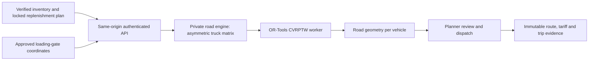

# Smart Logistics and Inventory — production design

This document is the target contract for integrating the existing replenishment
pipeline with road-aware transport planning. It deliberately separates what can
run as a synchronous route preview from the asynchronous, constrained fleet
optimizer. The implementation must fail visibly when geographic or routing data
is not trustworthy; it must never substitute demo data in an authenticated
production session.

> **Current status (26 July 2026): fail-closed local candidate.** M13–M13e,
> the dashboard road preview, worker and release workflow are present in the
> working tree, but no live Supabase migration, web deployment, worker rollout,
> Valhalla/OSRM activation or Production CI/CD run is claimed. The verified live
> baseline remains M24 and excludes transport.

## Research basis and design choice

The system is an inventory-routing problem (IRP), not only a shortest-path
screen. IRP research couples *when and how much to replenish* with *which
vehicle visits which locations and in what order*. Reviews of the field
describe multi-depot, multi-product, heterogeneous-fleet and time-window
variants, and objectives that combine transport, inventory, service and
sustainability costs:

- [Inventory-routing problems: review, challenges and innovations](https://doi.org/10.1016/j.ejor.2026.04.044)
- [A review on sustainable inventory routing](https://doi.org/10.1016/j.cie.2019.04.026)
- [Integrated scheduling and outbound vehicle routing review](https://doi.org/10.1016/j.ejor.2022.12.036)

SYNAPSE therefore uses two levels:

1. **Road preview** — an authenticated, bounded request builds an asymmetric
   road distance/time matrix and applies deterministic nearest-neighbour plus
   2-opt. This is useful for interactive comparison, but it is not a full fleet
   allocation and is described as a heuristic.
2. **Operational solve** — the guarded worker uses a truck road matrix and
   OR-Tools CVRPTW with vehicle weight, volume, pallet and destination
   time-window constraints. The current schema has no authoritative vehicle
   shift/departure-time field, so ETAs are anchored to the plan-week midnight
   in Bangkok and the worker remains deployment-gated. The result is a proposed
   plan that requires review before dispatch. OR-Tools documents that difficult
   routing problems generally return a good feasible solution rather than a
   proof of global optimality:
   [routing overview](https://developers.google.com/optimization/routing) and
   [VRP with time windows](https://developers.google.com/optimization/routing/vrptw).

## Runtime architecture



The synchronous preview is implemented with an OSRM-compatible Table and Route
API. Production must configure a controlled HTTPS endpoint; the public demo
server is development-only. The asynchronous solver continues to use Valhalla
because its per-request truck costing fits vehicle restrictions better. The
official interfaces are:

- [OSRM Table and Route services](https://project-osrm.org/docs/v5.24.0/api/)
- [Valhalla matrix API](https://valhalla.github.io/valhalla/api/matrix/)
- [Valhalla route API](https://valhalla.github.io/valhalla/api/turn-by-turn/overview/)
- [Valhalla status and version API](https://valhalla.github.io/valhalla/api/status/)

Every solver result must retain:

- immutable demand, fleet, capacity, time-window and departure snapshots;
- input hash and idempotency key;
- road-engine name/version, costing profile, tileset timestamp and OSM source
  version;
- solver name/version, time limit, objective, status and dropped-stop reason;
- ordered legs, road geometry, distance, duration and ETA;
- toll-tariff dataset/version, vehicle class and validity date;
- creator, reviewer, transition history and request IDs.

## Geographic data gate

The M13 seed coordinates were explicitly illustrative, carried no authoritative
geocoding provenance, and reused one warehouse point for three depot choices.
They are therefore not suitable for road dispatch and are quarantined by
default.

The workspace owner designated
`data/MEA_Synapse_Supabase_Production_20260724/data/districts.csv` as the
authoritative replacement. Its SHA-256 is
`fe97ecb44299dbd8b1fa8778b11483e343a31e8bd1d12ca7b11cba324e5fc62a`.
M13c preserves all source row numbers and eight-decimal precision, promotes the
18 coded district rows into both transport and M08 geocode registries, and
records the blank-code “MEA Procurement Department, Mueang Mai Bang Phli” row
as depot `WH-MMBP` for transport warehouse `เมืองใหม่`.

The CSV does not provide a canonical inventory warehouse/location identifier
for that depot. It is therefore coordinate-verified but not dispatch-eligible:
the system refuses to associate it with a replenishment plan until the
authoritative warehouse master supplies that relationship. Khlong Toei and Bang
Phli are not inferred as depots from district-office rows. Run
`python3 scripts/verify_transport_geocodes.py` to verify the source shape and
checksum before release.

A location becomes `verified` only after this workflow:

1. Start with the authoritative facility master and complete address.
2. Store geocoder candidates with provider, raw response, OSM object reference,
   timestamp and confidence; do not overwrite the approved coordinate.
3. Validate province/district containment, duplicates and spatial outliers.
4. Have a named data owner approve the physical loading-gate coordinate.
5. Snap it with the truck profile and reject excessive snap distance or a
   truck-inaccessible edge.
6. Persist `source_reference`, `verified_at`, `verified_by` and evidence.

The owner-designated CSV satisfies source/provenance promotion in the local
candidate. It does not prove that the coordinates are truck-accessible loading
gates, and it does not supply the missing canonical warehouse relationship;
both remain separate operational readiness gates.

The public Nominatim service is not a batch production dependency. Its policy
requires identification, caching and low request volume and prohibits several
bulk/autocomplete patterns:
[Nominatim usage policy](https://operations.osmfoundation.org/policies/nominatim/).

## M13d/M13e evidence boundary

M13d makes every legacy radial matrix row permanently ineligible as road
evidence, distinguishes candidate/verified/quarantined geocodes, quarantines
historical trip evidence and preserves exact coordinate provenance on route
stops. Legacy trips may only be cancelled.

M13e adds the evidence store needed by the operational worker, without seeding
any vehicle as trustworthy:

- explicit owner-approved transport↔canonical vehicle identity;
- source-checksummed weight/pallet capacity and expiring availability;
- a verified Valhalla truck matrix and immutable engine/tileset/OSM status;
- a valid WGS84 road `LineString`, ordered round-trip waypoints, road
  distance/duration and request/response hashes for every route vehicle; and
- approval checks tying every served item to the exact locked latest
  replenishment plan with no unserved stops.

The worker persists matrix, solve result and per-vehicle route evidence in one
transaction. `analytics.v_route_plan_geojson` publishes only evidenced road
lines and verified stop points. M13e still does not create operational transport
trips: the reviewed route-plan→trip activation and dispatch transition contract
remains intentionally absent, so direct trip creation stays fail-closed.

The governed same-origin queue accepts only admin/planner requests for the exact
locked latest plan and fixes `matrix_source=valhalla`. A bounded request ID is
the per-requester idempotency key. A planner may read only their own queued job;
an admin may inspect any. Readiness requires enabled operational writes,
verified exact-plan origin/stops/fleet and a healthy optimization-worker
heartbeat within ten minutes. For admin/planner callers it also returns
`optimization_eligible_plan_ids`: the exact plan UUIDs that pass current
locked-lineage, origin, geocode, packaging, fleet and compatible-worker gates.
The list is empty when global worker readiness is false and is not exposed as an
authorization shortcut to other roles. Queue creation rechecks both the selected
plan and the compatible heartbeat transactionally; a stale UI cannot bypass the
server gate. Queue readiness never implies trip readiness.

A `healthy` worker heartbeat is a routing attestation, not generic process
liveness. It records a controlled non-community Valhalla URL, truck profile,
worker/attestation version, the exact digest-bound tileset ID, engine version,
numeric operator dataset ID, tileset timestamp, SHA-256 of the validated
`/status` response and validation timestamps. The queue accepts only a recent
heartbeat matching that complete contract.

## Map and road-result UX

- Render a real Leaflet basemap and the route engine's road `LineString`.
- Never label a straight connector as a calculated route.
- Distinguish `quarantined`, `candidate` and `verified` locations visually and
  disable optimization until the selected depot and stops are verified.
- Show engine/profile, data timestamp, objective, baseline, improvement,
  duration and round-trip distance beside the result.
- Present upstream, timeout, unreachable and configuration failures explicitly.
- Make mutation affordances role-aware: only `admin`/`planner` may preview,
  queue or cancel; other roles keep read-only views and never render planner
  controls as if frontend hiding were the security boundary.
- Resume a lost optimization POST response with the same actor+plan-scoped
  `X-Request-ID`, then poll the governed job. Persist only opaque request/job
  IDs and state in session storage—never JWTs, profiles, payloads or route
  evidence. A failed/cancelled retry needs confirmation and a new request ID;
  a succeeded result is immutable.
- Preserve keyboard selection, 44-pixel controls, adequate contrast and a
  reduced-motion experience.

Production must use a contracted or self-hosted OSM-derived tile service with
visible attribution. The community tile server has no production SLA and its
usage is restricted:
[OSM tile policy](https://operations.osmfoundation.org/policies/tiles/) and
[OSM attribution guidance](https://www.openstreetmap.org/copyright/attribution-guide/).

## Toll handling

Road engines can avoid or identify tolled roads, but a routing edge flag is not
an auditable Thai-baht toll. Monetary toll must come from a separately governed
EXAT/BEM/DOH/M-Flow tariff table keyed by operator, plaza or entry/exit pair,
vehicle class and effective date. Until that dataset is approved, the UI may
offer avoid-toll routing but must display monetary toll as “not calculated”,
never mix it with old radial estimates.

## Production release gates

The following are required controls, not a record that a release occurred.

Pull request:

- dashboard lint, type/build and authenticated API contract tests;
- database migrations, RLS/RBAC, idempotency and transition tests;
- intelligence unit tests including null/unreachable/asymmetric matrices;
- deterministic Bangkok-area integration fixtures;
- secret, dependency, source and container scans.

Build and staging:

- build web and worker once; identify every artifact by immutable digest;
- generate SBOM, block high/critical worker-image vulnerabilities and retain the
  report; generate signed GitHub provenance/SBOM attestations when the repository
  plan supports artifact attestations;
- back up, migrate staging, deploy the exact artifacts and run an authenticated
  locked-plan → matrix → solve → geometry → review smoke test;
- verify worker, database, road engine and web readiness.

Production:

- use a protected environment, manual approval, one deployment at a time and
  OIDC short-lived credentials;
- supply the staging workflow run ID, artifact name and GitHub-recorded digest;
  the production workflow downloads, verifies and re-uploads the unchanged
  staging bundle rather than rebuilding it;
- require the staging and production public build-time configuration
  fingerprints to match. If Supabase or map public settings differ, first move
  them to a governed runtime-config contract; the workflow fails closed instead
  of silently promoting a staging-configured client;
- apply additive database migrations before application cutover;
- complete only after post-deploy transport and inventory smoke tests pass;
- keep the prior web artifact and a reviewed database forward-fix/restore plan.

Relevant controls:
[GitHub secure use](https://docs.github.com/en/actions/reference/security/secure-use),
[deployment environments](https://docs.github.com/en/actions/reference/workflows-and-actions/deployments-and-environments),
[OIDC](https://docs.github.com/en/actions/how-tos/secure-your-work/security-harden-deployments/oidc-in-cloud-providers),
and [artifact attestations](https://docs.github.com/en/actions/concepts/security/artifact-attestations).

### Open activation blockers

- `WH-MMBP` has an owner-designated coordinate but no owner-approved canonical
  warehouse/location mapping; the legacy Khlong Toei depot remains quarantined.
- No legacy transport vehicle is automatically mapped to `core.vehicles`;
  verified identity, measured weight/pallet capacity, current availability and
  driver/shift evidence are still required.
- Routed materials need verified physical packaging/UOM evidence.
- Production needs controlled, authenticated tile, OSRM-compatible preview and
  private Valhalla truck services bound to immutable OSM graph/extract versions
  and an expected nonnegative `VALHALLA_OSM_CHANGESET`/dataset ID.
- Monetary toll needs an approved effective-dated EXAT/BEM/DOH/M-Flow tariff
  plus road/plaza/entry-exit matching; `has_toll` alone is insufficient.
- Protected GitHub environments/reviewers, the release runner, OIDC receivers,
  deployment orchestrator, staging artifact evidence and authenticated canaries
  must be configured outside the repository.
- The route-plan→transport-trip activation contract must be designed, reviewed
  and tested before dispatch writes can be enabled.

Until every applicable blocker is closed, the honest state is “candidate / not
route-ready”; no Haversine, demo fleet, nearest-depot mapping, public community
service or legacy radial cost may be used as a Production fallback.

## Environment contract

Dashboard/server:

```dotenv
# Leave blank for standard Supabase; otherwise use one exact custom HTTPS origin.
SUPABASE_ALLOWED_ORIGIN=
ROUTING_ENGINE_URL=https://controlled-osrm.example
ROUTING_ENGINE_PROFILE=driving
ROUTING_ENGINE_TIMEOUT_MS=10000
ROUTING_ENGINE_MAX_CONCURRENCY=4
# Example syntax only: replace the 64 hex characters with the reviewed graph digest.
ROUTING_ENGINE_DATA_VERSION=osm-thailand-2026-07-25-sha256-0123456789abcdef0123456789abcdef0123456789abcdef0123456789abcdef
ROUTING_ENGINE_AUTH_TOKEN=stored-in-platform-secret-manager
NEXT_PUBLIC_MAP_TILE_URL=https://contracted-tiles.example/{z}/{x}/{y}.png
NEXT_PUBLIC_MAP_ATTRIBUTION=&copy; OpenStreetMap contributors
```

Worker:

```dotenv
VALHALLA_URL=https://private-valhalla.example
VALHALLA_AUTH_TOKEN=stored-in-platform-secret-manager
VALHALLA_TILE_URLS=https://controlled-object-store.example/osm/thailand-YYYY-MM-DD.osm.pbf
# Example syntax only: replace the 64 hex characters with the reviewed tileset digest.
VALHALLA_TILESET_VERSION=thailand-2026-07-25-sha256-0123456789abcdef0123456789abcdef0123456789abcdef0123456789abcdef
VALHALLA_OSM_CHANGESET=123456789
ALLOW_HAVERSINE_FALLBACK=false
```

`ROUTING_ENGINE_URL` and `VALHALLA_URL` are server-side values. Secrets, service
role keys and database credentials must never use the `NEXT_PUBLIC_` prefix.
Both `ROUTING_ENGINE_DATA_VERSION` and `VALHALLA_TILESET_VERSION` must match
`<lowercase-label>-sha256-<64 lowercase hex>`. The suffix is the reviewed
SHA-256 digest of the exact controlled road graph/tileset or its immutable,
signed build manifest—not a date, mutable label or checksum of the label.
`ROUTING_ENGINE_DATA_VERSION` is mandatory in Production so an OSRM deployment
that omits `data_version` can still bind each preview to that approved artifact;
a missing or noncanonical value fails the release gate.

Leave `SUPABASE_ALLOWED_ORIGIN` empty for a standard
`https://<20-character-project-ref>.supabase.co` project. When Production uses
a custom Supabase domain, set this **server-only** variable to its exact HTTPS
origin. Userinfo, path, query, fragment and loopback values are rejected; never
place this pin in `NEXT_PUBLIC_*` or use it as a broad origin allowlist.
The protected GitHub environment must also provide the two map values at build
time; the release workflow refuses an un-attributed or non-HTTPS tile template.
The deployment orchestrator owns the server-only routing URLs and routing-service
authentication tokens at runtime.
Configure `RELEASE_ORCHESTRATOR_AUDIENCE` (and
`ROUTING_SMOKE_AUDIENCE` when releasing the worker) so the receivers validate
GitHub OIDC claims for the repository, protected environment, commit and
audience. Long-lived release bearer tokens are not part of the workflow.
Set `SMOKE_EXPECT_TRANSPORT_ROUTE_READY=true` only with an admin/planner smoke
identity and a read-only `ROUTING_CANARY_PLAN_ID`; the smoke then proves a
locked plan can reach a configured OSRM-compatible engine and returns governed
road geometry. A worker promotion additionally requires the protected Valhalla
canary solve to report `succeeded` with `unserved_stop_count = 0`; a partial
route never qualifies as release evidence.
The Valhalla image is digest-pinned. Production must also pin the OSM extract in
controlled object storage and bind its exact digest in
`VALHALLA_TILESET_VERSION`; a floating `*-latest.osm.pbf` is not release
evidence. `VALHALLA_OSM_CHANGESET` is a required nonnegative operator-controlled
Valhalla `dataset_id`. Despite the field name, this integer is a secondary
compatibility identifier—not a cryptographic digest and not proof of the graph
bytes. It must match the numeric ID returned by validated Valhalla status and
route responses; cryptographic binding comes from the canonical tileset digest
plus recorded status/request/response SHA-256 hashes.
Set `ENABLE_GITHUB_ATTESTATIONS=true` only where the repository plan supports
GitHub artifact attestations; the release otherwise still retains immutable
checksums, SBOM, image inspection and vulnerability evidence.
