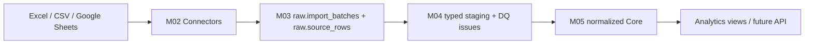
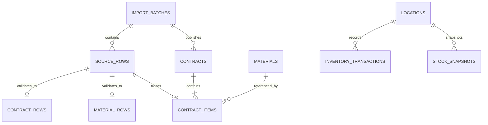

# Wave 1 — Data Foundation (M02–M05)

**Project:** `test-synapse-mea` (`mklnbumfwojxhqscthjd`)  
**Environment:** Test  
**Implementation date:** 2026-07-15  
**Status:** Deployed and accepted (21/21 checks passed)

## Outcome

Wave 1 converts the existing Excel contract baseline and the material master into an auditable PostgreSQL data foundation. Source data is retained, typed, validated and published to normalized Core tables without deleting or overwriting `public.contracts`.

| Layer | Contract rows | Material rows | Result |
|---|---:|---:|---|
| Legacy source | 6,305 | — | `public.contracts` preserved |
| Raw | 6,305 | 203 | Immutable payload, checksum, row hash and batch lineage |
| Staging | 6,305 | 203 | Typed and validated; 0 rejected |
| Core | 6,305 items / 2,857 headers | 776 union / 203 VMI | Reconciled with zero row delta |

The Core contract grain is `purchase_order`. Profiling found 15 contract numbers attached to more than one purchase order, while no purchase order was attached to multiple contract numbers. This prevents unrelated PO lines from being merged.

## Modules delivered

### M02 — Source Connectors

- Python package under `pipeline/` with a common connector interface
- Excel/OneDrive-synced `.xlsx`, CSV and public Google Sheets CSV connectors
- PDF/DOCX/DOC/TXT document discovery for later extraction modules
- SHA-256 source detection, deterministic row hashes and idempotent batch handling
- Optional PostgreSQL writer; database credentials remain external
- Four automated tests, all passing

### M03 — Ingestion and Raw

- `raw.source_rows` for immutable JSONB payloads and source-row lineage
- Extended `raw.import_batches` and `ops.pipeline_runs`
- Unique idempotency key: `(batch_id, source_entity, source_row_number)`
- Reconciled all existing contract rows and loaded the real `DB_Material` sheet
- Excluded transaction/demo sheets in `MEA_VMI_Database_Template.xlsx` because they contain template/mock data

### M04 — Data Quality and Staging

- Safe text, integer, numeric and date conversion functions
- Typed `staging.contract_rows` and `staging.material_rows`
- Versioned validation rules and row-level issues in `ops.data_quality_issues`
- SAP Plant to System District mapping for all 18 districts
- Batch-level DQ summary view
- Source anomalies are retained as warnings when business use remains possible

Known baseline findings:

- 2,130 contract rows have no material code
- 1,228 contract rows have no contract number; PO remains the contract key
- 38 material codes are not 12-digit SAP codes
- 11 delivery dates precede document dates
- Material master has one non-SAP placeholder ID (`None`) and one missing material name
- No non-positive quantity, reversed contract date range or hard validation rejection was found

### M05 — Core Model and Views

- Master tables for districts, warehouse, locations, vendors and materials
- Contract headers and contract items with source lineage
- Inventory transaction, stock snapshot and delivery event foundations
- 18 districts, one VMI warehouse and 19 total locations
- Views for contract status, current stock, reconciliation and material coverage
- RLS enabled on all 10 M05 Core tables; M06 later adds three further protected Core tables, and anonymous Core access remains blocked

## Data flow



Core lineage:



## Run and verify

Local connector tests:

```bash
python -m unittest discover -s pipeline/tests -v
python -m compileall -q pipeline/src
```

Database deployment order:

1. `supabase/migrations/202607150001_m03_raw_ingestion.sql`
2. `supabase/migrations/202607150002_m04_staging_quality.sql`
3. `supabase/migrations/202607150003_m05_core_model.sql`
4. `supabase/tests/wave1_data_foundation_verify.sql`

Acceptance result on 2026-07-15: `all_passed = true`, `check_count = 21`, `failed_count = 0`.

## Operations

- Store database URL/password only in a secret manager or ignored local environment file.
- Load a changed source as a new batch; do not mutate a succeeded raw batch.
- Re-run staging and Core refresh functions for the selected batch inside a transaction.
- Review `analytics.v_data_quality_summary` before publishing downstream.
- Take a logical backup before production migrations; the Supabase Free plan is treated as having no managed production backup guarantee in this project runbook.
- Use `supabase/rollbacks/20260715_wave1_rollback.sql` only before a dependent Wave 2 module exists.

## Next dependency

M05 is stable enough to start M06 (stock health/replenishment), M07 (forecasting), M09 (API) and M11 (document/RAG ingestion). Real stock and delivery feeds must be onboarded as new batches before inventory dashboards are treated as operational.
