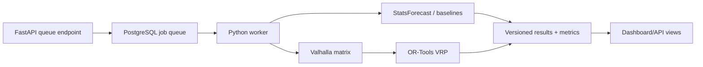

# Wave 3 — Forecasting and Route Intelligence

**Project:** `test-synapse-mea` (`mklnbumfwojxhqscthjd`)  
**Environment:** Test  
**Implementation date:** 2026-07-15  
**Status:** M07 and M08 platform capability deployed; operational activation is data-gated

## Delivered

### M07 — Demand Forecasting

- Monthly demand feature contract by material and district, including stock-out days and lead time
- Seasonal Naive and recursive Moving Average baselines
- Nixtla StatsForecast AutoETS candidate when a series has enough history
- Rolling-origin comparison with automatic selection by WAPE, then MAE and absolute Bias
- Versioned model registry, runs, results, metrics and 80% prediction intervals
- Retryable background job worker; persisted views let dashboards read results without training
- Idempotent monthly scheduler plus a free Unix-cron template for queue, worker and drift runs
- Drift checks for WAPE, Bias, 3-month demand shift and data freshness
- Operational readiness signal based on series with at least 14 monthly observations

### M08 — Route Optimization

- Verified-data contracts for location coordinates/time windows, material packaging, vehicles and drivers
- Valhalla truck time-distance matrix adapter; no paid map API dependency
- OR-Tools VRP with weight, volume, pallet, time-window, service-time and priority constraints
- Timeout, retry, explicit unserved-stop reasons, stop sequence, ETA and capacity utilization
- Versioned route plans, planner approve/reject workflow and MapLibre-ready GeoJSON
- Deterministic nearest-neighbour legacy baseline for reproducible comparison

## Background job flow



The worker claims jobs with `FOR UPDATE SKIP LOCKED`. Failures are retried up to the recorded maximum; production route jobs fail closed when `VALHALLA_URL` or required verified master data is missing. Haversine is accepted only for explicit development/test jobs.

## Verification

Run locally:

```bash
python -m pip install -e intelligence
python -m unittest discover -s intelligence/tests -v
python -m unittest discover -s pipeline/tests -v
```

Run `supabase/tests/wave3_intelligence_verify.sql` in Supabase after migrations `202607150005`–`202607150007`. Every returned row must have `passed = true`.

The local suite passes 12/12 Intelligence tests and 4/4 pipeline regression tests. The Supabase Wave 3 acceptance passes 12/12 database checks.

The route benchmark uses three deterministic Bangkok-area stops. Both plans measure 34,885 metres depot-to-depot; OR-Tools serves all three stops with zero unserved while enforcing capacity/time-window constraints, so it is no worse than the legacy nearest-neighbour plan. Synthetic records remain in unit tests only and are never written to Supabase.

## Operational readiness

Query `analytics.v_wave3_readiness` or `GET /v1/wave3/readiness` before queueing production work.

Current Test data is intentionally not marked operationally ready:

- Live readiness snapshot: 0 demand rows / 0 forecast-ready series; 19 active locations / 0 verified geocodes; 0 routing-ready materials; 2 source-traced vehicles / 0 with verified pallet capacity; 0 drivers; 0 approved replenishment plans.
- The private Stock Google Sheet still returns HTTP 401, so no genuine stock/usage history has been loaded.
- Forecasting needs at least 14 monthly observations per material/district before AutoETS comparison is enabled.
- Location coordinates must have `verified_at`; packaging must include box quantity/volume/weight and boxes per pallet.
- Vehicle pallet capacity and real drivers are not in the supplied source. The implementation does not invent them.
- Routing needs an approved replenishment plan and a reachable self-hosted Valhalla endpoint.

After real inputs are available, load them through the versioned ingestion path, verify readiness, activate `deploy/cron/synapse-intelligence.crontab.example`, approve replenishment, then queue route optimization.

## Operations and ownership

- Data owner: MEA Supply Chain / VMI team validates usage, packaging, coordinates, vehicles and drivers.
- Application owner: SYNAPSE team operates FastAPI, worker scheduling and Supabase migrations.
- Routing dependency owner: infrastructure team operates Valhalla and monitors matrix latency.
- On failure: inspect `ops.background_jobs`, `analytics.v_forecast_monitoring`, `analytics.forecast_drift_events` and `analytics.v_wave3_readiness`; fix the source/master issue, then allow the bounded retry or queue a new versioned run.

## Open-source references

- [StatsForecast AutoETS](https://nixtlaverse.nixtla.io/statsforecast/docs/models/autoets.html) and [time-series cross-validation](https://nixtlaverse.nixtla.io/statsforecast/docs/tutorials/crossvalidation.html)
- [Valhalla time-distance matrix API](https://valhalla.github.io/valhalla/api/matrix/api-reference/)
- [OR-Tools vehicle routing](https://developers.google.com/optimization/routing/vrp), [capacity constraints](https://developers.google.com/optimization/routing/cvrp) and [time windows](https://developers.google.com/optimization/routing/vrptw)

## Files

- `intelligence/` — M07/M08 workers, algorithms and tests
- `supabase/migrations/202607150005_m07_forecasting.sql`
- `supabase/migrations/202607150006_m08_routes.sql`
- `supabase/migrations/202607150007_wave3_readiness.sql`
- `supabase/tests/wave3_intelligence_verify.sql`
- `supabase/rollbacks/202607150005_m07_forecasting_rollback.sql`
- `supabase/rollbacks/202607150006_m08_routes_rollback.sql`
- `supabase/rollbacks/202607150007_wave3_readiness_rollback.sql`
